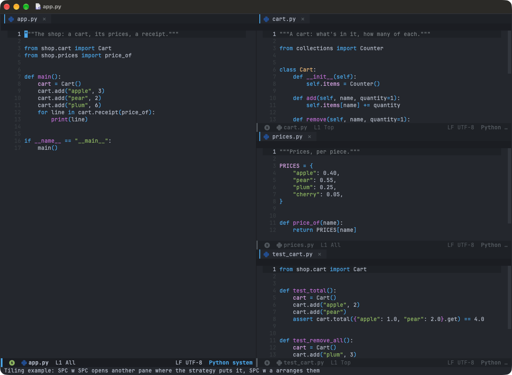
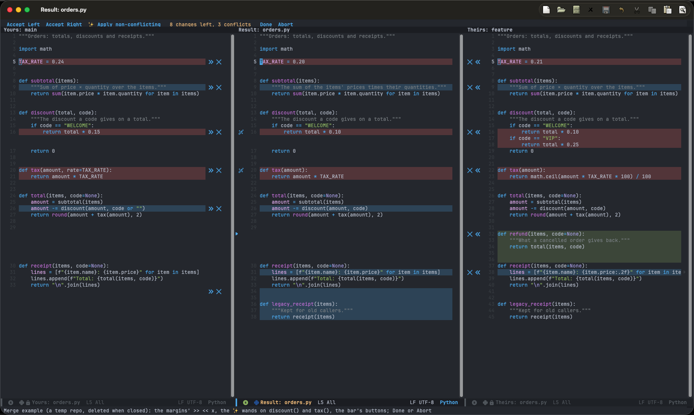
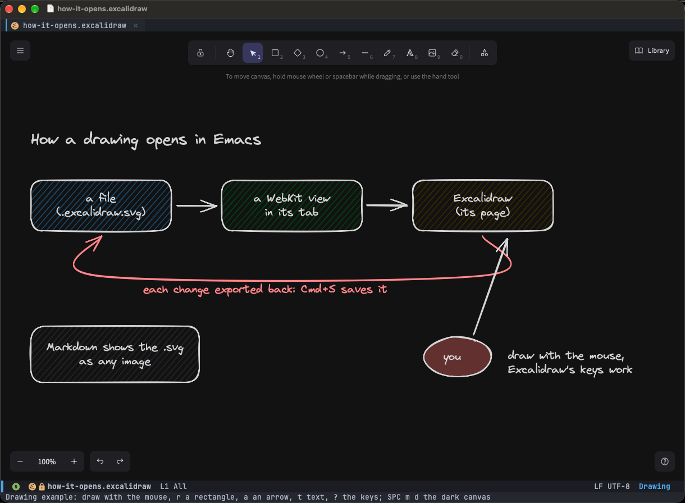
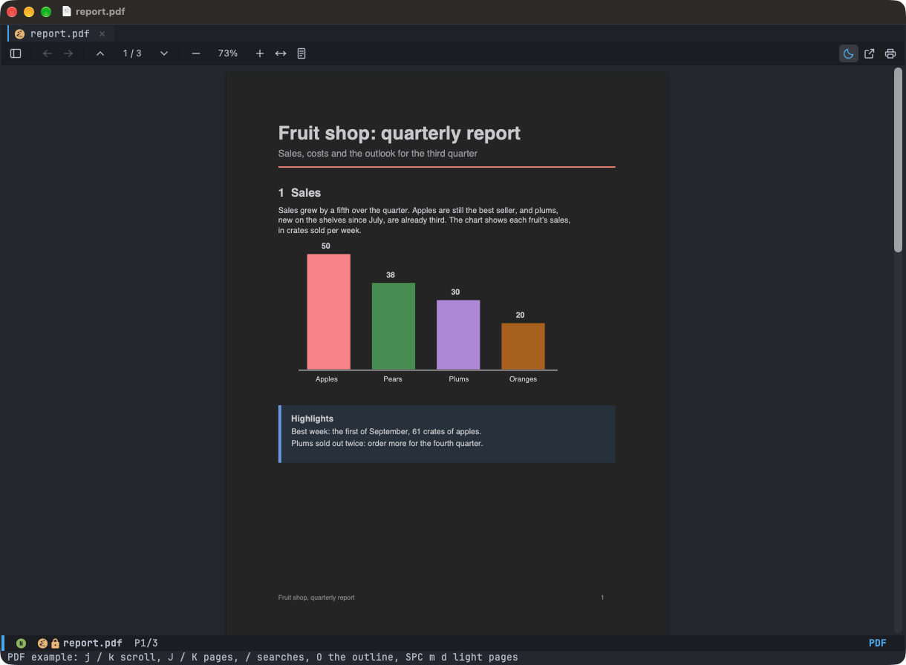
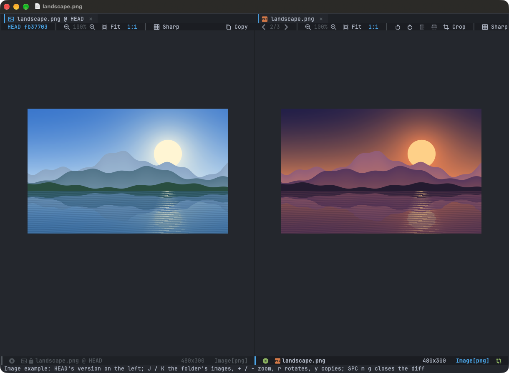
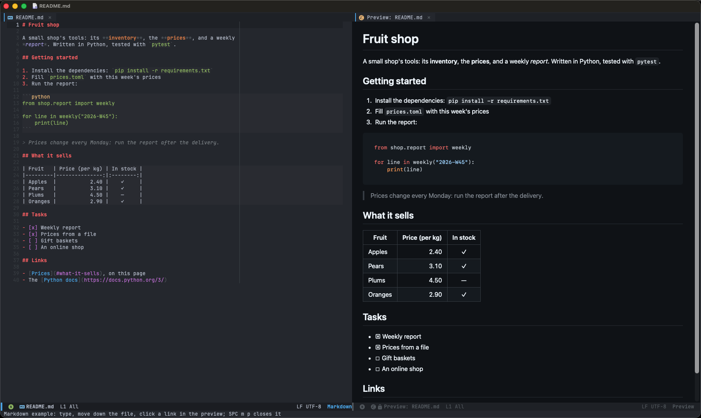

# doom

My Emacs configuration, built on [Doom Emacs](https://github.com/doomemacs/core).

> Doom is a configuration framework for GNU Emacs tailored for Emacs bankruptcy
veterans who want less framework in their frameworks, a modicum of stability
(and reproducibility) from their package manager, and the performance of a hand
rolled config (or better). It can be a foundation for your own config or a
resource for Emacs enthusiasts to learn more about our favorite operating
system.

It targets **macOS on Apple Silicon** with **Emacs 31** (emacs-plus), and aims for an IDE-like workflow: a project
sidebar that follows the current file, LSP for every language I use, format-on-save, and Claude Code inside Emacs. It
works both as a GUI app and in the terminal (`emacs -nw`).

It's **tiling first**, like a tiling window manager: applications (Claude Code, the terminal, magit, the Markdown
preview, drawings) open in a new pane where the tiling layout puts it, files open as tabs in the current pane, and a
pane closes with its last tab.

## Showcase

Each of these opens on files of its own with `M-x +my/example-NAME` (see [Examples](docs/examples.md)).

### Tiling first

Applications open in a new pane where the tiling layout puts it, the main pane on the left and the others stacked on
the right; files open as tabs in the current pane. `SPC w SPC` opens a pane the same way
([more](docs/editor.md#tiling)).



### Three-way merge

`e` on a conflicted file in Magit opens Yours, the Result and Theirs side by side, lined up and scrolling together:
take a change with `>>` / `<<`, ignore it with `x`, or let the ✨ wand merge both sides' words. It works in a terminal
too ([more](docs/git.md#resolving-conflicts)).



### Excalidraw

`*.excalidraw.svg` files open as drawings in Excalidraw, inside Emacs, and save as images that Markdown and GitHub
show ([more](docs/drawings.md)).



### PDFs

PDFs open in their tab, drawn by PDF.js: sharp at any zoom, with Vim keys, search, an outline, and dark pages that keep
the colours' hues (`SPC m d` turns them light) ([more](docs/pdf.md)).



### Images

Images open in Emacs's own viewer with a toolbar: the folder's images, zoom, rotate, flip, crop, sharp pixels, copy the
image, and its version in git's HEAD beside it (`SPC m g`) ([more](docs/images.md)).



### Markdown with live preview

`SPC m p` shows the rendered file beside it, updated as you type and following the cursor
([more](docs/markdown.md)).



## Installation

Requirements: macOS (Apple Silicon), [Homebrew](https://brew.sh), `git`, `node`/`npm` and
[`uv`](https://github.com/astral-sh/uv).

```sh
# 1. This config
git clone git@github.com:smyrgeorge/doom.git ~/.config/doom

# 2. Doom itself (its modules are a git submodule)
git clone --depth 1 --recurse-submodules https://github.com/doomemacs/core ~/.config/emacs

# 3. Emacs (prebuilt emacs-plus Emacs.app; macOS 15+, replaces Homebrew's `emacs` formula) + `doom sync`
#    (also fetches Doom's modules)
~/.config/doom/scripts/emacs.sh

# 4. CLI tools, fonts, BasicTeX (its installer asks for an admin password), language servers
~/.config/doom/scripts/tools.sh
~/.config/doom/scripts/lsp.sh

# 5. Let the GUI app see your shell's PATH (re-run when PATH changes)
~/.config/emacs/bin/doom env

# 6. Check everything
~/.config/emacs/bin/doom doctor
```

After changing `init.el` or `packages.el`, run `~/.config/emacs/bin/doom sync` and restart Emacs. Changes to
`config.el` and `config/*.el` only need a restart.

**One-time manual steps**

- **Claude Code:** install the `claude` CLI (the scripts don't), run it once in a terminal and log in; `agent-shell`
  reuses that login.
- **Kotlin LSP EULA:** read it with `kotlin-lsp --show-eula`, then run `kotlin-lsp --stdio` once and accept.
- **iTerm (terminal Emacs):** in *Settings → Profiles → Text*, use a Nerd Font (e.g. *JetBrainsMono Nerd Font*) for
  icons and tick *Use ligatures*; in *Profiles → Keys*, set the left Option key to *Esc+* so `M-` keys (e.g. `M-RET`)
  work.

## Documentation

- [The editor](docs/editor.md): tabs per window, tiling, error stripe, notices, sticky header, code.
- [PDFs](docs/pdf.md): PDFs drawn by PDF.js, with Vim keys.
- [Images](docs/images.md): Emacs's image viewer with a toolbar: zoom, rotate, crop, copy, git's HEAD beside it.
- [Drawings](docs/drawings.md): Excalidraw inside Emacs.
- [Project sidebar](docs/sidebar.md): treemacs as a project view that follows the current file.
- [Search](docs/search.md): Search Everywhere, find in files, projects.
- [Markdown](docs/markdown.md): live preview inside Emacs.
- [Git](docs/git.md): Magit additions, file diff, resolving conflicts in three panes.
- [Claude Code](docs/claude-code.md): sessions, drawing for Claude, and profiling Emacs for it.
- [AI agents](docs/ai-agents.md): the `emacs-profiling` skill, and installing it.
- [Terminal](docs/terminal.md): what differs in `emacs -nw`.
- [Key bindings](docs/keybindings.md): this config's own keys.
- [Examples](docs/examples.md): each feature on files of its own, with screenshots.
- [Shell commands](docs/cmd.md): `cmd/diff.sh`.
- [Tests](docs/tests.md): `tests/run.sh`.
- [Repository layout](docs/layout.md): what each file is for.
