# doom

[](https://github.com/smyrgeorge/doom/actions/workflows/tests.yml)

My Emacs configuration, built on [Doom Emacs](https://github.com/doomemacs/core) with Vim keys. It runs on **macOS**
and **Linux** with **Emacs 31**, as a GUI app or in a terminal (`emacs -nw`).

> [!NOTE]
> This project is still under development. Features change, and some are still being built (the agent workspace, the
> agent workflow). See [Next steps](#next-steps).

On top of Doom it adds:

- your coding agent in a pane of its own, with what it shows you under its conversation;
- tiling panes, with tabs in each;
- a three-way merge for Git conflicts;
- PDFs, images, Excalidraw drawings and a live Markdown preview, inside Emacs;
- language servers for each language `init.el` enables.

Keys use `Cmd` on macOS and `Ctrl` on Linux, as each system's apps do.

## Why Emacs

Coding agents mostly come with an app or a terminal of their own. Here they work inside the editor, next to everything
else:

- **One place.** The agent's conversation, what it shows you, the project's issues, Git, the terminal, PDFs and
  previews share one window and one set of keys. There's nothing to switch to.
- **Everything is text.** A session, a canvas, a run's pane, an issue: each is a buffer you search, copy and move
  through like any file.
- **A dynamic environment.** Emacs is less an editor than a Lisp environment that happens to edit text: every part of
  it can be changed while it runs, and almost anything can be built in it. This config builds a window manager, a
  three-way merge, a canvas for your agent and a crew of agents, all in Lisp. The agent works the same way: a project
  panel is a Lisp file it can write and open at once, and a new kind of component it makes is loaded without a restart.
- **A harness.** Emacs runs and talks to anything: processes, scripts, servers, agents over ACP. And the agents reach
  back into it, through MCP tools and shell commands (`cmd/agent-ui`). So it can be the glue between your agents, your
  code, your workflows and your tools, and what's built for one generalizes to the others. Agent UI gives any agent a
  UI, Agent workflow runs agents as steps beside scripts and Lisp, and Agent workspace has several of them work
  together, each built from the same parts.
- **A server.** Emacs runs as a server, and `emacsclient` controls it from anywhere: a terminal, a script, an agent
  (that's how `cmd/agent-ui` reaches it), or another machine, over SSH or Emacs's TCP server. Your editor, its sessions
  and their agents keep running, and you reach them from where you are.
- **Any agent.** agent-shell speaks ACP, so Claude Code, Codex or Gemini run the same way, with the same views.
- **Yours.** Free software: a config in Git, tested on every push, on macOS and Linux, in a GUI or a terminal.

## Next steps

- [ ] Agent UI in a repository of its own, an Emacs library that works without this config
- [ ] Agent workflow in a repository of its own, an Emacs library that works without this config
- [ ] Agent workspace in a repository of its own, an Emacs library that works without this config
- [ ] Expand what the agent workspace can do

## A tour

Every feature has an example on files of its own: `M-x +my/example-NAME` ([Examples](docs/examples.md)). `SPC` is the
leader key, and `SPC m` holds the current mode's keys.

### Agent UI

Your agent shows its work under its conversation: a checklist of its steps, test results filling in, a build's
progress, charts. Each view is updated in place as the agent works, whichever agent it is. It's built on top of
[agent-shell](https://github.com/xenodium/agent-shell), which runs the agent in Emacs ([more](docs/agent-ui.md)).

| Key | Action |
|---|---|
| `SPC o c` | Start your agent in a new pane |
| `SPC m u` | Hide or show Agent UI under the session |
| `C-c C-q` | Go to the question the agent is waiting on |
| `q` (in a view) | Close the view |
| `M-x +my/example-agent-ui` | Try it: an offline agent releasing a project |

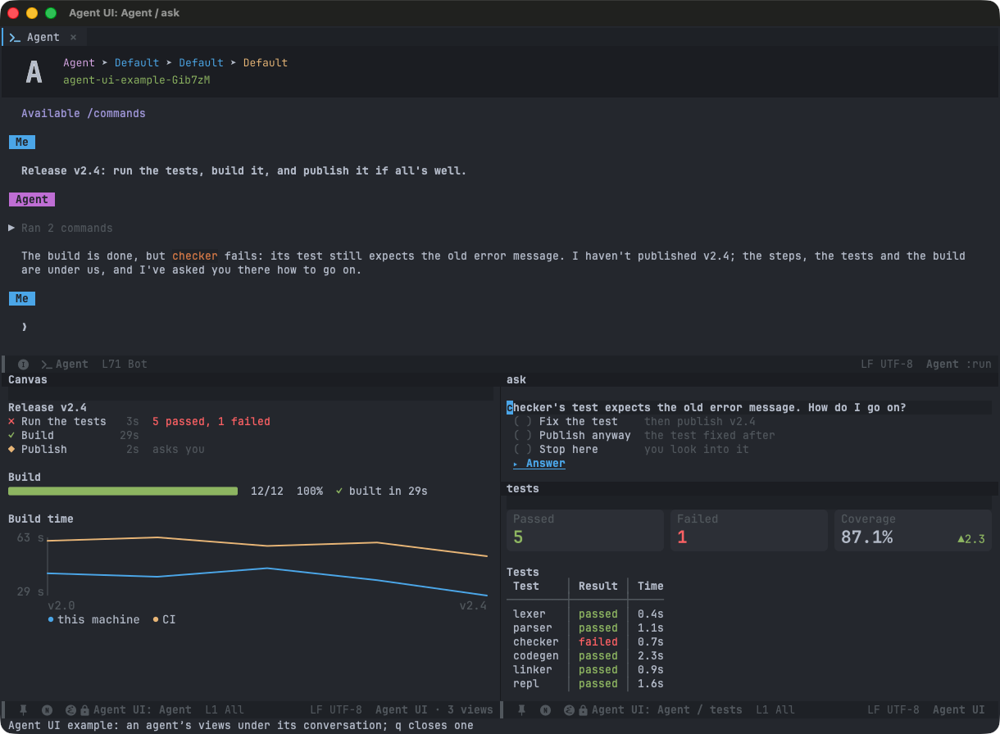

### Agent workflow

A workflow describes the work on an issue the way GitHub Actions does: jobs, the order they run in, and their steps. A
step is a script, Lisp, or an agent with its own instructions. Each run works in its own worktree, and its pane follows
it live. Its agents are [agent-shell](https://github.com/xenodium/agent-shell) sessions
([more](docs/agent-workflow.md)).

| Key | Action |
|---|---|
| `M-x agent-workflow-run-ticket` | Run a workflow on one or more issues |
| `M-x agent-workflow-list` | The project's runs (`RET` opens one) |
| `cmd/agent-workflow run ISSUE` | Start a run from the shell |
| `TAB` / `RET` (in a run's pane) | Fold a section / open the file, commit or session at point |
| `M-x +my/example-agent-workflow` | Try it: a run's pane, offline |

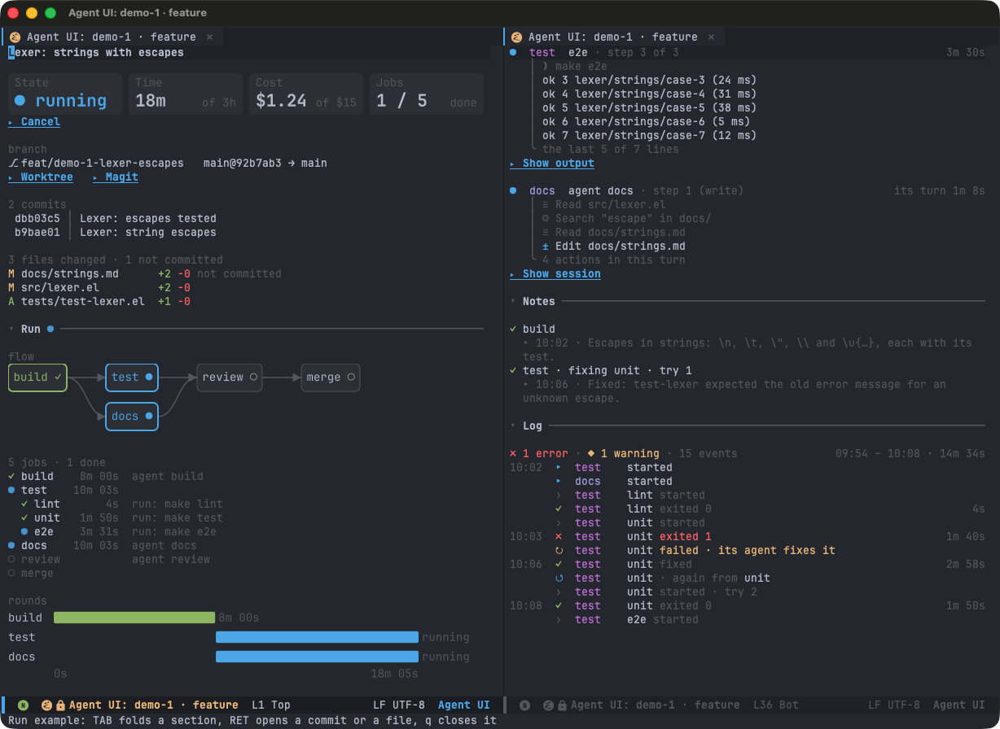

### Agent workspace

Several agents work on one project at once, as a crew. Each has a name, a role and a colour, and works in its own git
worktree. The crew's app shows the project's issues, the stage where the agents work, and the room where they talk.
Each agent is an [agent-shell](https://github.com/xenodium/agent-shell) session ([more](docs/agent-workspace.md)).

| Key | Action |
|---|---|
| `SPC o w` | Open the project's crew |
| `c` | Add an agent, or a whole crew |
| `t` (on an issue) | Give the issue to an agent |
| `#` | Talk to an agent in the room |
| `?` | The keys of where you are |
| `M-x +my/example-agent-workspace` | Try it: three offline agents |

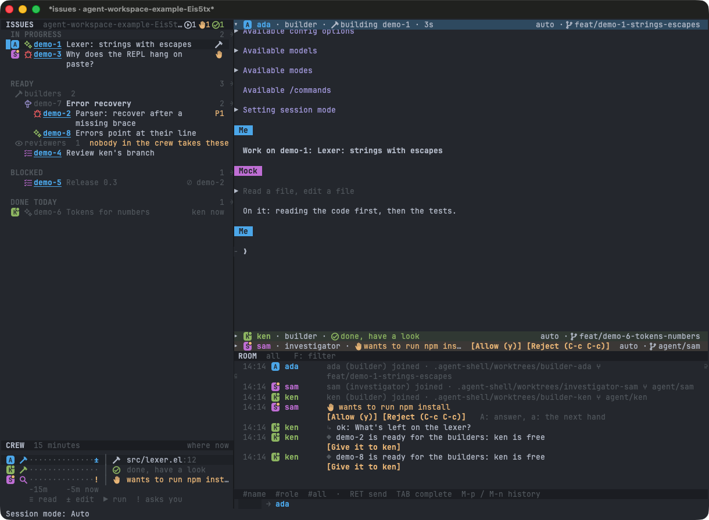

### Project panels

A dashboard kept in the project's repository, `.agent-ui/panels/NAME.el`: what it shows and the Lisp that fills it, in
one file. Slow queries load on their own without freezing Emacs. Your agent can write, check and open them too
([more](docs/agent-ui.md#project-panels)).

| Key | Action |
|---|---|
| `SPC o u` | Open one of the project's panels |
| `gR` | Read its file again and run it anew |
| `S` (on a canvas) | Save the component at point as a panel |
| `q` | Close it |
| `M-x +my/example-panel` | Try it: the CPU, every second |

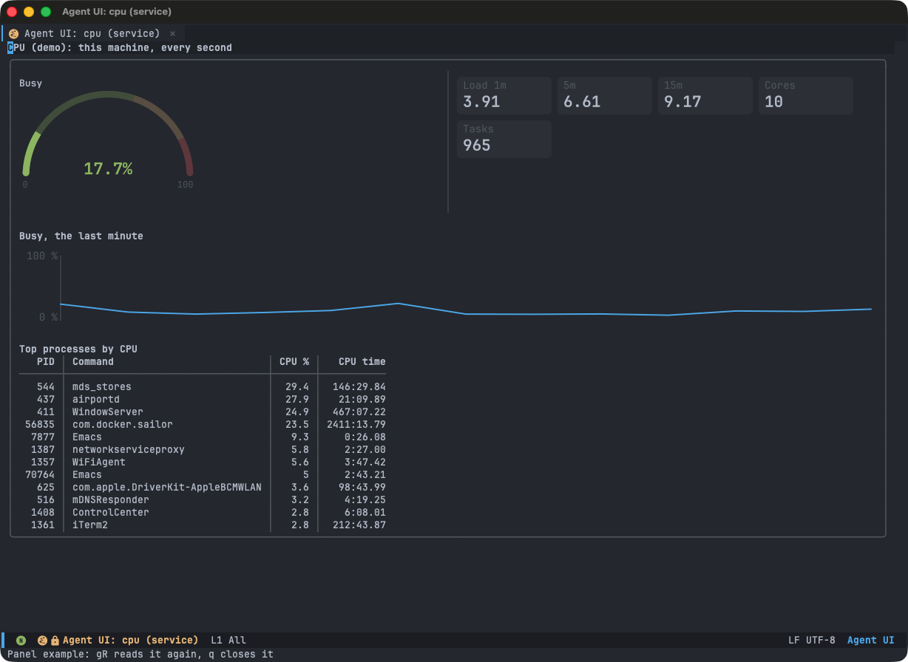

### Tiling window management

Applications (your agent, the terminal, Magit, previews, drawings) open in a new pane: the main one on the left, the
others stacked on the right. Files open as tabs in the current pane, and a pane closes with its last tab
([more](docs/editor.md#tiling)).

| Key | Action |
|---|---|
| `SPC w SPC` | A new pane |
| `SPC w a` | Arrange the panes again |
| `SPC w RET` | Swap the pane with the main one |
| `SPC w e` | Choose the layout: tall, wide, fullscreen, bsp... |
| `Cmd+1`..`Cmd+9` / `Cmd+W` | Pick a tab / close it (Linux: `Ctrl+1`..`Ctrl+9` / `Ctrl+Shift+W`) |
| `M-x +my/example-tiling` | Try it |

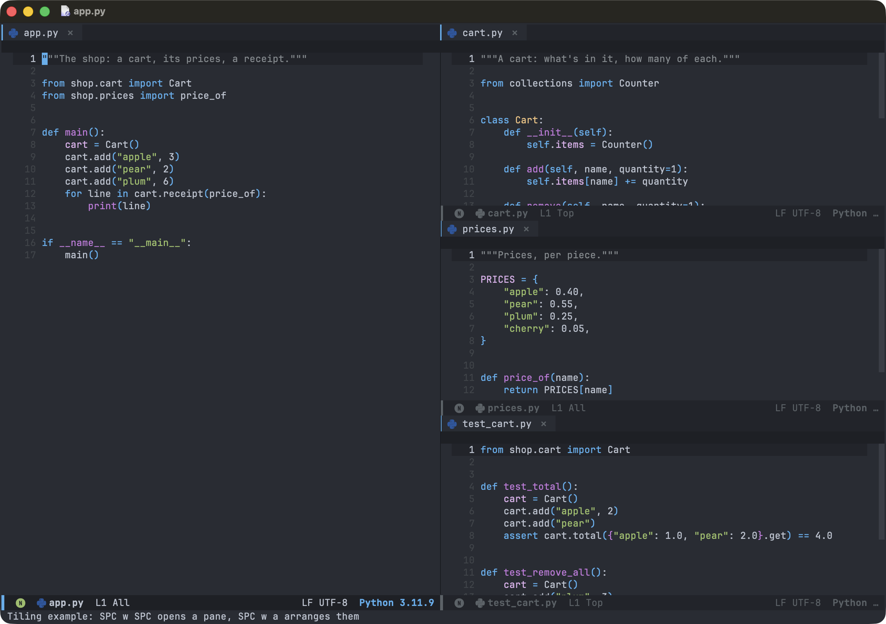

### Issues

The project's issues, tracked with [Beads](https://github.com/gastownhall/beads): the same ones your agent reads and
writes. Filter them, preview them as you move, edit them, and follow their dependencies ([more](docs/issues.md)).

| Key | Action |
|---|---|
| `SPC o i` / `SPC o I` | The project's issues / a new one |
| `RET` / `P` | Open an issue / preview it as you move |
| `f` / `/` | Filter / search |
| `C-c C-a` (on an issue) | Put it in your agent's prompt |
| `?` | Every command |
| `M-x +my/example-issues` | Try it |

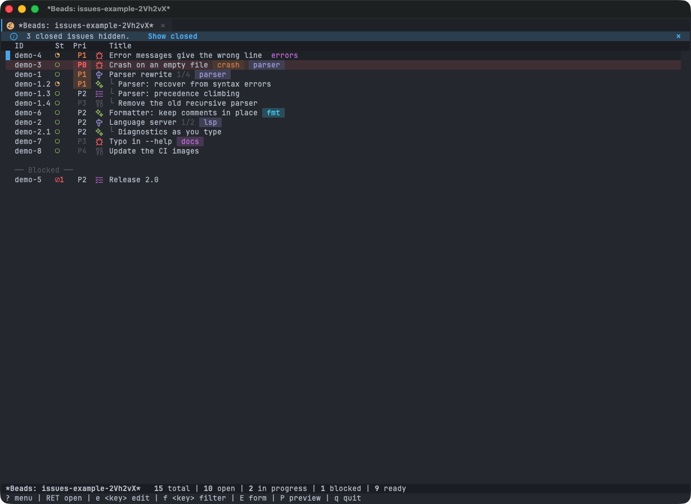

### Mermaid diagrams

`.mmd` files open with their diagram beside them, redrawn as you type, in the theme's colours. ```` ```mermaid ````
blocks are drawn too: in the Markdown preview, in your agent's replies and on its canvas ([more](docs/mermaid.md)).

| Key | Action |
|---|---|
| `SPC m p` | The diagram beside the file |
| `SPC m c` | Draw the file as an SVG |
| `SPC m o` | Open it in Mermaid's Live Editor |
| `M-x +my/example-mermaid` | Try it |

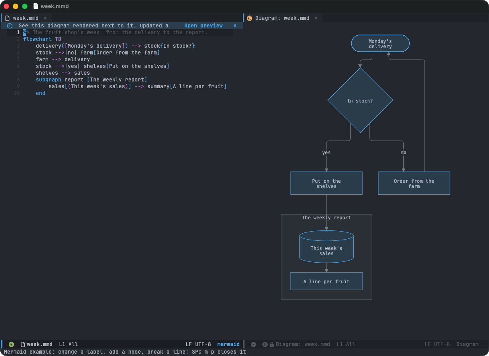

### Excalidraw drawings

`*.excalidraw.svg` files open in Excalidraw, inside Emacs. They're saved as images, so Markdown and GitHub show them
([more](docs/drawings.md)).

| Key | Action |
|---|---|
| `Cmd+S` | Save (Linux: `Ctrl+S`) |
| `SPC m d` | Dark canvas |
| `C-c C-d` (in your agent's session) | Draw something for the agent to see |
| `M-x +my/example-excalidraw` | Try it |

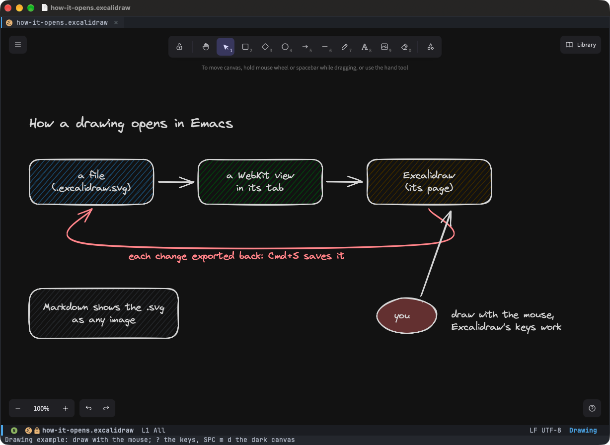

### Markdown preview

The rendered file beside it, in GitHub's style, updated as you type and following the cursor
([more](docs/markdown.md)).

| Key | Action |
|---|---|
| `SPC m p` | Open or close the live preview |
| `SPC m P` | Open the page in the browser |
| `M-x +my/example-markdown` | Try it |

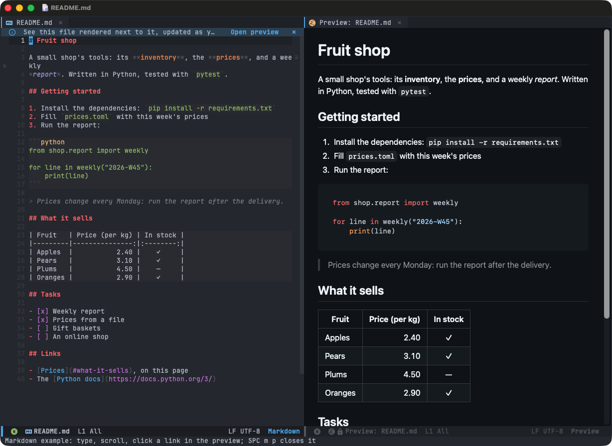

### PDFs

PDFs open in a tab, drawn by PDF.js: sharp at any zoom, with Vim keys, search and an outline. Pages are dark, keeping
their colours' hues ([more](docs/pdf.md)).

| Key | Action |
|---|---|
| `J` / `K` | Next / previous page |
| `/` | Search |
| `o` / `O` | Go to a heading / the outline in a sidebar |
| `Cmd+=` / `Cmd+-` | Zoom in / out (Linux: `Ctrl`) |
| `SPC m d` | Dark or light pages |
| `M-x +my/example-pdf` | Try it |

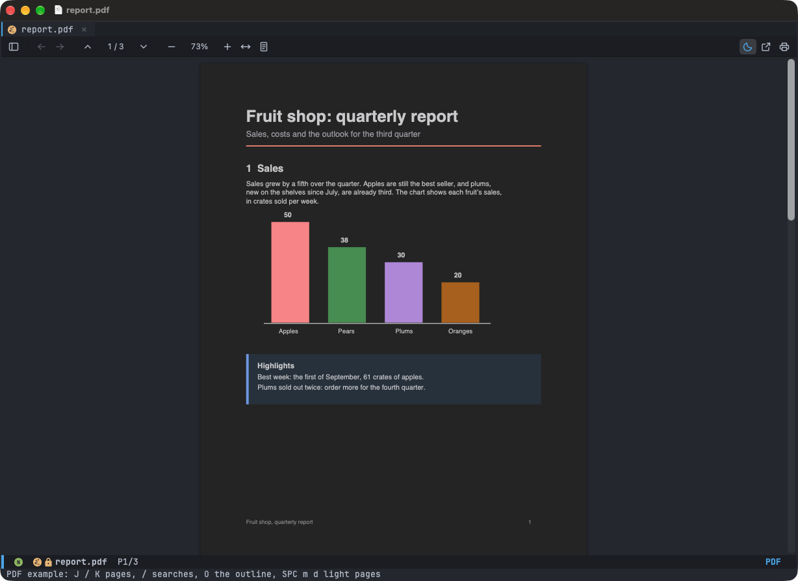

### Images

Images open with a toolbar: the folder's other images, zoom, rotate, flip, crop and copy. The image's version in Git's
HEAD can be shown beside it ([more](docs/images.md)).

| Key | Action |
|---|---|
| `J` / `K` | Next / previous image in the folder |
| `+` / `-` | Zoom in / out |
| `r` / `c` | Rotate / crop |
| `y` | Copy the image |
| `SPC m g` | Beside its version in Git's HEAD |
| `M-x +my/example-image` | Try it |

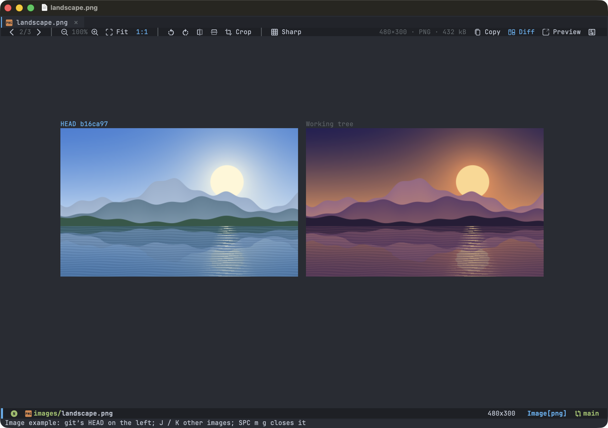

### Three-way merge

Resolve Git conflicts with Yours, the Result and Theirs side by side, lined up and scrolling together. Take a change
from either side, ignore it, or let the ✨ wand merge the words of both. It works in a terminal too, and from the shell
with `cmd/diff` ([more](docs/git.md#resolving-conflicts)).

| Key | Action |
|---|---|
| `e` (in Magit, on a conflicted file) | Resolve its conflicts |
| `]c` / `[c` | Next / previous change |
| `SPC m l` / `SPC m r` / `SPC m x` | Take the change from Yours / Theirs / ignore it |
| `SPC m w` | Merge it word by word |
| `C-c C-c` / `C-c C-k` | Done / abort |
| `M-x +my/example-merge` | Try it |

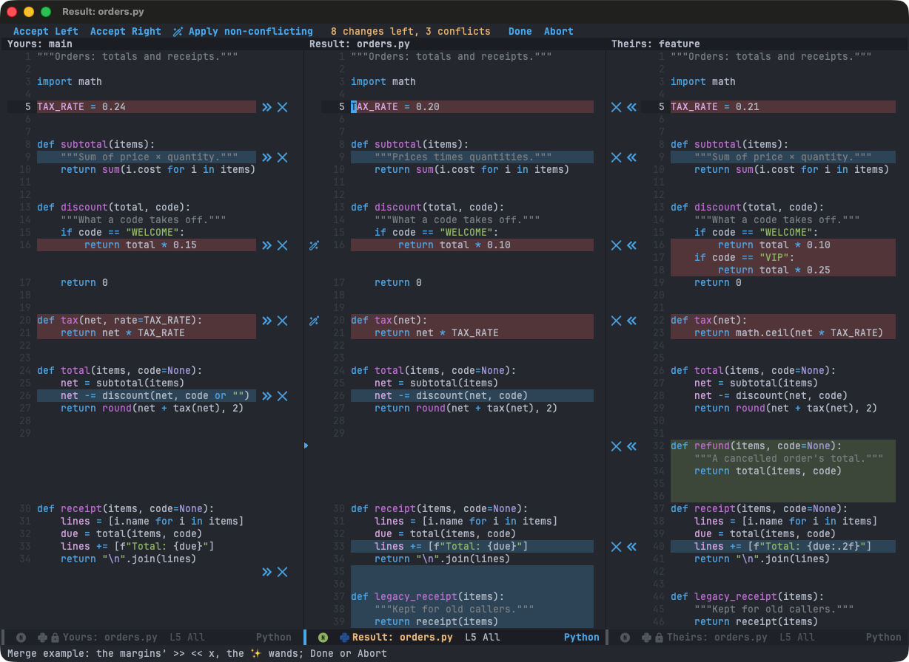

## Installation

| | macOS | Linux |
|---|---|---|
| System | Apple Silicon, macOS 15 or later | Debian, Ubuntu or Fedora; X11 or Wayland |
| Needs first | [Homebrew](https://brew.sh), `git` | `git`, `curl`, `sudo` |
| Emacs | emacs-plus's prebuilt Emacs.app | GNU's release, built from source |

```sh
# 1. This config, and Doom
git clone git@github.com:smyrgeorge/doom.git ~/.config/doom
git clone --depth 1 --recurse-submodules https://github.com/doomemacs/core ~/.config/emacs

# 2. Emacs, then Doom synced against it
~/.config/doom/scripts/emacs.sh

# 3. Everything init.el and this config need outside Emacs
~/.config/doom/scripts/tools.sh

# 4. Let the GUI app see your shell's PATH, then check the setup
~/.config/emacs/bin/doom env
~/.config/emacs/bin/doom doctor
```

- **`emacs.sh`** installs Emacs 31, or updates it, then runs `doom sync`. On macOS it's emacs-plus's Emacs.app. On
  Linux it builds GNU's latest release into `/usr/local`, with WebKit for PDFs, drawings and the preview
  (`XWIDGETS=no` builds without it).
- **`tools.sh`** installs the language servers, formatters and linters of the modules `init.el` enables, the fonts, and
  your agent's adapter (Claude Code; `AGENTS="codex gemini-cli"` for others). It stops on a module it doesn't know, so
  no language goes without its tools. `--check` only reports what's missing. Run `emacs.sh` first.

### Keeping it up to date

| After | Run |
|---|---|
| Any time | `scripts/emacs.sh` and `scripts/tools.sh`: each updates what it installs |
| Doom's packages | `scripts/upgrade.sh`, then restart Emacs |
| Changing `init.el` or `packages.el` | `~/.config/emacs/bin/doom sync`, then restart (and `tools.sh` for a new module) |
| Changing `config.el` or `config/*.el` | Restart Emacs |

`packages.el` pins the packages whose internals this config changes (agent-shell, acp, shell-maker, beads.el, vui).
`upgrade.sh` moves each pin to its package's latest commit, runs the tests, and commits `packages.el` if they pass. If a
test fails it puts the old pins back; `--keep` keeps the new ones, to fix the config for them.

### Once, by hand

- **Your agent:** install its command line, run it once in a terminal and log in. Emacs uses that login.
- **Kotlin:** accept kotlin-lsp's licence: read it with `kotlin-lsp --show-eula`, then run `kotlin-lsp --stdio`.
- **Linux:** run `M-x nerd-icons-install-fonts` for the icons. `tools.sh` lists the few servers no distribution
  packages (marksman, kotlin-lsp, ktlint, lua-language-server), and where to get them.
- **iTerm** (terminal Emacs on macOS): in *Settings → Profiles → Text*, pick a Nerd Font (e.g. *JetBrainsMono Nerd
  Font*) and tick *Use ligatures*. In *Profiles → Keys*, set the left Option key to *Esc+* so `M-` keys work.

### On Linux

- **Without WebKit:** most distributions' Emacs has no xwidgets, which PDFs, drawings and the live preview need
  (`emacs.sh` builds it in). Without it, PDFs open in DocView, drawings as their file, and the preview is
  markdown-mode's.
- **Other apps:** the file's default app and your file manager stand in for macOS's Preview and Finder. Printing uses
  `lp`, copying images `wl-copy` (Wayland) or `xclip` (X11), rotating images ImageMagick.
- **Keys:** Linux desktops keep many `Super` keys for themselves, so this config's keys there are `Ctrl` and
  `Ctrl+Shift` ones ([Key bindings](docs/keybindings.md)).

## Documentation

- [The editor](docs/editor.md): tabs per window, tiling, the error stripe, notices, the sticky header, code
- [Key bindings](docs/keybindings.md): this config's own keys, on macOS and Linux
- [Project sidebar](docs/sidebar.md): treemacs following the current file
- [Search](docs/search.md): Search Everywhere, find in files, projects
- [Git](docs/git.md): Magit additions, a file's diff, resolving conflicts in three panes
- [PDFs](docs/pdf.md), [Images](docs/images.md), [Drawings](docs/drawings.md), [Markdown](docs/markdown.md),
  [Mermaid](docs/mermaid.md)
- [Your agent](docs/agent-shell.md): its sessions, drawing for it, profiling Emacs
- [Agent UI](docs/agent-ui.md): what your agent shows under its session, and `cmd/agent-ui` (its own package,
  [agent-ui](https://github.com/smyrgeorge/agent-ui))
- [Agent workspace](docs/agent-workspace.md): a crew of agents on one project, each in its own worktree (being built)
- [Agent workflow](docs/agent-workflow.md): the work on an issue as GitHub Actions describes it, some steps an agent
  (being built)
- [Notifications](docs/notifications.md): on the desktop while you're in another app (your agent finished, needs you)
- [Issues](docs/issues.md): the project's Beads issues
- [AI agents](docs/ai-agents.md): the `emacs-profiling` skill
- [Terminal](docs/terminal.md): what differs in `emacs -nw`
- [Examples](docs/examples.md): each feature on files of its own, with screenshots
- [Shell commands](docs/cmd.md): `cmd/diff`, `cmd/agent-ui`, `cmd/agent-workspace`, `cmd/agent-workflow`
- [Tests](docs/tests.md): unit and end-to-end tests, on macOS and Linux, on each push (GitHub Actions)
- [Repository layout](docs/layout.md): what each file is for

## Attributions

This config builds on the work of others:

- [GNU Emacs](https://www.gnu.org/software/emacs/), and everyone who has made it what it is.
- [Doom Emacs](https://github.com/doomemacs/core): the framework under it.
- [agent-shell](https://github.com/xenodium/agent-shell), with [acp.el](https://github.com/xenodium/acp.el) and
  [shell-maker](https://github.com/xenodium/shell-maker): your agent in Emacs. Agent UI, Agent workflow and Agent
  workspace are built on it.
- [Beads](https://github.com/gastownhall/beads): the issue tracker. [beads.el](https://codeberg.org/ctietze/beads.el)
  and [vui.el](https://github.com/d12frosted/vui.el) show its issues in Emacs.
- [Excalidraw](https://github.com/excalidraw/excalidraw) for drawings, [PDF.js](https://github.com/mozilla/pdf.js) for
  PDFs, [Mermaid](https://github.com/mermaid-js/mermaid) and [mermaid-cli](https://github.com/mermaid-js/mermaid-cli)
  for diagrams, [MathJax](https://www.mathjax.org) for Agent UI's formulas, and
  [highlight.js](https://github.com/highlightjs/highlight.js) for code in the Markdown preview.
- [yaml.el](https://github.com/zkry/yaml.el) reads the workflows' files. [delta](https://github.com/dandavison/delta)
  and [magit-delta](https://github.com/dandavison/magit-delta) draw diffs.
  [nyan-mode](https://github.com/TeMPOraL/nyan-mode) puts the cat in a session's mode line.
- The packages Doom's modules bring: Magit, Vertico, Treemacs, nerd-icons and many more.
