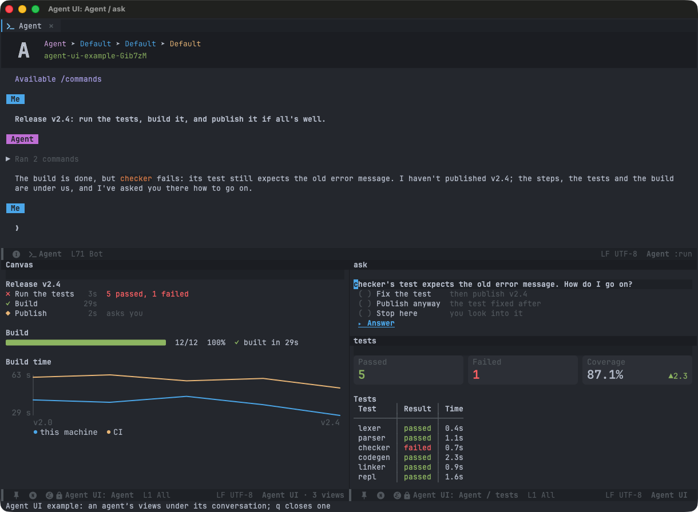

# Agent UI

> **Status:** working in agent-shell's sessions, whatever their agent. Its own package now:
> [agent-ui](https://github.com/smyrgeorge/agent-ui), from its working copy in `~/dev/agent-ui` while it settles
> (`packages.el`).

Your coding agent (in [agent-shell](agent-shell.md)) shows you things in Emacs beyond its replies: a progress bar that
moves while a build runs, a table of test results filling in, a chart, a question for you. It draws them on a
**canvas** under its conversation, through a small command line or MCP tools, in the GUI and in a terminal.

Try it: `M-x +my/example-agent-ui`, an offline agent releasing a project ([Examples](examples.md)).

What it is and how it works (its components, the command line, the canvas, sources, panels, types the agent makes) is
in the package's own docs:

- [Getting started](https://github.com/smyrgeorge/agent-ui/blob/main/docs/getting-started.md)
- [The command line and MCP](https://github.com/smyrgeorge/agent-ui/blob/main/docs/command-line.md)
- [The canvas](https://github.com/smyrgeorge/agent-ui/blob/main/docs/canvas.md)
- [Component types](https://github.com/smyrgeorge/agent-ui/blob/main/docs/components.md)
- [Project panels](https://github.com/smyrgeorge/agent-ui/blob/main/docs/panels.md)

This page is what this config adds on top of it (`config/agent-ui.el`).

## Keys

Vim's keys in a canvas, as Doom's other buffers':

| Key | What it does |
|---|---|
| `q` | Close the canvas (a session's saved components come back when it's resumed) |
| `g r` | Redraw it |
| `g R` | A project panel: read again from its file, run anew |
| `S` | Save the component at point as one of the project's panels |
| `a` | Put the component at point into its session's prompt |
| `b` | Report a bug in Agent UI, about the component at point |
| `c` / `d` | Comment on a line of code or a diff (sent with Send the review), or remove the comment |
| `s` | Sort a table by the column at point |
| `K` / `J`, `M-up` / `M-down` | Move a rank's item up or down |
| `x` / `e` | Drop or reword a plan's step before approving it |
| `R` | Review the component types the agent made |
| `SPC m u` | Hide Agent UI in the session's pane, or show it again |
| `SPC m e` | Export what the canvas shows as a PDF |

In a session, `C-c C-q` (or `SPC m q`) goes to the question waiting on its canvas. `SPC o u` opens one of the
current project's panels, in a pane of its own; `SPC o U` in the window you're in. A form opens in a buffer of its own,
with Emacs's keys: `C-c C-c` sends it, `C-c C-k` cancels it.

## In the session's pane

Agent UI opens under its session's conversation, its views (the session's canvas, and its others: ask, tests...) laid
out in columns. Under them, Doom's mode line, saying what Agent UI's own bar would (`config/editor/modeline.el`).
[Tiling](editor.md#tiling) lays the session's pane out as one, Agent UI's windows in it.

## Project panels

A project's panels are in `.agent-ui/panels/` in its repository. This config has two, `cpu` and `memory`
(`M-x +my/example-panel`). Each panel opened offers, in a notice, to export it as a PDF (`SPC m e`).

## What the agent is told

Every session is told about Emacs by this config ([agent-shell](agent-shell.md)), for any agent, including the ones
that take no system prompt. Agent UI's paragraph is part of that, so the package's own system prompt is off
(`agent-ui-system-prompt`). Each session also gets Agent UI's MCP tools; `(setq +my/agent-ui-mcp nil)` in `config.el`
turns them off.

## Diagrams

Mermaid diagrams (the `mermaid` component, and a `markdown` one's blocks) are drawn by this config's renderer
(`config/mermaid.el`), in the theme's colours, and drawn again when the theme changes.

## Bugs in Agent UI

A bug in Agent UI itself, reported by the agent (`agent-ui bug`, asking you first) or by you (`b` on a component,
`M-x agent-ui-report-bug`), is filed into this config's [Beads issues](issues.md), labelled `agent-ui`, whatever
project the session is in. A similar open bug gets a note instead. `RET` right after opens it in the issue view. The
component types the agent makes and you keep (in `.agent-ui/kept/`) get an issue each, for their tests and docs.

## Files

| File | What it is |
|---|---|
| `packages.el` | The `agent-ui` package, from `~/dev/agent-ui` |
| `config/agent-ui.el` | This config's layer over it: keys, settings, hooks |
| `cmd/agent-ui` | The package's command line (its `bin/agent-ui`), for this config's docs and scripts |
| `.agent-ui/panels/` | This config's project panels |
| `tests/unit/test-agent-ui-config.el` | Tests of this config's layer (the package has its own) |
| `tests/unit/test-agent-ui-tiling.el`, `tests/e2e/test-agent-ui.el` | Agent UI with tiling, and in a GUI Emacs |
