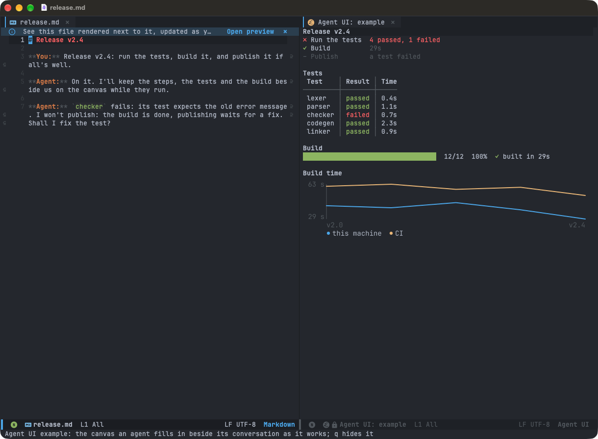

# Agent UI

> **Status:** working, in Claude Code sessions in agent-shell (epic `doom-nwj`): the canvas, the command line and MCP
> tools, the `text`, `markdown`, `progress`, `steps`, `table`, `chart`, `image`, `html`, `diff`, `choice`, `files`, `stats`, `log`, `timeline`, `graph`, `code`, `issues`, `heatmap` and `panel` types, sources (an element
> following a command, a file, a poll), actions (buttons into the prompt), types the agent makes (kept or discarded by
> you), elements in the conversation, canvases kept with their sessions, and what the agent is told. `M-x
> +my/example-agent-ui` shows it ([Examples](examples.md)).

A coding agent (Claude Code in [agent-shell](claude-code.md)) shows you things in Emacs beyond its replies: a progress
bar that moves while a build runs, a table of test results filling in, a chart. It draws them on a **canvas**, a pane
beside its session, through a small command line. Everything works in a terminal (`emacs -nw`); the GUI draws some
elements better (charts as SVG) and has elements of its own (images, drawings, web pages).


## The model

- An **element** is data: a JSON object with a `type`, an `id` and the type's properties. The agent never writes Lisp
  for the common case, and an element can be saved and shown again.
- An **element type** (`progress`, `table`...) is defined once in Lisp: its properties, a function drawing it as text,
  and optionally one drawing it for the GUI. The types form a **registry**, from which the agent's catalog is made.
- A **canvas** is a buffer per agent-shell session, shown in a [tiled](editor.md#tiling) pane beside it, without taking
  the focus. It holds the session's elements in the order they were shown. Showing an element with an id already there
  replaces it in place; updating it redraws only that element.

## Elements as JSON

```json
{"id": "build", "type": "progress", "title": "Build", "value": 3, "max": 12, "label": "compiling parser.c"}
```

| Key | |
|---|---|
| `id` | A name of the agent's choice (`[a-z0-9_-]+`), unique in its canvas. Omitted: one is made and returned |
| `type` | An element type of the registry |
| `title` | Optional, any type: a heading line above the element |
| `source` | Optional, any type: a command, file or poll it follows ([Sources](#sources)) |
| `actions` | Optional, any type: buttons putting a prompt into the session's prompt ([Actions](#actions)) |
| anything else | The type's properties. An unknown one is an error naming the type's properties, so the agent learns them |

**Updates** are partial: an object with the `id` and the properties that change, merged into the element's
(shallowly: a list given replaces the list). A property set to `null` goes back to its default.

**Appends** add to an element's list properties (a table's `rows`, a chart's `values`) without sending them all again.
A table with a `key` column replaces a row with the same key instead of adding one, so a row can change state:
`parser` *running*, then `parser` *passed*.

## The command line

`cmd/agent-ui` (the system prompt gives its full path). JSON comes on stdin or as the last argument; the reply is JSON
on stdout.

```sh
agent-ui show '{"id":"build","type":"progress","title":"Build","max":12}'
agent-ui update build '{"value":5,"label":"linking"}'
agent-ui append tests '{"rows":[["lexer","passed","0.4s"]]}'
agent-ui remove build
agent-ui clear                 # every element of the canvas
agent-ui list                  # the canvas's elements: id, type
agent-ui types [TYPE]          # the catalog: each type, its properties, an example
agent-ui batch < ops.json      # several operations, one trip to Emacs
agent-ui render '{"type":...}' # an element drawn as text, nothing shown: for the agent to see it
agent-ui render --ansi '{...}' # the same in its colours (24-bit ANSI), to print in a terminal
agent-ui define dial.el        # a type of the agent's own (below)
agent-ui snapshot build        # the element as an image for the agent's reply (below)
agent-ui list --canvas tests   # any of them, on another canvas of the session (below)
agent-ui bug < bug.json        # a bug in Agent UI itself, into its own issues (below)
```

A batch is an array of operations, each an object with its `op` and what it takes, flat:

```json
[{"op": "show", "id": "build", "type": "progress", "max": 12},
 {"op": "update", "id": "build", "value": 3},
 {"op": "append", "id": "tests", "rows": [["lexer", "passed"]]},
 {"op": "remove", "id": "old"}]
```

Its reply has each one's: `{"ok": true, "results": [{"ok": true, "id": "build"}, ...]}`, `ok` false if one failed
(the others are done).

| Reply | |
|---|---|
| `{"ok": true, "id": "build"}` | Done |
| `{"ok": false, "error": "progress: unknown property \"total\"; its properties: value, max, label, unit, status"}` | Not done, and why |

Its exit status: 0 done, 1 not done (the reply says why), 2 a wrong use (an unknown operation, an argument missing),
3 no Emacs to talk to. Each error is a reply too, on stdout.

**How it reaches Emacs.** The script writes the request in a temporary folder (`request`: the operation, the id, the
session, the directory, the options, the other canvas, a line each; `payload`: the JSON as given) and runs `emacsclient --eval '(agent-ui-request
"FOLDER")'`; Emacs writes its `reply` there. No JSON is ever quoted into Lisp, whatever it holds.
Without an Emacs server it fails with a clear error.

**Which canvas.** agent-shell starts the agent with `AGENT_UI_SESSION` in its environment (advice on the client
agent-shell makes), naming its session after its buffer; the agent's shell inherits it, so the script finds its
session's canvas, `Agent UI: SESSION`. Without it (a session started before Agent UI was loaded, an agent in a
terminal), the session working in the script's directory or above it (the deepest; of those, the most recently used),
else the canvas `default`. A session's canvas is killed with it. `--canvas NAME`, or `"canvas": "NAME"` in the JSON (an
element's, a change's, a batch's operation's), picks the session's other canvas `Agent UI: SESSION / NAME`, made in a
pane of its own when first shown; a name is letters, digits, spaces, `_ . -`, up to 40.

**In Lisp,** the same operations: `(agent-ui-show SPEC)`, `(agent-ui-update ID PATCH)`, `(agent-ui-append ID PATCH)`,
`(agent-ui-remove ID)`, each taking an optional `:canvas`. SPEC and PATCH are plists (`(:type progress :value 3)`), as
`json-parse-string` makes them with `:object-type 'plist`.

## The canvas

- **Its buffer** is `Agent UI: SESSION`, read-only, in `agent-ui-canvas-mode`. It opens in a tiled pane the first
  time an element is shown (tiling's `agent-ui` application, `+my/tiling-apps`), without taking the focus, and again if it was closed.
  With Doom's workspaces, it opens in its session's workspace: while you're in another, it waits there for you.
  `q` closes it for good: its pane and its buffer, its elements with it (a session's saved ones come back when the
  session is resumed; one the agent updates after is gone). Emptying it (cleared, its last element removed) hides it;
  it closes with its session. `a` on an element puts it into the session's prompt; `b` on one files a bug in Agent UI ([below](#bugs-in-agent-ui)); `c` on a line of code or a diff (or a region's lines) writes a review comment under it (`c` on a comment edits it, `d` removes it), Send the review putting them all, with their places, into the session's prompt; `s` on a table's
  column sorts it by it (again: the other way); `M-↑` / `M-↓` (`K` / `J`) move a rank's item; `x` drops a plan's step or rejects a diff's hunk (again: back), `e` rewords a step; `h` / `l` on a slider's track move its knob; `R` reviews the types the agent made.
- **Other canvases:** a session has its canvas and may have others, named (`--canvas tests`, `"canvas": "tests"` in
  the JSON, the MCP tools' `canvas`): `Agent UI: SESSION / tests`, each in a pane of its own, with its own elements
  and ids. They close with the session, and are kept and come back with it.
- **Each element** is the text between two markers, its id in a text property. Drawing replaces that text only;
  point and each window's scroll stay where they were.
- **Redraws are throttled:** an update marks the element dirty, and a timer (`agent-ui-redraw-delay`, 0.1s) redraws the
  dirty ones. A hundred updates a second cost ten redraws.
- **Animated elements** (a spinner, an indeterminate bar) are redrawn by one timer of the canvas, running only while one
  is shown in a window. The spinner is a gap going round a square, `▟▙▛▜` (block elements: a coding font has them);
  `agent-ui-spinner-frames` sets other frames, in `config.el`.
- **The width** is the canvas window's; its elements are drawn again when it changes size, or the font's size changes.
- **Terminal or GUI** is decided by the frame showing the canvas (`display-graphic-p`). A type without a GUI drawing
  draws as text in both.
- **Glyphs in their cells:** in the GUI, a character the default font lacks (`✎`, `⏵`) comes from another font, often
  wider or narrower than a column and taller than a line. A canvas draws such a glyph as large as a line holds, and
  makes the space beside it narrower or wider by as much: borders and the `│` between columns stay at their columns'
  pixels, every line the same height.

## Defining a type

```elisp
(agent-ui-define progress
  "A progress bar: VALUE of MAX. Without MAX, it runs without an end (indeterminate)."
  :props ((value  number "Done so far" 0)
          (max    number "The total; none: indeterminate")
          (label  string "What's being done now")
          (status (choice running done failed) "Its colour" running))
  :example (:title "Build" :value 5 :max 12 :label "linking")
  :animated (lambda (props) (null (plist-get props :max)))
  :check (lambda (props) ...)       ; optional: more than each property's kind
  :append (lambda (element patch) ...) ; optional: how its lists grow
  :prepare (lambda (element) ...)   ; optional: the element as it's kept
  :extend (lambda (old new ctx) ...) ; optional: its drawing edited, not drawn again
  :text (lambda (props ctx) ...)    ; a propertized string
  :gui  (lambda (props ctx) ...))   ; optional: a string with an image
```

- **`:props`** list each property: its name, its kind (`string`, `number`, `boolean`, `list`, `(choice A B...)`), a line
  saying what it is (in the catalog the agent reads), and a default. A spec is checked against them before drawing.
- **`:check`** checks what each property's kind can't (a list's items, properties that go together), signalling
  `agent-ui-error` with what's wrong; it may return the properties normalized (a step's status as a symbol). Inside a
  list, JSON's `false` stays `:false`, for the type to show.
- **`:append`** says how `agent-ui append` adds to it (a table's rows by key); without it, each list is added to.
- **`:prepare`** turns the element into what's kept, each time it's shown or changed: for what it notes as time
  passes (a step's start, then how long it ran). Called again on its result, it must change nothing.
- **`:extend`**, when the element was drawn as OLD and is now NEW (lines appended to it), returns edits making OLD's
  drawing NEW's (`(replace LINE TEXT)`, `(delete LINE COUNT)`, `(insert BEFORE-END TEXT)`), or nil to draw it again.
  An append to a long log or table draws only what's appended: under a millisecond at 1000 lines, where drawing it
  again took 13 to 20. Used only at the width and kind of frame it was drawn for; a test compares it with drawing
  it again.
- **`:text` and `:gui`** take the element's properties (checked, defaults filled) and a context: `:width` in
  characters, `:graphic`, `:tick` for animations, the theme's colours. They return the text to insert; they don't touch
  the buffer. So a type is tested by calling them.
- **Badges** for any type (core.el): `agent-ui-pill` a rounded tag (a status, a label, a count in it), filled or
  outlined, `agent-ui-pie` a fraction as a pie. Their text in a terminal (`[bug 3]`, `◑`), as wide in the GUI, where
  an SVG shows over it (svg.el, sized from the context's `:char-width` and `:line-height`, in the theme's colours).
- **A type that asks** (picks, a note, an answer for the agent) uses `config/agent-ui/ask.el`: its state is the
  element's own `:selected`, `:note-text` and `:answered` (saved with the session); `agent-ui-ask-pick-button`,
  `agent-ui-ask-all-none`, `agent-ui-ask-note-button`, `agent-ui-ask-answer-button` draw its buttons,
  `agent-ui-ask-answered-line` the answer once given (locked), `agent-ui-ask-check` checks a selection. `choice` is
  made of them.
- **Errors are contained:** a drawing that signals shows the error in the element's place, in the error face; the
  canvas and its other elements go on.
- **Limits** keep a drawing quick, as it runs in Emacs's only thread: a table's rows, a chart's values, a text's length
  are capped (`agent-ui-max-rows`...), with a line saying what was left out.

## The first types

| Type | What | Properties |
|---|---|---|
| `text` | A paragraph | `text`, `face` (plain, muted, success, warning, error) |
| `markdown` | Markdown, drawn as agent-shell draws replies | `markdown` |
| `table` | Columns and rows, fitting the width; with a `key` column (index or name), appending a row by its key replaces it; sorted by a column (`s` on it in the canvas); buttons on each row with its cells in their prompts; `select` asks you to pick rows (marks, RET or a click, All / None, a note), Send putting "Answer to ID (question): their keys" into the session's prompt | `columns`, `rows`, `key`, `align`, `sort`, `descending`, `row-actions`, `select` |
| `progress` | A bar, or a run without an end; on a canvas, its rate and time left from its updates over time; `pie`: drawn small, one line (`◑ 7/12  58%  linking`, a pie in the GUI) | `value`, `max`, `label`, `unit`, `status`, `pie` |
| `steps` | A checklist whose steps change state; appending a step by its name changes it; a step's time (timed from running to done), its own steps under it. With `approve`, a plan you approve first: `x` on a step drops it (again: back), `e` rewords it, a note; Approve puts "Answer to steps ID (question): approved: 1. A; 2. B (edited, was: X). Dropped: C" into the session's prompt and the steps become that plan, or Reject says so with a note | `steps`: `["name", {"name":..., "status": "pending/running/done/failed/skipped", "detail":..., "seconds":..., "steps": [...]}]`, `approve` |
| `chart` | Lines (several series; on a time axis, with `times`), bars (several series grouped, or stacked), a histogram or a sparkline; SVG in the GUI, characters in a terminal; appending values makes it live | `kind`, `values` or `series`, `labels`, `unit`, `min`, `max`, `height`, `window`, `stacked`, `bins`, `times` |
| `image` | An image file (an `.excalidraw.svg` drawing too), or one from a URL (in the GUI, downloaded once with curl, kept in Doom's cache, `agent-ui/images/`), in the GUI, sized to the pane; in a terminal, a line naming it; `RET` opens it | `file` or `url`, `alt`, `width` (percent), `height` (lines) |
| `choice` | A question for you: options to pick (one or several), a note; Answer puts "Answer to choice ID (question): …" into the session's prompt, then it shows the answer | `question`, `options`, `multiple`, `note`, `submit`, `selected` |
| `compare` | Alternatives side by side (code versions, texts, approaches, diffs) for you to pick the better: each option an element in its column under its mark, stacked when narrow (and images, in the GUI); a note; Answer puts "Answer to compare ID (question): B. Note: …" into the session's prompt | `question`, `options` (`label`, `element`), `multiple`, `note`, `submit` |
| `confirm` | A yes / no gate before something risky (deploying, deleting, pushing): its question, what will happen (lines, or a diff), high danger in red; Proceed or Cancel sends "Answer to confirm ID (question): proceed" (or cancel) at once, then it shows the answer; at high danger, Proceed asks you to type a word first (the branch's name; `yes`), and refuses another | `question`, `details`, `diff`, `danger`, `word`, `proceed`, `cancel`, `submit` |
| `form` | Several fields you answer together (a new ticket's details): text, a number within a range, yes / no, one of its options, a file. On the canvas, its fields and values and Fill in: `RET` opens it in a buffer of its own, in a new pane (vui.el's fields, checked as you type: `TAB` to the next, `C-c C-c` sends it, `C-c C-k` cancels, keeping what you typed). Sent: "Answer to form ID (question): {JSON of the values}" into the session's prompt, then it shows the values, answered | `question`, `fields` (`name`, `label`, `type`, `required`, `min`, `max`, `options`, `placeholder`, `value`), `submit` |
| `rank` | Items you put in order (priorities, the order to do things in): numbered, `M-↑` / `M-↓` (`K` / `J`) move the one at the cursor; a note; Answer puts "Answer to rank ID (question): in this order: C, A, B" into the session's prompt, then it shows the order | `question`, `items`, `note`, `submit` |
| `slider` | A number you tune in a range (a threshold, a timeout): its track, the knob at its value; on the track, `h` / `l` (or `←` / `→`) move it a step, `H` / `L` ten, a click puts it there; Set puts "Answer to slider ID (label): 42 ms" into the session's prompt. Live: each value sent once the knob rests, no Set | `label`, `min`, `max`, `step`, `unit`, `value`, `live`, `submit` |
| `math` | Formulas typeset (LaTeX math): in the GUI an image typeset in the background, if a tool is installed (MathJax through node: `npm install -g mathjax-full`, which `scripts/tools.sh` installs; or LaTeX and dvisvgm), cached by the formula's hash, sized to the font, in the theme's colour; in a terminal or without a tool, Unicode where it's simple (`∑ᵢ₌₁ⁿ i = (n(n+1))/2`), else the source | `tex`, `display` (block, inline) |
| `countdown` | Time ticking while you wait: elapsed `since` a start, or left `until` an end (a timestamp, epoch seconds, or seconds from now, made a time when shown), its last `warn` seconds in the warning colour; past the end, "ended 2m ago"; a tile with the time big in the GUI; redrawn only while its canvas is in a window | `since` or `until`, `label`, `warn` |
| `gauge` | One value against its range and thresholds (coverage against a target, a budget, a latency against an SLO): zones coloured by `thresholds` (each from its `at` up), the value in its zone's colour, the `target` a mark; a bar in text, a half-circle arc in the GUI; several side by side in a panel's row | `value`, `min`, `max`, `unit`, `label`, `thresholds`, `target` |
| `tags` | A row of chips (a project's labels, a run's statuses, filters in use), each in its face or colour with a count in it: pills, `[bug 12]` in a terminal, a rounded tag in the GUI; wrapped, a chip never split; a chip with a `prompt` is a button putting it into the session's prompt; appending a tag by its label changes it. `select` asks you to pick chips: a picked one filled, `RET` or a click (un)picks one, Send putting "Answer to ID (question): their labels" into the session's prompt | `tags` (`label`, `face`, `color`, `count`, `prompt`), `select` |
| `todo` | A checklist you and the agent both tick: the agent ticks items by appending them (by label), you tick them (`RET`, a click) and add some (Add); who did it shows after an item. Send your changes puts "Changes to todo ID by the user: done: …; not done: …; added: …" into the session's prompt; it goes on after (never locked) | `items`, `submit` |
| `files` | Files with their state (changed, added, deleted, renamed, failing, passing) and counts, flat or a tree by folder (`RET` folds a folder); `RET` opens a file at its line; `select` asks you to pick files (a folder's mark picks its files) | `files`, `tree`, `dir`, `select` |
| `stats` | A row of figures with their change (▲▼, green or red by whether a rise is good): tiles in the GUI, side by side as text | `figures` |
| `log` | Lines coloured by level (found by their words, or given), errors and warnings counted, the last ones shown; follows a file with `"into": "lines"` | `lines`, `show`, `keep` |
| `timeline` | Tasks as bars on a time axis (seconds or timestamps), running ones growing, coloured by status, a scale under them; SVG in the GUI | `tasks` |
| `graph` | Nodes and edges, laid out in layers by itself (no Graphviz): boxes and curved arrows in the GUI, shrunk to fit; each node's arrows as text; nodes coloured by status | `nodes`, `edges`, `direction` |
| `code` | A snippet highlighted by its language's mode, lines numbered and linked to its file (`RET` opens it there), marked lines with notes; or a file's lines, read when drawn | `code`, `file`, `from`, `to`, `language`, `marks` |
| `issues` | The project's Beads issues as a board (Ready, In progress, Blocked, Done), fetched by bd in the background and refreshed after the agent's bd commands; an epic's or a label's only; `RET` opens an issue in Emacs's issue view; `select` asks you to pick issues | `dir`, `parent`, `label`, `limit`, `select` |
| `heatmap` | A grid of cells coloured by value (a scale: blue, green-red, red-green) or by state (passed, failed, flaky...), a legend; SVG cells with values in the GUI | `rows`, `columns`, `values`, `scale` |
| `panel` | Elements laid out together: a row (side by side, by weights) or a column, in a border; panels nest; a row too narrow stacks; in the GUI, a row with a chart, graph or image is one image, its children side by side (their buttons not clickable there). Each child is an element of its own: updated, appended to, removed, shown again, snapshot, linked by its id (unique in the canvas), its source running with it | `children`, `layout`, `weights`, `border`, `min-width` |
| `diff` | Changes from a unified diff: by file (lines added and removed) and hunk, coloured, line numbers; `RET` opens the file there; a source with `"into": "diff"` follows `git diff`. With `accept`, changes the agent proposes: each hunk accepted to begin with, `x` on one rejects it (again: back; or `RET` on its mark), Accept all / Reject all; Send puts "Answer to diff ID (question): accepted: FILE @@ … @@; rejected: …" (and your comments) into the session's prompt | `diff`, `dir`, `accept` |
| `html` | A web page as a card: its title and the start of its text; `RET` opens it in WebKit in a pane (`config/html.el`), else the browser | `file` or `url`, `lines` |

A `file` property is relative to the agent's directory, kept by its full name. A button (`agent-ui-button`) opens
what an element shows: `RET` or a click on it.

## Examples

**A build**, its bar moving as the agent learns more:

```sh
agent-ui show '{"id":"build","type":"progress","title":"Build","max":12}'
agent-ui update build '{"value":7,"label":"linking"}'
agent-ui update build '{"value":12,"status":"done","label":"done in 41s"}'
```

```text
Build
███████████████░░░░░░░░░░░  7/12  58%  linking
```

**Tests as they run**, one row per test, changing state by its key:

```sh
agent-ui show '{"id":"tests","type":"table","title":"Tests","columns":["Test","Result","Time"],"key":0,"rows":[]}'
agent-ui append tests '{"rows":[["lexer","passed","0.4s"],["parser","running",""]]}'
agent-ui append tests '{"rows":[["parser","failed","1.2s"]]}'
```

```text
Tests
 Test    │ Result │ Time
─────────┼────────┼──────
 lexer   │ passed │ 0.4s
 parser  │ failed │ 1.2s
```

**A chart**, as text in a terminal and as SVG in the GUI:

```sh
agent-ui show '{"id":"latency","type":"chart","title":"p95 latency (ms)","kind":"bar",
                "labels":["mon","tue","wed","thu"],"values":[120,95,180,60]}'
```

```text
p95 latency (ms)
mon  ████████████████          120
tue  ████████████▋              95
wed  ████████████████████████  180
thu  ████████                   60
```

## Sources

The agent's tool calls run one after another: a bar it updates itself stands still while it waits on a long command.
An element's `source` has Emacs follow what changes instead (`config/agent-ui/source.el`):

| Source | |
|---|---|
| `{"command": "make -j8"}` | Run by Emacs, in the agent's directory (or `dir`); its output kept in a log the reply names; when it ends, its `done` or `failed` patch (`$code`: its exit code), a progress bar's own if none |
| `{"file": "build.log", "from": "end"}` | A file followed as it grows (from its start by default; written again, from its start again) |
| `{"poll": "df -h /", "every": 10}` | A command run every so many seconds |

Rules turn its lines (`\r` ends one too, as a progress meter's) into changes: each line matching a rule's `match` (a
regular expression as in `grep -E`, turned into Emacs's) applies its `set` (an update) and `append`, their `"$1"`
a group's value (a number if it reads as one), `$N` in text replaced. `tail: N` sets a text element to the last N
lines. A chunk of output is one update, however many lines it has.

```json
{"id": "build", "type": "progress", "title": "Build", "max": 1,
 "source": {"command": "ninja -C build", "match": "^\\[(\\d+)/(\\d+)\\] (.*)$",
            "set": {"value": "$1", "max": "$2", "label": "$3"}}}
```

`agent-ui list` gives each source's state: running, its exit code, how many lines, its log, and the error of a
change the element refused. A source stops when its element is removed or shown again, or its canvas closed. An
update can't change a source: showing the element again does.

## MCP

Each agent-shell session also gets the operations as MCP tools, with their schemas: `show`, `update`, `append`,
`remove`, `clear`, `list`, `types`, `render`, `snapshot`, `batch`, `define`, `bug` (`show`'s description lists the types,
asked of Emacs). The server is `cmd/agent-ui-mcp.el`, run by a batch Emacs (this Emacs's binary) the agent starts,
registered in `agent-shell-mcp-servers` with the session's name and directory; each call goes through
`cmd/agent-ui`, so replies and errors are the command line's. The system prompt says the tools are there.
`(setq +my/agent-ui-mcp nil)` in `config.el` turns them off.

## Actions

Any element can have `actions`: buttons under it, each a `label` and the `prompt` it puts into the session's prompt
when pressed (`RET` or a click), for you to read and send; with `"submit": true`, sent at once. At most 6; they're
checked when the element is shown. While the agent works, a sent one is queued until it's done, and one for the
prompt is offered to queue (change it first if you like). A snapshot leaves the buttons out: they stay on the canvas.

```json
{"id": "result", "type": "text", "text": "2 tests failed.", "face": "error",
 "actions": [{"label": "Fix them", "prompt": "Fix the 2 failing tests."},
             {"label": "Show the log", "prompt": "Show me the test log.", "submit": true}]}
```

```text
2 tests failed.
⏵ Fix them   ⏵ Show the log
```

## A question waiting

The agent asks on a canvas of its own (`--canvas ask`: `Agent UI: SESSION / ask`), its pane beside the session.

- **Shown, it takes the focus:** its pane is selected, the cursor on the question, once you stop typing for a moment
  (`agent-ui-focus-questions-delay`, 1s: what you type in the session isn't taken over by the canvas's keys). Not a
  resumed session's questions coming back.
- **Answered, it goes:** once you send the answer, the question leaves its canvas; a canvas left empty is closed, its
  buffer killed, and the cursor goes back to the session. Beside other elements, they stay. A plan you approved stays:
  its steps run on.

In `config.el`: `(setq agent-ui-focus-questions t agent-ui-close-answered t)` (Agent UI's own default: neither).

When the agent's turn ends with a question on its session's canvases not answered (a `choice`, a `confirm`, a `form`, a
`rank`, a `slider` to set, a `compare`, a plan to approve, hunks to accept, rows to pick in a `table`, `files` or `issues`, chips to pick in `tags`, a panel's child too), you see it:

- the canvas's pane is shown (if it was closed), scrolled to the question, the cursor on it; the focus stays where it
  is;
- the session's mode line says `❓ question waiting` until it's answered, or its canvas closed;
- a notification says it while Emacs isn't in front (`SPC t N`: `agent-ui-question`), instead of "finished".

Each question is brought up once: at the first turn's end it's waiting at, not at every one after.

| Key | Action |
|---|---|
| `C-c C-q` (`SPC m q`) in a session | Go to its question waiting: the canvas's pane selected, the cursor on it (in a canvas: its session's; elsewhere: any session's) |

## Bugs in Agent UI

When Agent UI itself misbehaves (an element drawn wrong, an error, a property it lacks), it's filed from the session
you're in, whatever its project, into Agent UI's own issues: this config's Beads (`.beads/`, found from Agent UI's
code; bd run there, never with the session's `BEADS_DIR`), a bug labelled `agent-ui`. Nothing is pushed anywhere.

| Who | How |
|---|---|
| The agent | `agent-ui bug JSON` (the MCP tool `bug`): `title`, `description`, `expected`, `workaround`, `element` (the id of the one showing it), `repro` (an element showing it with neutral data). It's told to ask you first, then carry on with a workaround |
| You | `b` on the element in its canvas: what's wrong, what you expected (`M-x agent-ui-report-bug` anywhere) |

The issue carries the element as shown (its JSON, its drawing, its error), the repro drawn as text, and the
environment: GUI or terminal, the pane's width, Emacs's version, Agent UI's commit, the session. A bug that looks the
same already open (most of its title's words) gets the report as a note instead (`"new": true` files it anyway).
Filed: a message (`RET` right after it opens the issue), and a notification while Emacs isn't in front (`SPC t N`:
`agent-ui-bug`).

Not filed (no `.beads` there, no `bd`, bd failing): nothing is, and the report comes back written: to the agent in
its reply (`{"ok": false, "error": ..., "report": ...}`), for you to file by hand; to you in a buffer, also copied.
`agent-ui-bug-report-url` names where to report it then (none yet).

## Kept with the session

A session's canvas is saved as it changes (a moment later, the changes together), as its elements' JSON, in the
session's `.agent-shell/agent-ui/`, named by its ACP session id, beside agent-shell's transcripts
(`config/agent-ui/persist.el`). When a session starts with that id (resumed: `SPC o C` with `C-u C-u`, or
agent-shell's restart), its canvas comes back as it was. Its elements' sources aren't started again: a command isn't
run twice. Closing a canvas, or its session, leaves what's saved; clearing it saves it empty. Its other canvases are
kept beside it (`ID@tests.json`, the name hex-escaped) and come back with it.

## In the conversation

agent-shell owns its buffer's text, so an element isn't put there: it goes the ways agent-shell already has
(`config/agent-ui/snapshot.el`).

- **From the agent:** `agent-ui snapshot ID` saves the element as it's drawn, without its buttons, an SVG (its text in its faces' colours,
  a word at its column; a bar's blocks as rectangles; borders' box-drawing characters as lines through their cells,
  meeting from line to line; a chart's own SVG nested), in the session's `.agent-shell/images/`, and replies with a
  Markdown image link. In its reply, agent-shell shows it inline, and the transcript keeps it.
- **From you:** `a` on an element in a canvas puts it into its session's prompt, as text: its id, its type, its
  drawing in a code block.
- **Links:** `show`'s reply has the element's link, `agent-ui://canvas/NAME#ID`. In the agent's reply as a Markdown
  link, agent-shell draws it, and a click on it (`browse-url`, whose handler this is) brings up the canvas's pane,
  selected, the cursor on the element.

## Types the agent makes

When none of the types fits, the agent writes one: an Emacs Lisp file with one `agent-ui-define` and the definitions it
uses, each named after it (`agent-ui-NAME-...`), nothing else (no `setq`, nothing run at load; `require` of a few
built-in libraries only). `agent-ui define FILE` stages it (`config/agent-ui/staging.el`):

1. **Checked:** its forms read, one type, its definitions named after it, not a type already there (built in or kept).
2. **Compiled** by the byte compiler, nothing written: errors refuse it, warnings go back to the agent (by its lines).
3. **Loaded,** and **its example drawn:** the reply has that drawing as text (`preview`), so the agent sees what it
   made. An example that doesn't draw refuses it. Refused, nothing of it stays (a staged type it was replacing is back).

A staged type is usable at once. A message says the agent made one, and each canvas's header lists the types waiting.
**`R`** in a canvas (`M-x agent-ui-review`) lists them (`config/agent-ui/review.el`):

| Key | Action |
|---|---|
| `RET` | Its preview: what it is, its properties, its example drawn (as SVG if it has a GUI drawing), its code |
| `a` | Keep it: its file moves to `config/agent-ui/kept/` (this config, in git), loaded at each start; an issue is filed in this config's Beads issues for its tests and documentation |
| `x` | Discard it: its file deleted, the elements of it removed from the canvases |
| `v` | Its code, read-only |

Staged types wait in Doom's cache (`agent-ui/staged/`): after a restart they aren't loaded again, but stay listed for
the review, which loads one to preview it. Kept types are the library's like the others: the tests expect each type
to have its tests and its section in the skill, which the filed issue is for.

## What the agent is told

A paragraph in Claude Code's system prompt (`agent-ui-agent-context`, one of
`+my/agent-shell-claude-context-functions`), while Emacs runs a server: the canvas, when to use it rather than Markdown
in a reply (for what changes over time or deserves watching), that issues and plans go there without being asked (a
project's or an epic's issues as the `issues` board, a search's as a table, a plan or the current ticket's acceptance
criteria as `steps`), that a list to pick from goes there as a `choice` (the turn ended, the answer its next prompt;
a small question, with agent-shell's forms on, as AskUserQuestion in the conversation), the command's full path with
an example, to read the skill before using it the first time, and,
when Agent UI itself misbehaves, to ask you and file it with `agent-ui bug`
([Bugs in Agent UI](#bugs-in-agent-ui)). The MCP server's instructions, also in its system prompt, say the same of its
`bug` tool. The skill, [skills/agent-ui/SKILL.md](../skills/agent-ui/SKILL.md), has each
type with examples, how to follow a long command, and cleaning up; it's read from there, nothing to install (as other
skills, it can be installed too: [AI agents](ai-agents.md)). A test runs each of its examples, so they stay right as
the types change.

## Later

Libraries considered (doom-n3q): vui.el doesn't draw the canvas (its full re-render gains nothing over redrawing one
element, and an element's state is its own data, saved and snapshot), but a form's fields will be vui's (typed,
validated); svg-lib isn't used (it needs a GUI frame to measure, fetches icons from the network), its status pills
and progress pie to be drawn by Agent UI with svg.el.


## Files

| Path | What |
|---|---|
| `config/agent-ui.el` | Settings and keys; loads `config/agent-ui/` |
| `config/agent-ui/core.el` | The registry, `agent-ui-define`, checking specs, containing errors |
| `config/agent-ui/canvas.el` | The canvas: its buffer, elements, redraws |
| `config/agent-ui/request.el` | `agent-ui-request`: the command line's way in, finding the canvas |
| `config/agent-ui/agent.el` | agent-shell's sessions: `AGENT_UI_SESSION`, finding a request's session, its canvas |
| `config/agent-ui/workspaces.el` | A session's canvas in its session's workspace (persp-mode), not the current one |
| `config/agent-ui/persist.el` | Kept with the session: saved as it changes, back when it's resumed |
| `config/agent-ui/ask.el` | What the elements that ask share: picking, a note, the answer into the session's prompt, locked once given |
| `config/agent-ui/snapshot.el` | In the conversation: an element as an SVG for the agent's reply, into the prompt |
| `config/agent-ui/source.el` | Sources: an element following a command, a file, a poll |
| `config/agent-ui/staging.el` | Types the agent makes: checked, compiled, loaded, kept or discarded |
| `config/agent-ui/review.el` | The review: the list of staged types, a preview, keep, discard |
| `config/agent-ui/kept/` | The types you kept (made when you keep one) |
| `config/agent-ui/elements.el`, `elements/` | The element types, a file each: `text`, `markdown`, `progress`, `steps`, `table`, `chart`, `image`, `html`, `diff`, `choice`, `files`, `stats`, `log`, `timeline`, `graph`, `code`, `issues`, `heatmap`, `panel`, `todo`, `confirm`, `form`, `rank`, `slider`, `compare`, `tags`, `gauge`, `countdown`, `math` (its MathJax script in `elements/math/tex2svg.js`) |
| `examples/agent-ui.el` | The example: a canvas beside a conversation, filled in as the agent works |
| `cmd/agent-ui` | The command line |
| `cmd/agent-ui-mcp.el` | The MCP server: the same operations as tools |
| `skills/agent-ui/SKILL.md` | The skill: the types with examples, for the agent |

None of `config/agent-ui/` uses Doom (`config/agent-ui.el` does: its settings, keys, the Beads issue for a kept type),
so it can become a package of its own.
