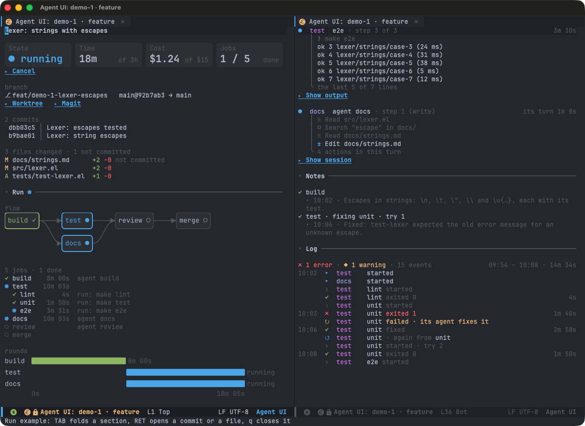

# Agent workflow

> **Status:** working, a run starting only when you start it: there are no other triggers yet. Its own package now:
> [agent-workflow](https://github.com/smyrgeorge/agent-workflow), from its working copy in `~/dev/agent-workflow` while
> it settles (`packages.el`), built on [Agent UI](agent-ui.md) and agent-shell.

A **workflow** describes the work on an issue the way GitHub Actions does: jobs, the order they run in, which run in
parallel, and their steps. A step is a script, Lisp, a built-in, or an **agent**: an LLM in agent-shell with its own
tools, permissions and instructions. Each run has its pane, where you follow it and answer what it asks.

Try it: `M-x +my/example-agent-workflow`, a run's pane as it runs, offline ([Examples](examples.md)).

What it is and how it works (the workflow format, agents, running, the pane, the command line) is in the package's own
docs:

- [Getting started](https://github.com/smyrgeorge/agent-workflow/blob/main/docs/getting-started.md)
- [Workflows](https://github.com/smyrgeorge/agent-workflow/blob/main/docs/workflows.md)
- [Agents](https://github.com/smyrgeorge/agent-workflow/blob/main/docs/agents.md)
- [Running](https://github.com/smyrgeorge/agent-workflow/blob/main/docs/running.md)
- [The command line](https://github.com/smyrgeorge/agent-workflow/blob/main/docs/command-line.md)
- [Customization](https://github.com/smyrgeorge/agent-workflow/blob/main/docs/customization.md)

This page is what this config adds on top of it (`config/agent-workflow.el`).

## Keys

| Key | What it does |
|---|---|
| `M-x agent-workflow-run-ticket` | Start runs on issues, each with its workflow (picked in columns, those that fit first) |
| `M-x agent-workflow-run` | Start a workflow that takes no ticket |
| `M-x agent-workflow-list` | Every run of the project; `RET` opens its pane, `gr` reads them again, `q` closes it |
| `M-x agent-workflow-check` | Every workflow and agent of the project checked, each problem taking you to its line |

`cmd/agent-workflow` is the package's command line (its `bin/agent-workflow`), for this config's docs, scripts and
workflows ([cmd/agent-workflow](cmd.md#cmdagent-workflow)).

## The issue picker

`M-x agent-workflow-run-ticket` offers the project's open issues as the [issue list](issues.md) draws them: a status
icon (blocked by an open issue: `⊘1`), a priority badge and a type icon before each, its labels as tags after
(`agent-workflow-issue-affixes-function`). An epic stands for its open issues.

## What the agent is told

Every session is told about Emacs by this config ([agent-shell](agent-shell.md)), for any agent, including the ones that
take no system prompt. Agent workflow's lines are part of that, so the package's own are off
(`agent-workflow-system-prompt`): every session is told where the `agent-workflow` skill is, and an agent of a run its
job, how it ends its step and its agent's instructions.

## Agents other than Claude Code

Claude Code takes an agent's tools and deny as its options. Another agent's permission requests are answered by the same
rules, in Claude Code's syntax, as an agent workspace's role's are (`config/agent-shell/permissions.el`,
`agent-workflow-session-rules-function`).

## The agent workspace

A project whose [agent workspace](agent-workspace.md) crew runs has no agents of the pool: its loops would take the same
issues. A run refused there says so (`agent-workflow-project-busy-functions`).

## Trust

A project's own workflows run once you trust it. The trust is Agent UI's: one per project, for its dashboards and its
workflows, kept in Doom's data folder (`agent-ui-trust-file`). `M-x agent-ui-trust-project` trusts the current project,
`M-x agent-ui-forget-project` forgets one.

## Notifications

A run that waits for you, or fails, sends a [notification](notifications.md) while Emacs isn't in front, however it was
started. Clicking it opens the run's pane. Its agents' sessions don't notify on their own (a turn over, a permission, a
question): their run says what needs you.

| Key | Action |
|---|---|
| `SPC t N` | Turn one kind of notification on or off: this one is `agent-workflow-needs-you` |

## This config's own

This config has two workflows of its own in `.agent-workflow/`, samples to start a project's from. They take no ticket
(`ticket: false`). They run once you trust this config (`M-x agent-ui-trust-project` in it, or asked as one first runs).

| Key | Action |
|---|---|
| `M-x agent-workflow-run` | Pick one and start it |
| `cmd/agent-workflow run --workflow screenshots` | Start screenshots from the shell |
| `cmd/agent-workflow run --workflow github` | Start github from the shell |
| `cmd/agent-workflow dry-run screenshots` | What it would do, nothing run |

| Workflow | Jobs |
|---|---|
| screenshots | **capture**: its script takes the examples' screenshots again (`.agent-workflow/scripts/screenshots.sh`), then the `screenshots` agent looks at each changed one and commits the good ones. **review** (changes: capture again). **merge** |
| github | Runs in your checkout (`runs-in: checkout`). **check**: gh is logged in and your checkout is on main (`.agent-workflow/scripts/github-check.sh`). **all-green**, after it: push your main (`github-push.sh`), then watch its GitHub Actions until they're done (`github-watch.sh`) |

**screenshots:**

- On macOS, Emacs needs the Screen Recording permission. Without it, the script breaks and the run asks you.
- The `screenshots` agent (`.agent-workflow/agents/`) may read, look at images and commit. It never takes the
  screenshots again, and changes nothing else.

**github:**

- It needs gh, logged in (`brew install gh`, `gh auth login`). Without it, the run fails at once (✗ failed) and says
  why. It fails the same way when your checkout isn't on main.
- It starts once your checkout has no uncommitted changes.
- The push sends your main's HEAD, so your own commits go too.
- When an Action fails, the `ci` agent reads its logs, fixes the code or its test, and commits on your main. The
  all-green job then runs again from its push (`retry-from`), 5 times at most.
- The `ci` agent may read, edit, run the tests and commit. It commits only the files it changed, since your checkout may
  have yours. It never pushes (the script does), and never runs the Actions again.
- With nothing to push (origin has your main already), it watches the Actions of origin's main. If they're done already,
  their verdict comes at once.
- If none show up within 5 minutes, it says so and goes on only when none was to run: the commit's message asks GitHub
  to skip them (`[skip ci]`...), or none of its `.github/workflows/` runs on a push. Otherwise GitHub didn't start one
  that should have run, and the run asks you, rather than passing with nothing checked.
- The run asks you when a run is cancelled on GitHub, when a push is refused (origin has commits you don't), when your
  checkout is off main at a push, or when no Actions run started for a push that should have started one.

Its scripts read these from Emacs's environment (`(setenv "GITHUB_POLL" "60")`):

| Variable | Default | What |
|---|---|---|
| `GITHUB_REMOTE` | `origin` | Where it pushes |
| `GITHUB_POLL` | 30 | Seconds between looks at the Actions |
| `GITHUB_APPEAR` | 300 | Seconds a pushed commit's Actions have to show up |
| `GITHUB_LOG_LINES` | 150 | How many of a failed job's last lines the agent gets |

## Files

| File | What it is |
|---|---|
| `packages.el` | The `agent-workflow` package, from `~/dev/agent-workflow` |
| `config/agent-workflow.el` | This config's layer over it: settings, hooks, keys |
| `cmd/agent-workflow` | The package's command line (its `bin/agent-workflow`), for this config's docs and scripts |
| `.agent-workflow/` | This config's own workflows, agents and scripts |
| `config/notify/agent-workflow.el` | Its notifications |
| `tests/unit/test-agent-workflow-config.el` | Tests of this config's layer and its own workflows (the package has its own) |
