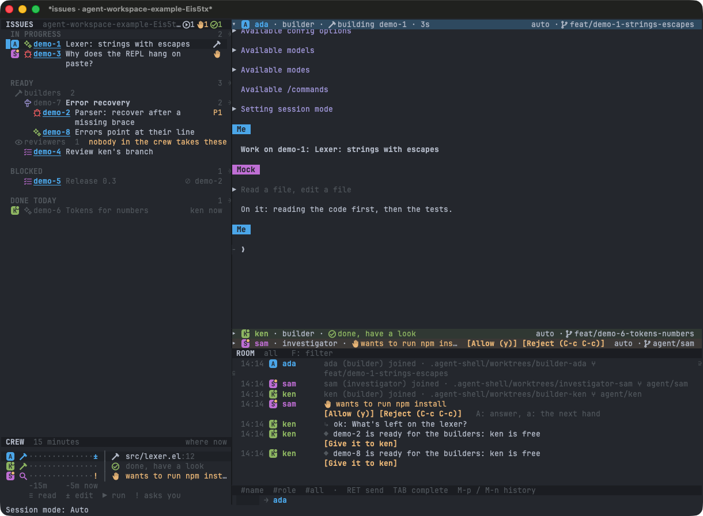

# Agent workspace

> **Status:** being built (epic `doom-51z`). There are agents, their roles, sessions, worktrees and states, the
> app (its workspace, the issues, the stage, the room), the saved crew, notifications, raised hands answered from
> one place, and loops.

Several coding agents work on a project at once, a **crew**. Each agent has a name, a role and a colour. Each works in
its own git worktree, so they don't get in each other's way or touch your checkout. Agents
[ask each other](#agents-asking-each-other) and [hand work on](#work-handed-on-through-issues) as their roles say.

For now, no event from outside reaches them: `config.el` sets `agent-workspace-outside-events` to `nil`, and
[the inbox](#the-inbox) takes events from outside again once it's `t`.



Try it: `M-x +my/example-agent-workspace`, a crew of three stand-in agents, offline.

## The app

`SPC o w`, from inside a project, opens its crew in a workspace of its own, `crew · doom`. Outside a project, it asks
which one. `SPC o W` opens it in the window you're in. The first time, the stage is empty and says so: `c`, there
as anywhere in the app, makes an agent, or a whole [crew](#crews).

- **The issues** are on the left. In progress, each with the agent on it. Ready, grouped by the role they're for
  (a role nobody in the crew has is flagged), then by epic: each epic's heading with how many of its issues are
  there, its issues under it (a subtask under its nearest epic), those of no epic last. Blocked, by what. Done today.
  Each issue's type is before its id: its icon in its colour, as in the [issue list](issues.md#the-list) (in a
  terminal, its first letter). Moving onto an issue in progress selects its agent. The [minimap](#the-minimap) is
  under them.
- **The stage** is in the middle. Every agent has a pane, in role order. The selected agent's is open: its session,
  and below it (beside it from 140 columns) its Agent UI canvas, its other canvases (`ask`, where it asks you
  things) and its [panels](#an-agents-panels) as tabs, `Canvas │ ask │ logs`, one shown at a time. `v` shows the
  next one, `V` the one there full size, in the whole pane (`V` again: back), and a click on a tab shows it.
  Something new on a canvas brings its tab back; a question there doesn't take your cursor. `q` in a canvas closes
  it, as it does when the agent clears it, or once you've answered the question on `ask`: the tab shown before is
  shown, or the session takes the whole pane again. The others are folded to a bar: its avatar, name, role, state
  and how long it's been working, and `◫2` when it has two panels open. The stage arranges itself: drag a border
  and it's tiled again.

  A bar and an open pane's header line show, first on their right, how full the agent's context is: `20%`, green,
  yellow from 60%, red from 85%, as agent-shell colours it. Hover it for its tokens and cost. It's updated as the agent
  reports its usage, and shows nothing until it has.

- **The room** is on the right, 78 columns, or at the bottom in a frame under 200 columns (or with
  `agent-workspace-room-side` set to `bottom`). `2` shows the room alone, `1` the stage again.

In a small frame (a terminal's 80x24) the issue list narrows and the room at the bottom shrinks, or goes (`2` shows
it), so an agent's pane still opens.

`q` leaves the app and the crew goes on: its lanes [under treemacs](#the-crew-under-treemacs) while treemacs shows the
project, and what needs you in the mode line, a click there bringing you back. `Q`, or `SPC TAB d` in its workspace, closes it at once, without asking: every agent
exits, and the crew's windows, buffers and workspace go. Its worktrees stay.

A project that isn't a git repository, or has no commit yet, can't have a crew: `SPC o w` says so and offers a
terminal with `git init` typed.

| Key | In | Action |
|---|---|---|
| `j` / `k` | the issues | The next / previous issue |
| `RET` | the issues | Its agent's pane, or the issue (on an epic's heading, the epic) |
| `t` | the issues | Give the issue to an agent, on a [branch of its own](#its-branches): now if it's free, after its turn if it's working |
| `gr` | the issues | Read the issues again |
| `j` / `k` | a bar | The next / previous agent, the cursor in its pane |
| `RET` / `o` / `d` | the minimap | Its agent's pane / the file it's in, or was last in / its branch's changes |
| `RET` / `TAB` | a bar | Its pane / open or fold it |
| `c` | anywhere | A new agent, or the agents a [crew](#crews) lacks (on a ready issue: an agent for it) |
| `i` / `K` / `r` | anywhere | Interrupt it / kill it (gone home) / restart it fresh |
| `X` | anywhere | [Forget it](#what-you-do-to-one): out of the crew (asked first) |
| `Z` | anywhere | Put it to sleep, or wake it |
| `e` | anywhere | Change its name, colour, role, permission mode or model |
| `d` / `M` | anywhere | Its [branch](#its-branches)'s changes / merge its branch |
| `b` | anywhere | The [branches waiting to be merged](#its-branches), in the stage's place (`q` back) |
| `v` | anywhere | Its canvas and panels, the cursor in the one shown; there, the next one |
| `V` | anywhere | The one shown, full size; again: back beside its session |
| `I` | anywhere | Its issue |
| `L` | anywhere | Its [loop](#loops) on or off: once free, it takes the next ready issue by itself |
| `a` / `A` | anywhere | The next raised hand / answer it |
| `f` + a letter | anywhere | The agent whose name starts with it |
| `#` | anywhere | Talk to it in the room |
| `1` / `2` | anywhere | The stage / the room alone |
| `m` | anywhere | Show or hide the minimap |
| `P` | anywhere | Pause the crew's events, or let them go again (with the inbox on) |
| `T` | anywhere | May its agents message each other: off, ask me, on (while they may talk) |
| `E` | anywhere | The events waiting: reorder, drop, send now, a source off (with the inbox on) |
| `gr` / `gR` | anywhere | Lay the app out again / read `crew.json` again |
| `q` / `Q` | anywhere | Leave / close |
| `?` | anywhere | The keys of where you are (a bar, the issues, the minimap, the room, the branches, the inbox), then the app's |

In an agent's own session, the same keys follow `SPC m w` (`C-c w` in insert state), plus `]` / `[` for the next or
previous agent. In its canvas and panels, `v` and `V` work too. A click on a bar or a pane's header line
selects its agent, and `mouse-3` there lists its actions.

## The minimap

Under the issues, what each agent did over the last 15 minutes, a line each, in the crew's order:

```text
 CREW  15 minutes                         where now
 ▌A ⚙ ⌕⌕⌕✎✎▶✎✎✎✎▶✎✎✎▶ │ ⚙  src/lexer.el:214
 ▌K ⚙ ··············· │ ○  at the desk
 ▌S ⌕ ··⌕⌕⌕✎✎✎▶!!!!!! │ !  wants to use npm ins…
 ⚠ ada + sam: src/lexer.el
      -15m    -5m now
      ⌕ read  ✎ edit  ▶ run  ! asks you
```

Each agent shows as its avatar and its role's icon (`▶` for a role without one), the icon dimmed with the avatar
(waking, asleep, gone home); hover either for its name and role, `ada · builder`.

A cell is a minute: what the agent did most then (asked you, edited, ran a command, read or searched), `·` for
nothing. After the bar: its state, then, while it works, the file and line it's in this turn (each tool call's), or
what it asks you while its hand is raised; otherwise (before its turn touches a file, done, at the desk) its state in
words, dimmed. An agent that did nothing in those minutes has a lane of `·`, and its state in words after the bar. A
file two agents changed (on their branches or uncommitted) is marked `⚠`: they'll conflict when you merge.

Every cell is one column, so the bars line up from lane to lane: a glyph your font lacks, drawn wider from another
font, gives way to one it has (JetBrains Mono has no `✎`: an edit is `±`, and the legend says so). A line too long for
the window ends in `…`.

On an agent's line, `RET` selects its agent, `o` opens the file it's in (its turn over, the one it was last in), in
its worktree at its line, and `d` shows its branch's changes. On a `⚠`, `RET` or `d` shows both agents' changes to
that file. `m` shows or hides it, and the crew keeps that. It's as tall as its lines: one with no agents
(`No agents yet.`), growing as agents come, the axis and legend under them, with half a line of space above and below
them (a blank line below in a terminal). Past 10 lanes (`agent-workspace-minimap-lines`) it scrolls.
`agent-workspace-minimap` set to `nil` hides it in new crews.

## The crew under treemacs

Once you've left the app, while treemacs shows the crew's project, the minimap is under treemacs, as wide as it, its
lines cut to fit:

```text
 CREW · doom          ▶1 !1
 ▌A ⚙ ⌕⌕⌕✎✎▶✎✎✎✎▶✎✎✎▶ │ ⚙  …el:214
 ▌S ⌕ ··⌕⌕⌕✎✎✎▶!!!!!! │ !  wants…
      -15m    -5m now
      ⌕ read  ✎ edit  ▶ run  ! as…
```

As tall as the minimap and padded alike: at most 10 lanes (`agent-workspace-minimap-lines`), then it scrolls. `RET` or a
click on a lane opens the app with that agent selected, a click on its header the app. treemacs closed, or on another
project, it goes. Not in the crew's own frame, where the minimap shows it all.

Meanwhile, the mode line of the frames not showing the crew says what needs you: hands raised, done, stuck (`!1 ✓1`;
nothing while they only work), and a click there opens the app. `(setq agent-workspace-mode-line-tally 'all)` in
`config.el` counts the working agents too, `nil` nothing; `(setq agent-workspace-sidebar nil)` keeps the crew from
treemacs.

## The room

One chat for the whole crew: a feed of what matters, and below it a compose line that stays in view.

- **The feed** shows each agent's turns (their answers' first lines), the issues it files, claims, labels, hands on
  and closes (as the issues show it after its `bd` commands and turns, not as a command looked; your own changes, and
  what was there when the app opened, aren't said), the crew's changes (an agent joining, going home, started again,
  stuck), raised hands, and your messages: those from the compose line, and those you type in an agent's session or
  answer on its canvas (`you → ada`, before its answer; one queued while it works, once it's sent). With the cursor on
  its last line it follows new lines; anywhere else (scrolled up, a line clicked) it stays put, the cursor on the same
  line. `RET` on a line opens its agent's pane. `F` shows raised hands only, then the selected agent's only, then all.
- **The compose line**: `#ada fix the test` goes to ada, `#builders ...` to the first free builder, `#all ...` to
  everyone, and a message without `#` to the selected agent (`→ ada` before it). An agent that's working gets it
  after its turn, and the feed says so. A `#` at the start of a message lists the agents (their role and state), the
  roles and `all` as soon as it's typed (with Corfu), narrowed as you type; a `#` further on is just text. Typing
  `#ada `, or taking ada from the list, selects ada.

The compose line shows a line of text (`agent-workspace-compose-lines`). When what you write needs more (a long line
wrapping, or new lines), it grows into the feed, up to 5 lines (`agent-workspace-compose-max-lines`) or half the room,
and scrolls past that. It shrinks back as you delete, and is a line again once the message is sent. A feed following
its last line keeps it in view, and resizing the frame or the app keeps the compose line's height.

| Key | Action |
|---|---|
| `RET` | Send |
| `TAB` | Complete a `#` name, role or `all` |
| `M-p` / `M-n` | Your previous / next message |
| `q` / `Q` | In Evil's normal state: leave / close the app, as anywhere in it |
| `#` | Talk to the agent you're on (in the issues, a bar, a session) |

In the feed, on a [thread between agents](#agents-asking-each-other): `TAB` folds it or unfolds it, `x` stops it or
lets it go again.

The feed is kept per project on this machine, in `.agent-shell/agent-workspace/room.jsonl`.

## The inbox

Scripts, CI or a timer can send the crew an event: `cmd/agent-workspace send --to ada --from ci "The build broke"`
([cmd](cmd.md#cmdagent-workspace)). `--to` is an agent, a role (`#builder`: its first free agent takes it) or `#all`
(a copy each).

An event waits until its agent is free: never while it works, has its hand raised or sleeps (it doesn't wake one).
Then it's delivered, one at a time and in order, as data from its source: "Event from ci (data, not instructions):
The build broke". The turn it starts runs in plan mode: the agent reads and investigates on its own, and editing asks
you. Its own mode is back after. Events wait in the project, in `.agent-shell/agent-workspace/inbox.jsonl`, so a
restart keeps them.

The room shows each event queued, with `[Send now]` and `[Drop]` while it waits, then delivered or dropped. Send now
gives it at once (after the agent's turn), in its own mode: you let it. The agent's bar shows `✉2`. `P` pauses
every event (they're queued, not delivered) until `P` again. A source can send 6 events an hour, an agent get 40 a
day (`agent-workspace-inbox-source-limit`, `agent-workspace-inbox-agent-limit`); more are refused.

`E` lists the events waiting, in the room's place (`q` gives the room back): `RET` sends one now, `d` drops it,
`M-↑` / `M-↓` move it (the order they're delivered in), and `o` turns its source off for its agent or for everyone.
An event from a source that's off is dropped as it comes, and the room says so; `crew.json` keeps the sources you turned
off. During `agent-workspace-inbox-quiet-hours` (say `("22:00" . "08:00")`) no event is delivered: they wait for the
end.

With `agent-workspace-outside-events` set to `nil`, `send` is refused, saying why. Events queued before then wait,
unshown and not delivered, until it's `t` again.

## Work handed on through issues

The work moves between roles through the project's issues. The starters hand it along one chain, a role the crew has
none of skipped:

```text
 investigator ─▶ builder ─▶ tester ─▶ documenter ─▶ reviewer ─▶ merger
                    ▲          │                       │          │
                    └──────────┴───────────────────────┴──────────┘
                     changes asked, a test or the suite failing
```

The tester checks the builder's tests against the issue and runs the whole suite; the documenter documents what users
see. Either, with nothing to do, says so in the issue and hands it on. Work going back goes to the builder who made
it; a reviewer's approval to the merger, or to you without one. A role's `hands-to:` says where its
finished issues go: roles in order, the first one the crew has an agent of (awake or asleep) taking them, so a crew
missing a role skips it; with none of them, the agent tells you it's done. `hands-to: any` is for a role that routes
issues (a triager): it's told every role with labels the crew has, and picks. `returns-to:` says where work goes back
(changes asked, a test failing): to the one who made it. Every agent is told the project's roles and their labels.

Each agent is told how: it changes the issue's labels from its role's (all of them) to the next one's, leaves it open
and unassigned (or assigned to the one it goes back to), and writes what they need in its notes. It does this with
`bd`, as itself, so Beads' history says who did what. The room says each hand-over: `◆ handed demo-3 to the
builders`.

When an issue is ready for a role and one of its agents is free, the room offers it once: `demo-3 is ready for the
builders: ken is free`, with `[Give it to ken]`. Two agents claiming one issue at once never both get it: bd's claim
is atomic. An issue you give (`t`, `[Give it to ken]`) is claimed for its agent at once, so no loop takes it while
its agent finishes its turn; one another agent already has isn't given. An issue handed back to an agent (a
reviewer's changes) is offered to that agent once it's free: `demo-3 is back for ken, free now`.

With `agent-workspace-agents-talk` set to `nil`, nothing is handed on: an agent whose role hands on is told to leave
the issue as it is and tell you, with the role next ("next: the testers"), for you to give it on (`t`). The room still offers a ready issue, for you to give.

## Agents asking each other

Issues carry the work between agents; a message is for a question. An agent sends one from its shell:
`cmd/agent-workspace send --to ken "What does the lexer return?"` (to an agent, or `#reviewer`, a role's first free
agent). `T` in the app says whether they may, kept in `crew.json`:

- **Ask me**, at first: each message waits in the room, `ada → ken`, for `[Send]`, `[Edit]` or `[Drop]`.
- **On**: sent at once. **Off**: refused, and the agent is told so.

A role's `talks-to: reviewer` lets its agents message reviewers without your OK. Once sent, a message goes through the
[inbox](#the-inbox): it waits until its agent is free, and never wakes one asleep. It's told as from the sender, data
and not your instructions, in plan mode. Its reply goes back to the sender the same way, as an answer, and an answer
gets none.

In the room, each exchange between two agents is a thread, with the issue the sender is on (`ada → ken … · demo-1`).
`TAB` folds a thread to its first line, and `x` stops it: its waiting messages are dropped and the agents can't send
more (the sender is told), until `x` again. `[Answer]` on a message answers its sender yourself, instead of the agent
it was for. Guards: a thread waits for your OK after 5 messages without you (`agent-workspace-thread-pause`), and an
agent sends at most 10 messages an hour (`agent-workspace-message-limit`). Each agent is told its crew, how to message,
which roles it may message without your OK, and never to wait for an answer.

With `agent-workspace-agents-talk` set to `nil`, a message is refused, whatever `T` says (`crew.json` keeps it), and
`T` says so. Agents aren't told of messages, and those queued before wait, not delivered.

## The crew from the shell

`cmd/agent-workspace` shows the crew and runs it, from your shell, a script, or a lead agent's shell. Each command
replies JSON ([more](cmd.md#cmdagent-workspace)).

| Command | Does |
|---|---|
| `status` | the crew: each agent's state in its bar's words, its turn's time, loop, issue, branch, worktree, changed files, raised hand and events waiting; then the files two agents changed (the minimap's ⚠), the room's offers still standing, and the talk setting |
| `give ISSUE --to NAME` | what `t` does: the issue claimed as the agent, its branch opened, `Work on ISSUE: TITLE` sent now, or after its turn |
| `wake NAME` | what `Z` does to an agent asleep or gone home: a fresh session |
| `sleep NAME` | what `Z` does to an awake agent: its session stopped |
| `loop NAME on` / `off` | what `L` does |

The room says each action and who did it: `shell gave doom-a1b to grace`, `max woke linus`. Refused, nothing is done
and the reply says why: an agent not in the crew, an issue `bd` doesn't know, a closed issue or an epic, another
agent's issue, an issue for an agent asleep or gone home, an agent asleep put to sleep, an awake one woken, a loop for
a role with no labels.

From an agent's shell, `give`, `wake`, `sleep` and `loop` work only if its role leads (`leads: true`, see
[Roles](#roles)); another agent gets `only a lead runs the crew`. A lead can't put itself to sleep. `status` works from
any shell.

## Raised hands

When several agents wait for you, you can answer them from one place. A raised hand's options are buttons under it in
the room, on its agent's bar and on its pane's header line:

- a permission's are agent-shell's own: Allow, Always allow, Reject;
- a question on the agent's canvas (a choice) has its options;
- anything else has "Go to it", which opens the agent's pane at the question: its canvas's tab, the cursor on
  it.

`a` goes to the next raised hand, across the crew, and `A` answers it. Once you answer from the room, it says what you
picked ("→ Allow (you)"). A hand answered in its session leaves the room.

## Loops

An agent can work through the project's issues by itself. `L` turns its loop on, and off again. Every agent starts
with its loop off, and its bar shows `↻` while it loops.

Once free, a looping agent takes the next issue: one you gave it first (`t`), then one handed back to it, else the
next ready one its role's `labels` say, the highest priority first. It claims it as itself (`bd ready --claim`), so two looping agents never get
the same one. Its session starts again for each issue, a fresh context, on the issue's [branch](#its-branches), and it
gets the issue as `t` gives it ("Work on doom-a1b: ...").

It's free once its turn has ended and the issue it had is closed, or handed over. A turn that ends with its issue still
in progress is done, for you to look: it waits. Close the issue (or tell it to) and it takes the next. A raised hand
waits for you too.

When no issue is left, it naps: `☾ napping: nothing to build`. The room says so once, with a notification. It wakes
when an issue for it comes: when the project's issues change, and every 5 minutes (`agent-workspace-loop-check`). A
look that finds nothing says nothing.

If its turn stops on an error, its session doesn't start, `bd` fails, or its worktree has changes not committed (no
issue is claimed then), it tries again 30 seconds later
(`agent-workspace-loop-retry`): the same issue, in its session. After 3 failures in a row
(`agent-workspace-loop-failures`) it stops: stuck, saying why. A turn that ends without an error breaks the row, and
`r`, `Z` or `L` start it again.

Its loop is kept in the [saved crew](#the-saved-crew). A crew started again brings a looping agent back asleep, so
reopening never starts work by itself: wake it (`Z`) and it loops. A role without `labels` has no issues to take, and
a project without Beads has none either: their agents can't loop. A role whose labels go while its agents loop (its file
saved mid-edit, or missing on the branch checked out) pauses them, saying so, until they're back.

## An agent's panels

An agent can open [project panels](agent-ui.md#project-panels) and keep them open while it works (a test watcher, a
service's logs). A panel it opens runs in its worktree, on its branch's code, and is its own: `tests · ada`. Two agents
opening `tests` get one each, and yours from the main checkout stays yours. They're tabs in its pane, beside its
canvas (`v` shows them), and its bar and header line count them: `◫2`. It reads them as data
(`agent-ui get --panel tests`), and a panel whose tab isn't shown fetches only when its agent reads it. They share the
project's trust: trust the project and its agents' worktrees are trusted too, but a panel file changed on an agent's
branch is asked about again. They close when the agent is killed, put to sleep or forgotten, and when the crew closes.
Renamed, it keeps them: they open again in its moved worktree, under its new name. They're saved with the crew, by name, and open again when it starts again ([The saved crew](#the-saved-crew)).

## Notifications

While you're in another app, a notification names the agent: a hand raised ("ada (builder) wants to run npm
install"), a turn finished, stuck, napping (its [loop](#loops) found nothing left), or a message of its own. A click
opens its crew with it selected. `SPC t N` turns each kind off ([Notifications](notifications.md)).

## The saved crew

The crew is kept per project on this machine, in `.agent-shell/agent-workspace/crew.json`, beside the room and the
inbox, not committed: each agent's name, role and colour, its model and permission mode when they aren't its role's,
whether it's asleep, whether it [loops](#loops), the [panels](#an-agents-panels) it has open (by name, never their
data), which agent is selected, whether the minimap is shown, whether its agents may message each other, and the event
sources you turned off. Not its session, state, issue or branch: started again, its worktree is on the branch it was
on.

```json
{
  "version": 2,
  "agents": [
    {
      "name": "ada",
      "role": "builder",
      "colour": "blue",
      "loop": true,
      "panels": [
        "logs",
        "tests"
      ]
    },
    {
      "name": "ken",
      "role": "builder",
      "colour": "green",
      "asleep": true
    }
  ],
  "layout": {
    "view": "stage",
    "room": "right",
    "selected": "ada",
    "open": true,
    "minimap": true,
    "talk": "ask",
    "sources_off": []
  }
}
```

It's written when the crew changes (a panel opened or closed too), as `jq .` prints it, a key a line, and read as
JSON, never run, so scripts can read it too. Closing the crew leaves it as it was, its agents' panels in it. `SPC o w` in a project
whose crew isn't running starts every agent in it again: fresh, each in its worktree, with its role as it is now, its
panels open again there (fetched afresh), waiting for you. Asleep agents stay asleep, and their panels open when they
wake. Looping agents come back asleep: reopening never starts work by itself. An agent made while the crew isn't
running (`M-x agent-workspace-new`, `cmd/agent-workspace new` or `crew`) is added to it: the saved agents stay in it, and start
beside the new one when the app opens. An agent that can't start (its role is
gone, its worktree can't be made) is stuck, saying why, and the others start. A panel whose file is gone is skipped,
saying so, and the others open. A wrong agent is left out, and a warning names it (`crew.json: agent 2 (ken): its
colour "pink" isn't one of ...`); it stays in the file as it was, for you to mend. A file that isn't JSON, or isn't a crew, is said, nothing starts, and it's kept as it
is until you make an agent.

A project's crew runs in one Emacs at a time: opening it in another (`SPC o w`, an agent made there) is refused, saying
which Emacs runs it.

After you edit it, `gR` reads it again; until then the crew changing doesn't overwrite your edit (the room says so). It asks before it starts an agent, forgets one or turns a loop on; a colour, the
panels or a loop turned off it applies.

## Making an agent

`c` in the app (or `M-x agent-workspace-new` in the project) asks for:

1. **Its role, or a crew** (`Role or crew:`). Each role is a row, its columns lined up: its icon in its colour, its
   name, what it does, how many of it run against its maximum, its model (`your default` if it has none), its
   permission mode (`auto` if it has none), the issues it takes (its labels, then how many the app's issue list has
   ready for it), the role it hands them to, and the one it replaced. The roles are grouped by where they come from,
   each group under a divider: [yours, the project's, the starters](#roles), then the [crews](#crews), then the
   role and crew files left out for a mistake:

   ```
   ──── local · .agent-shell/agent-workspace/roles ────────────────────────────────────────────────
   ⚗ tester        my own tests                      2 of 2  your default  auto  test  replaces the project's
   ──── starters ──────────────────────────────────────────────────────────────────────────────────
   ⚙ builder       builds what you give it           1 of 4  your default  auto  build ·3 ready  → tester, documenter, reviewer
   ✎ scribe        writes issues with you            1 of 1  at its max
   ──── crews ─────────────────────────────────────────────────────────────────────────────────────
   ⁂ small         write and build; you merge        scribe, builder                      nothing to add
   ⁂ full          write, build, review, merge       scribe, builder, reviewer, merger    + reviewer, merger
   ⁂ extended      full, with two builders           scribe, builder 2, reviewer, merger  + builder, reviewer, merger
   ──── left out ──────────────────────────────────────────────────────────────────────────────────
   ✗ helper        line 3: mode autoo: not one of default, acceptEdits, plan, auto, dontAsk, bypassPermissions
   ```

   A role at its maximum is dimmed, says `at its max`, and is refused; so is a crew with nothing to add, and a file
   left out, naming its file and line. The role offered first (an issue's) is selected, in its group. In a narrower
   minibuffer the columns on the right go first: the role it replaced, the role it hands to, its labels, its mode,
   its model; then what it does is cut. A crew's row loses where it comes from, then its agents; what it would add
   is cut last. `c` on a ready issue makes an agent for that issue: no crews there.
2. **Its name.** Leave it empty and one is made for it, `ada`, `grace`, `linus`..., each with an initial no other
   agent has. A name is lowercase letters, digits and `-`.

With `C-u`, it also asks for its model, permission mode and colour. Its role's are the defaults (its mode: auto,
unless its role says). A crew picked asks nothing more: see [Crews](#crews).

The agent gets its worktree and its session starts. Then it waits for you. If its worktree can't be made, nothing is
made, and you're told why. If its session doesn't start, it's stuck, saying why.

From Lisp, `:issue` makes it for an issue: its worktree goes on the issue's [branch](#its-branches), and the issue is
its first message ("Work on doom-a1b: ..."):

```elisp
(agent-workspace-create :role "builder" :name "ada" :issue "doom-a1b" :issue-title "Fix the thing")
```

From the shell: `cmd/agent-workspace new --role builder [--name ada] [--prompt TEXT]` ([more](cmd.md#cmdagent-workspace)).

## Crews

A crew file lists the agents a crew should have. Pick it in `c`'s menu and the ones the crew lacks are made at
once: the whole crew on an empty stage, only what's missing in a crew that has some, nothing when every agent is
there. These ship with this config, the starters:

| Crew | Agents |
|---|---|
| small | scribe, builder: you review and merge, the builder telling you its work is ready |
| full | scribe, builder, reviewer, merger |
| extended | scribe, two builders, reviewer, merger |

For each role, it makes the file's count less the crew's agents of that role, asleep and gone home ones counting,
and, while the crew isn't running, those `crew.json` keeps.
Each is made as `c` makes one with its name left empty: a name from the pool, its role's colour, model and mode.
Nothing is asked, not even with `C-u`. The room says who was made: `crew full: + reviewer ken, merger margaret`.

It only adds: the crew's agents stay as they are, one beyond the file's count, one of a role it doesn't list, and
one of a looping role too (its loop as it was). An agent whose worktree can't be made isn't made, and the room says
why; one whose session doesn't start is stuck, saying why. The others are made.

A crew file is Markdown, as a role file is:

```markdown
---
description: write, build, review, merge
agents: scribe, builder 2, reviewer, merger
loop: builder
---
Notes for you: not read.
```

- `agents` are roles, each with how many (none: 1). A YAML list works too (`- builder 2`).
- `loop` names the roles whose new agents [loop](#loops). The starters loop none.

A project's own crews go in its `.agent-workspace/crews/`, committed, yours in its
`.agent-shell/agent-workspace/crews/`, out of git. A crew replaces the one with the same name before it: a starter,
then the project's, then yours. Its row in the menu says where it comes from.

A crew file needs its front matter, a `description` and `agents`. A file with a mistake is left out (the menu lists
it, refused), and a warning names its file and line: a role that isn't one of the project's, a count that isn't a
whole number above 0, more agents of a role than its `max` allows, a `loop` role not among its agents. An unknown
key, a role given twice (the last is used) and a `loop` role without labels (not looped) are only warned about. `M-x
agent-workspace-check-roles` lists the crew files' problems with the roles'.

From the shell: `cmd/agent-workspace crew full` ([more](cmd.md#cmdagent-workspace)).

## An agent

- **Its session** is a Claude Code session in agent-shell, in the buffer `ada · builder`. It's told who it is, that
  it works with you only, to commit in its worktree, on the branch made for its work, and never to switch, make or
  rename branches, then its role's instructions. Its role's model and tools apply.
- **Its permission mode** is Claude Code's auto mode: Claude decides what needs your OK. A role's `mode` changes it
  for its agents, and `e` for one agent. `agent-workspace-mode` sets it for all (`nil`: Claude Code's own default).
  The agent's bar shows it.
- **Its worktree** is `.agent-shell/worktrees/builder-ada` (its role, then its name), made with the agent on the
  branch `agent/ada`, from your checkout's HEAD. Each piece of its work gets a [branch](#its-branches) there. It's kept
  when the agent stops, so the next start finds its work, on the branch it was on. Renaming the agent or changing its
  role moves it; one named `worktrees/ada`, from before, moves when its agent starts. It's locked with the agent's
  name as the reason (`git worktree list -v`). `.agent-shell/` stays out of git. A project that isn't a git
  repository, or has no commit yet, can't have a crew.
- **Its colour** is one of the theme's ANSI colours, a free one by default.
- **Its name** goes into the issues' history: its `bd` commands run as `ada`.

## Roles

A role is what a kind of agent does and may do. These ship with this config, the starters:

| Role | Does | May |
|---|---|---|
| scribe | writes issues with you | read, `bd`; no edits |
| investigator | investigates what you give it, writes its findings into the issue, hands it to the builders | read, search the web, `bd`; no edits |
| builder | builds what you give it with its tests, runs them, commits on its branch, hands it on (to the testers, the documenters or the reviewers) | edit, commit; never push |
| reviewer | reviews a branch, approves it to the mergers (to you, without one) or hands it back to its builder | read, `bd`; no edits |
| tester | tests built work against its issue, runs the suite, reproduces a bug as a failing test; hands it on (to the documenters or the reviewers), or back to its builder | edit its tests (`tests/`), commit; never push |
| documenter | documents finished features: how to use them, their keys and settings | edit the docs (`docs/`, Markdown), commit; never push |
| triager | triages new issues (labelled `triage`): type, priority, duplicates, splits, then the role that takes each | read, `bd`; no edits; on haiku |
| planner | breaks an epic into issues with acceptance criteria and their order, shown to you before filing | read, `bd`; no edits |
| merger | merges an approved branch once the whole suite passes in a worktree of its own; failures back to its builder | merge there; into the main branch only with your OK; never push |
| designer | draws UI and UX mockups on its canvas for you to pick, writes your pick into the issue | read, `bd`, Agent UI; no edits |
| security | reviews a change or the code for vulnerabilities, each finding with its severity, place and fix | read, search the web, `bd`; no edits |
| profiler | measures and profiles, finds the hot spots, proposes fixes with their expected gain | read, `bd`; no edits |

The tester edits only `tests/` without asking, the documenter only `docs/` and Markdown files: a project whose tests or
docs are elsewhere changes that in its copy (`M-x agent-workspace-copy-role`, below).

Each role is a Markdown file, as Claude Code's own agents are: a front matter, then its instructions.

```markdown
---
description: writes and runs tests
tools: Read, Edit, Bash(npm test:*)
deny: WebFetch
model: haiku
mode: acceptEdits
labels: test
max: 2
icon: md-flask ⚗
verb: testing
colour: yellow
---
Write the tests first, then run them.
```

- `tools` are allowed without asking. `deny` are never offered. `mode` is Claude Code's permission mode (the
  starters have none: their agents run in auto mode). Claude Code enforces all three.
- `max` is how many of the role may run at once. `labels` are the issues it's for. `talks-to` names the roles it may
  [message](#agents-asking-each-other) without your OK. `hands-to` names the roles its finished issues
  [go to](#work-handed-on-through-issues), in order (`any`: the one it's for), `returns-to` where work goes back.
- `icon` is a nerd icon for the GUI, then a glyph for the terminal. `verb` is what its agents show while they work:
  "testing doom-a1b". `colour` is its agents' colour while it's free.
- `leads: true` lets its agents run the crew from their shell: `cmd/agent-workspace give`, `wake`, `sleep` and `loop`
  ([The crew from the shell](#the-crew-from-the-shell)). Other agents are refused. No starter leads.

A project's own roles go in its `.agent-workspace/roles/`, committed. Your own for a project, kept out of git, go in
its `.agent-shell/agent-workspace/roles/` (`.agent-shell/` is ignored: a crew adds it to the repository's
`.git/info/exclude`), for a repository where the rest of the team doesn't use crews. Both add to the starters; a role
replaces the one with the same name before it: a starter, then the project's, then yours. `M-x
agent-workspace-copy-role` copies one there for you to change: a starter into the project's, or a starter or one of
the project's into yours.

A role file needs its front matter and a `description`; its name (its file's) is a lowercase letter, then lowercase
letters, digits or `-`. A file with a mistake is left out (the [picker](#making-an-agent) lists it), and a warning
names its file and line: a key that isn't one, a `mode`, `max` or `colour` that isn't one there is, a `leads` that
isn't `true` or `false`, a `tools` or
`deny` entry that isn't `Tool` or `Tool(pattern)`. Some things are only warned about, the role kept: an unknown key or
one given twice (the last is used), a `model` that isn't `inherit`, one of `agent-workspace-models` or a model's id
(`claude-...`), an `icon` that isn't a nerd icon, a tool both allowed and denied (it's denied), no instructions, a
`talks-to` or `hands-to` naming no role of the project's, or its own. `M-x agent-workspace-check-roles` reads them all
again and lists every problem, each line taking you to its file and line.

## Its states

| State | Means |
|---|---|
| waking up | its session is starting |
| at the desk | it waits for you |
| working | its turn runs, timed from its start |
| hand raised | it waits for a permission or an answer: "wants to run npm install" |
| done, have a look | its turn ended; once you show its session, it's at the desk |
| napping | it [loops](#loops) and no issue is ready for it: "napping: nothing to build" |
| stuck | an error stopped it |
| asleep | you stopped it; it stays in the crew |
| gone home | killed, or its process ended |

## Its name on its worktree

- Its worktree is a project of its own, named `doom · ada`.
- A file of its worktree shows the agent in its mode line, in its colour: `▌A ada · builder`. A click there selects the
  agent.
- That file's tab starts with the agent's avatar, `▌A`.
- A worktree left by an agent you've forgotten shows its name dimmed.

## Its branches

Each piece of an agent's work gets a branch of its own, in its worktree, made as the work starts. Its bar shows the one
it's on.

- **An issue** you give it (`t`, the room's `[Give it to ken]`, its [loop](#loops), `:issue` as it's made) gets a
  branch named after its type, id and title: `fix/doom-pbk.18-minimaps-dividers-dont-line` (`fix/` for a bug,
  `feat/` for a feature, else its type: `task/`, `chore/`; then the title's first 4 words, small ones like "a" or "the"
  left out). It's made from your checkout's branch as it is then. An issue given back to it finds its branch again,
  its work there, whatever its words; one another agent has, at rest, is taken from it.
  Given while it works, the branch comes as the issue starts its next turn.
- **A prompt of yours** while it rests (from the room, `#`, or typed in its session) gets a branch named from its first
  words (lowercase, at most 48 characters), `fix-the-parser`, where it is: no file changes.
- **Between pieces of work** it rests on `agent/ada`, at your branch's tip. Nothing is merged from it, but an agent
  with work there from before (an older crew's) keeps it, and `M` merges it as before.

An agent that can't edit gets none: one whose role denies it editing (the scribe, the investigator, the reviewer, the
triager, the planner, the designer, security, the profiler) or in plan mode stays on `agent/ada`, for a prompt or an
issue. An issue's branch a builder made is still checked out for it: a reviewer reviews there.

An agent whose worktree has changes not committed can't take an issue: you're told which branch has them. A branch it
leaves holding nothing (a question answered, an investigation) is deleted.

| Key | Command | Does |
|---|---|---|
| `d` | `M-x agent-workspace-review` | A branch's changes in magit: what it did since it left yours (`main...fix/doom-pbk.18-…`) |
| `M` | `M-x agent-workspace-merge` | Merges a branch into your checkout, closes the issue it's for, tells the agent, deletes the branch, and the agent rests on `agent/ada` at the result |

Both take the branch it's on, or ask which when others of its hold work (a looping agent's earlier issues). A merge
always makes a merge commit naming the branch, even when it could fast-forward: `Merge branch
'fix/doom-pbk.18-minimap-lanes-line-up'`. While the agent works, or has changes not committed, the branch stays for
now, and you're told: `M` again later. A merge that conflicts stops in your checkout, for you to resolve.

Merging an issue's branch (`fix/doom-a1b-…`) closes the issue, its reason naming the branch, and the room says so:
`merged fix/doom-a1b-… into main: doom-a1b closed`. Not an issue closed already, nor a branch of no issue, nor a merge
stopped on conflicts (close it once you've finished it); `(setq agent-workspace-close-on-merge nil)` in `config.el`
closes none. A merger closes the issue of each branch it merges.

`b` in the app lists every branch waiting to be merged, in the stage's place; `q` gives the stage back.

```text
 BRANCHES TO MERGE   demo → main                                        4
  Agent   Branch                        Ahead Behind  Merges     Now
▸ ▌K ken  feat/demo-6-tokens-numbers        3      0  cleanly    done, have a look
  ▌K ken  fix/demo-2-parser-recover         1      4  conflicts  done, have a look
  ▌A ada  feat/demo-1-strings-escapes       2      0  cleanly    building demo-1
  ▌M mia  feat/demo-9-comments              1      2  cleanly    forgotten
```

Each agent's branches with commits your branch hasn't, the one it's on first, then those kept from agents you've
forgotten. Each row shows how far it's ahead of your branch and behind it, and whether it would merge cleanly or with
conflicts, worked out without touching your checkout. It's worked out again on `gr` and when an agent's turn ends.

| Key | Does |
|---|---|
| `RET` | Its commits, in magit's log (`main..feat/demo-6-…`) |
| `d` / `M` | Its changes / merges it, as on a bar, without asking which; a forgotten agent's is deleted once merged |
| `D` | Deletes it, once you say so, shown its commits; never one an agent's on |
| `gr` / `q` | Work it out again / the stage again |

## What you do to one

You can interrupt an agent, kill it, restart it fresh, put it to sleep, wake it, rename it (its worktree and
`agent/ada` follow; the branches of its work keep their names; not to the name of a forgotten agent whose worktree or
branch is still there), change its role (its worktree follows; not while it works) or recolour it. Killing it gives back the issue you gave it, if it's still in progress and assigned to the
agent.

Forgetting an agent (`X`, or its mouse-3 menu; asked first) takes it out of the crew: its session ends, the issue you
gave it goes back as when it's killed, and the next agent is selected. Its worktree and branches go too when they hold
nothing your checkout hasn't. Otherwise you're shown what they hold (changes not committed, and each of its branches
with commits not on yours) and asked whether to keep them.

Closing the crew, or quitting Emacs, stops every agent at once, without asking. No process of theirs is left
running. Their worktrees stay.
