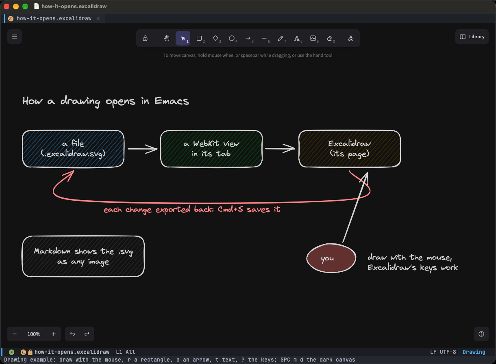

# Drawings

`*.excalidraw.svg` and `*.excalidraw` files open in their tab in [Excalidraw](https://excalidraw.com). A
`.excalidraw.svg` is also an image that Markdown and GitHub show. Excalidraw's keys work (`?` lists them), with `Cmd`
on macOS and `Ctrl` on Linux, as Excalidraw has them there. Try it: `M-x +my/example-excalidraw`.

| macOS | Linux | Action |
|---|---|---|
| `Cmd+S` | `Ctrl+S` | Save |
| `Cmd+C` / `Cmd+X` / `Cmd+V` | `Ctrl+Shift+C` / `Ctrl+Shift+X` / `Ctrl+Shift+V` | Copy / cut / paste, through the kill ring |
| `Cmd+Z` / `Cmd+Shift+Z` | `Ctrl+Z` / `Ctrl+Shift+Z`, `Ctrl+Y` | Undo / redo (Excalidraw's) |
| `Cmd+G` / `Cmd+Shift+G` | right click → Group / `Ctrl+Shift+G` | Group / ungroup |
| `Cmd+[` / `Cmd+]` | right click → Send backward / `Ctrl+]` | Send backward / bring forward |
| `Cmd+=` / `Cmd+-` / `Cmd+0` | `Ctrl+=` / `Ctrl+-` / `Ctrl+0` | Zoom in / out / reset |
| `SPC m d` | `SPC m d` | Dark canvas |
| `SPC m l` | `SPC m l` | Browse libraries |
| `SPC m r` | `SPC m r` | Reload the file |

On Linux `Ctrl+G` stays Emacs's (quit), and Emacs reads `Ctrl+[` as `Esc`: grouping and sending backward are in the
selection's right-click menu there.

The library is shared by all drawings. In Markdown or Org, `Option+Enter` (Linux: `Alt+Enter`) → **Insert a new
drawing** links a new one at point. In a Claude Code buffer, `C-c C-d` draws for Claude: see
[Drawing for Claude](claude-code.md#drawing-for-claude). Drawings need an Emacs with xwidgets (see [PDFs](pdf.md));
without it a drawing opens as its file (an `.excalidraw.svg` as an image).
