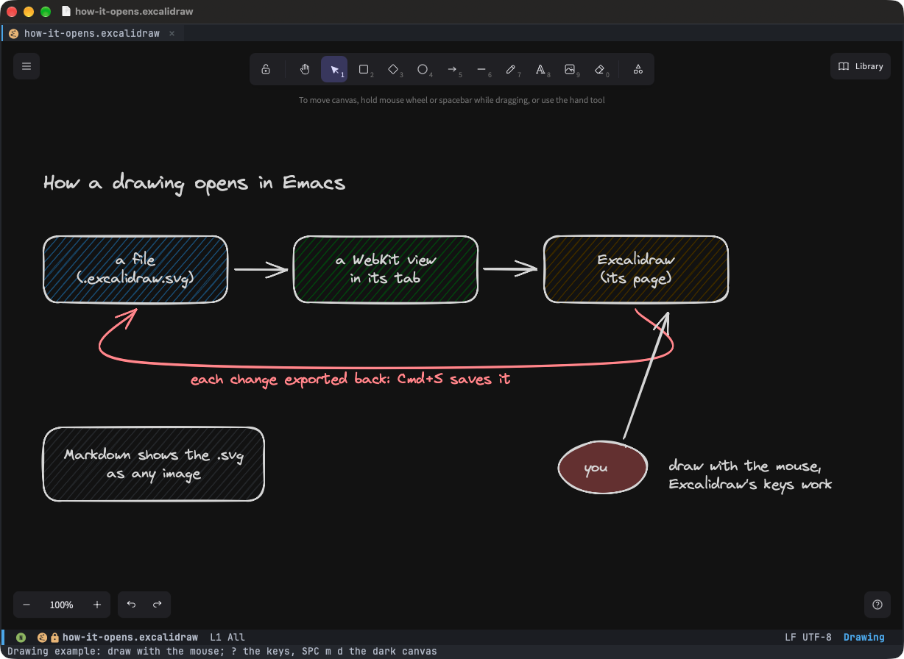

# Drawings

`*.excalidraw.svg` and `*.excalidraw` files open in their tab in [Excalidraw](https://excalidraw.com). A
`.excalidraw.svg` is also an image, so Markdown and GitHub show it. Try it: `M-x +my/example-excalidraw`.

Excalidraw's own keys work (`?` lists them), with `Cmd` on macOS and `Ctrl` on Linux, as Excalidraw has them there.

| macOS | Linux | Action |
|---|---|---|
| `Cmd+S` | `Ctrl+S` | Save |
| `Cmd+C` / `Cmd+X` / `Cmd+V` | `Ctrl+Shift+C` / `Ctrl+Shift+X` / `Ctrl+Shift+V` | Copy / cut / paste, through the kill ring |
| `Cmd+Z` / `Cmd+Shift+Z` | `Ctrl+Z` / `Ctrl+Shift+Z`, `Ctrl+Y` | Undo / redo (Excalidraw's) |
| `Cmd+G` / `Cmd+Shift+G` | right click → Group / `Ctrl+Shift+G` | Group / ungroup |
| `Cmd+[` / `Cmd+]` | right click → Send backward / `Ctrl+]` | Send backward / bring forward |
| `Cmd+=` / `Cmd+-` / `Cmd+0` | `Ctrl+=` / `Ctrl+-` / `Ctrl+0` | Zoom in / out / reset |
| `SPC m d` | `SPC m d` | Dark canvas |
| `SPC m l` | `SPC m l` | Browse libraries |
| `SPC m r` | `SPC m r` | Reload the file |
| `Option+Enter` → **Insert a new drawing** | `Alt+Enter` → **Insert a new drawing** | In Markdown: link a new drawing at point |
| `M-x +my/excalidraw-insert` | `M-x +my/excalidraw-insert` | In Org: link a new drawing at point (Org keeps `Option+Enter` for a new heading) |
| `C-c C-d` | `C-c C-d` | In your agent's session: draw for the agent ([more](agent-shell.md#drawing-for-the-agent)) |

- On Linux, `Ctrl+G` stays Emacs's (quit), and Emacs reads `Ctrl+[` as `Esc`. So grouping and sending backward are in
  the selection's right-click menu there.
- A drawing opens all in view, centred: at 100% if it fits its pane, else zoomed out to fit. It stays fitted as the pane
  is resized, until you zoom or scroll.
- The library is shared by all drawings.
- Drawings need an Emacs with xwidgets (see [PDFs](pdf.md)). Without it, a drawing opens as its file: an
  `.excalidraw.svg` as an image.
