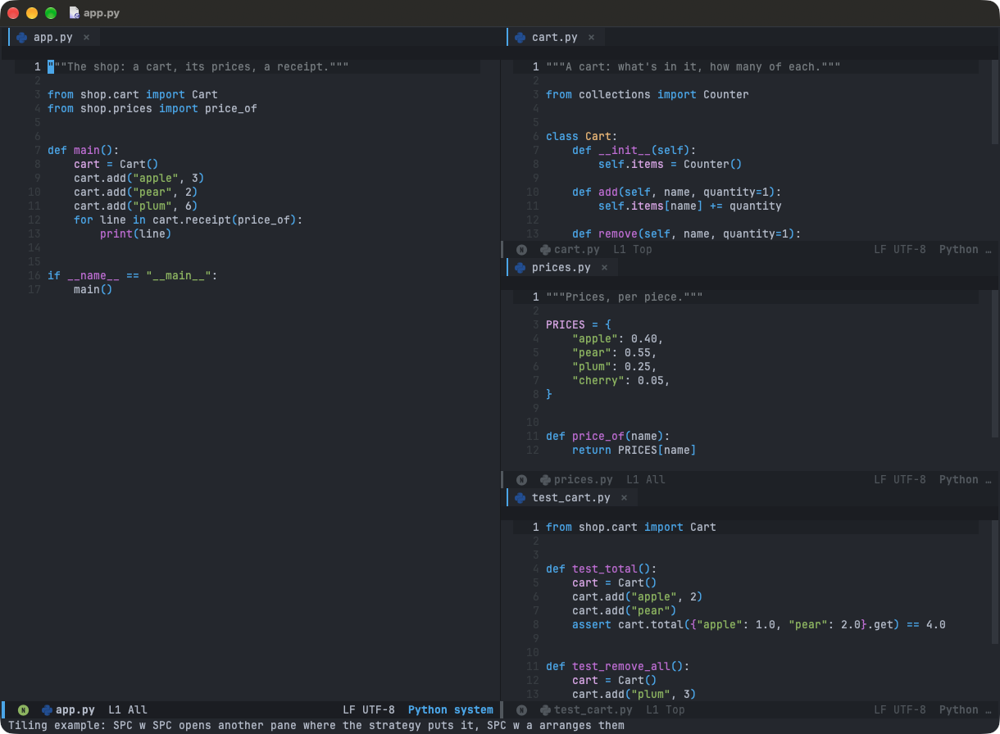
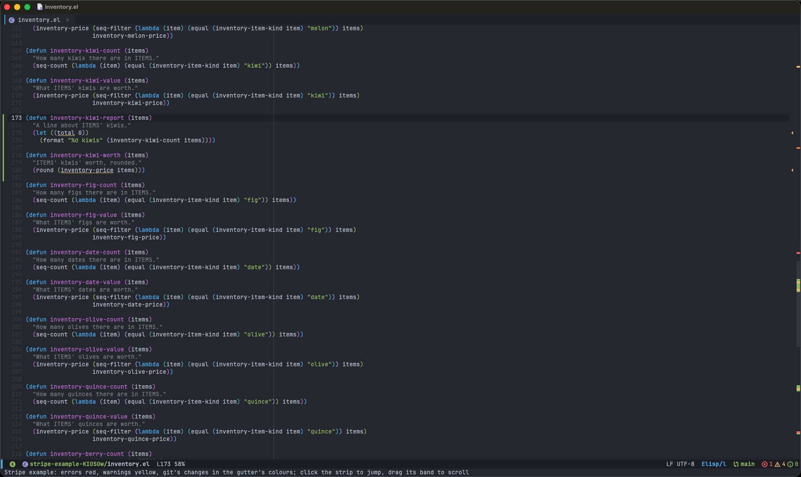
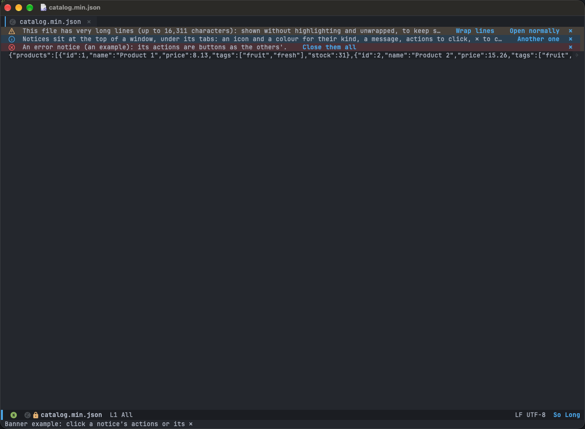

# The editor

## Tabs per window

Each window has its own tabs: the files shown in it (and new buffers, `SPC b N`, and the buffer list, `SPC b i`), of
the current workspace. A file, or the buffer list, closes once no window has it as a tab (the buffer list's `q` too).

| macOS | Linux | Action |
|---|---|---|
| `gt` / `gT` | `gt` / `gT` | Next / previous tab |
| `Cmd+1`..`Cmd+8`, `Cmd+9` | `Ctrl+1`..`Ctrl+8`, `Ctrl+9` | Tab 1 to 8, the last tab |
| `Cmd+W`, middle click | `Ctrl+Shift+W`, middle click | Close the tab, and the window with its last tab |
| Right click | Right click | Close the others, split vertically / horizontally |

The buffer list (`SPC b i`) is grouped by workspace: each buffer under the workspace it's in (the issues, a Claude
session too), those in none under Default.

## Tiling

Emacs is tiling first:

- Applications (Claude Code, the terminal, magit, the Markdown preview, drawings, issues) open in a new pane where the
  tiling strategy puts it; one already open (shown, or a tab under a file), in its pane. Inside magit, a log or a diff
  stays in its pane; a commit opens in a new one. `SPC o C` (Claude Code) and `SPC o T` (a terminal) open in the window
  you're in instead.
- Then they behave as any buffer: a file opened in their pane is a tab there, and they keep theirs.
- Files always open as a tab in the current pane, whatever pane it is. From a popup or the sidebar, in the last pane
  used.
- A pane closes with its last tab (`Cmd+W`, `SPC b k`). When one closes (however: `SPC w d`, `q`, its last tab), the
  stacked panes share its rows again, at equal heights.

Which applications open in a new pane is chosen in `config.el`: `(setq +my/tiling-apps 'all)` (the default), or a list
of `claude`, `terminal`, `preview`, `drawings`, `magit`, `issues`, `agent-ui`, `html` (`M-x customize-variable
+my/tiling-apps` ticks them). One left out opens as it would without tiling (the terminal as a popup); an unknown name
is warned about at startup.

The strategy, chosen in `config.el` (`(setq +my/tiling-strategy 'tall)`), says where the panes go:

| Strategy | Layout |
|---|---|
| `tall` | The main pane on the left, the others stacked on the right |
| `tall-right` | The main pane on the right, the others stacked on the left |
| `wide` | The main pane on top, the others side by side below it |
| `fullscreen` | The current pane alone, the others hidden behind it in order |
| `bsp` | No main pane: each new pane halves the current one along its longer side |

`SPC w SPC` opens a new pane showing the current buffer, `SPC w a` arranges the panes again (in the strategy chosen,
the main pane staying the main one), and `SPC w RET` moves the current pane's buffer to the main pane (the main's to
its place). `SPC w ]` / `SPC w [` make the main pane bigger / smaller, from any pane (`]` / `[` again repeat it).
`SPC w }` / `SPC w {` make the current pane bigger / smaller among the others, which stay even (`}` / `{` again repeat
it); it keeps its size when you arrange the panes, open one or close another.

| Strategy | `SPC w ]` / `SPC w [` | `SPC w }` / `SPC w {` |
|---|---|---|
| `tall`, `tall-right` | The main pane's width (the same for both) | A stacked pane's height |
| `wide` | The main pane's height | A pane's width in the row below |
| `fullscreen` | Nothing to resize | Nothing to resize |
| `bsp` | The current pane's half of its split | Its split's half of the one above |

In `fullscreen`, a new pane opens alone, just after the current one, and closing it (`SPC w d`, its last tab, `q`)
shows the next one. Each workspace keeps its own hidden panes. Choosing another strategy shows them all again at its
next `SPC w a` or `SPC w SPC`, laid out its way.

In `bsp`, `SPC w a` lays the panes out as a spiral, each halving the last, and when a pane closes, its space goes to
its neighbour and every split runs along its longer side again. Splits are always even: a resize lasts until the
panes are laid out again.

| macOS | Linux | Action (`fullscreen`) |
|---|---|---|
| `SPC w w` / `SPC w W` | `SPC w w` / `SPC w W` | The next / previous pane in front (in the other strategies, the next / previous window) |
| `SPC w RET` | `SPC w RET` | The pane in front becomes the first, the main one when another strategy lays them out |

Try it: `M-x +my/example-tiling`.

Without `(load! "config/tiling")` in `config.el`, each opens where it would on its own.

## Error stripe

A strip at the right edge of a file's window maps the whole file, as IntelliJ's does:
- diagnostics: errors (red), warnings (yellow), suggestions (dim yellow: LSP hints and information);
- TODO comments: `TODO`, `FIXME`, `HACK` (blue);
- git changes: added, changed and deleted lines, in the gutter's colours;
- the part on screen, a light band.

Where marks overlap the most important wins: error > warning > TODO > deleted > changed > added > suggestion.
Click a mark to jump to it, drag the band to scroll. Try it: `M-x +my/example-stripe`.

## Notices

Notices at the top of a window, with action buttons. Markdown files offer the [live preview](markdown.md); HTML files
offer to open them in your browser (`M-x +my/html-open-in-emacs` shows one in WebKit, in a pane); files with lines over 5,000 characters open plain, and offer to wrap them or open
them normally. Large files (over 20,000 lines or 1 MB) open at once without the language server, spelling, syntax
checking, the sticky header and the error stripe, and offer to open them normally. Try it: `M-x +my/example-banner`.

## Sticky header

The header line shows the classes and functions the top line is inside (`class Api { › fun call(x: Int) {`); in
Markdown, the headings (`# Guide › ## Setup`); in a Dockerfile, the stage (its `FROM` line). Before any, the file's
path in its project.

A tree-sitter language gets it from its major mode: the functions it declares (Python, Java, TypeScript, Rust, C, Lua,
CSS, JSON, YAML...), else its outline (Markdown, Dockerfile). A mode declaring neither needs its scopes' node types in
`+my/sticky-defun-types` (Kotlin's are there); an entry there also replaces a mode's own, set in `config.el`.

## Code

| macOS | Linux | Action |
|---|---|---|
| `Cmd+B` | `Ctrl+Shift+B` | Go to the declaration; on the declaration, list the usages |
| `Cmd+[` / `Cmd+]` | `Alt+←` / `Alt+→` | Back / forward (`C-o` / `C-i` on both) |
| `Option+Enter` | `Alt+Enter` | Spelling fixes, code actions and [Claude](claude-code.md), in one menu |
| `SPC c ~` | `SPC c ~` | Cycle the word through snake_case, UPPER_CASE, PascalCase, camelCase and kebab-case |

Spelling knows ~40k programming words and checks camelCase words part by part.

## Behaviour

- New windows take focus; `SPC w S` / `SPC w V` split and leave it.
- Saving returns to normal state.
- `q` closes transient menus.
- A thin line marks column 120, or a project's `.editorconfig` `max_line_length`.
