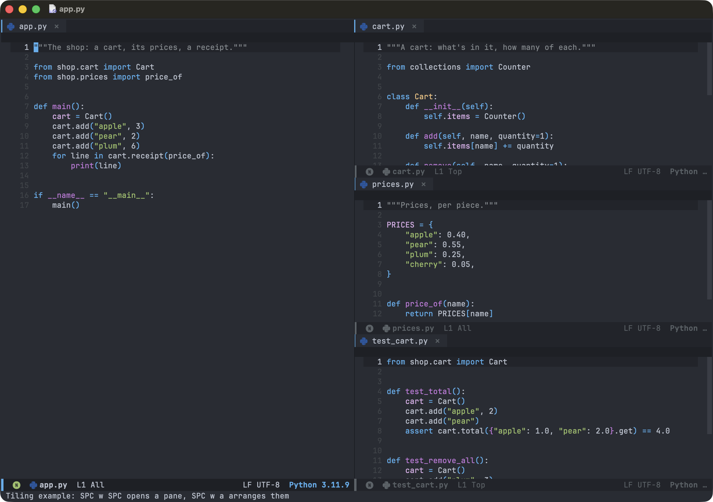
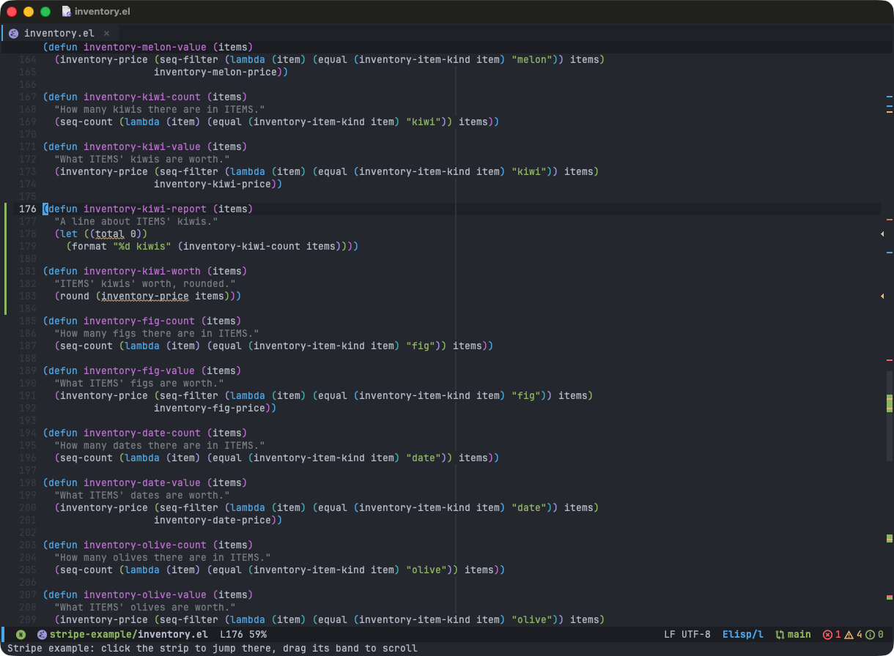
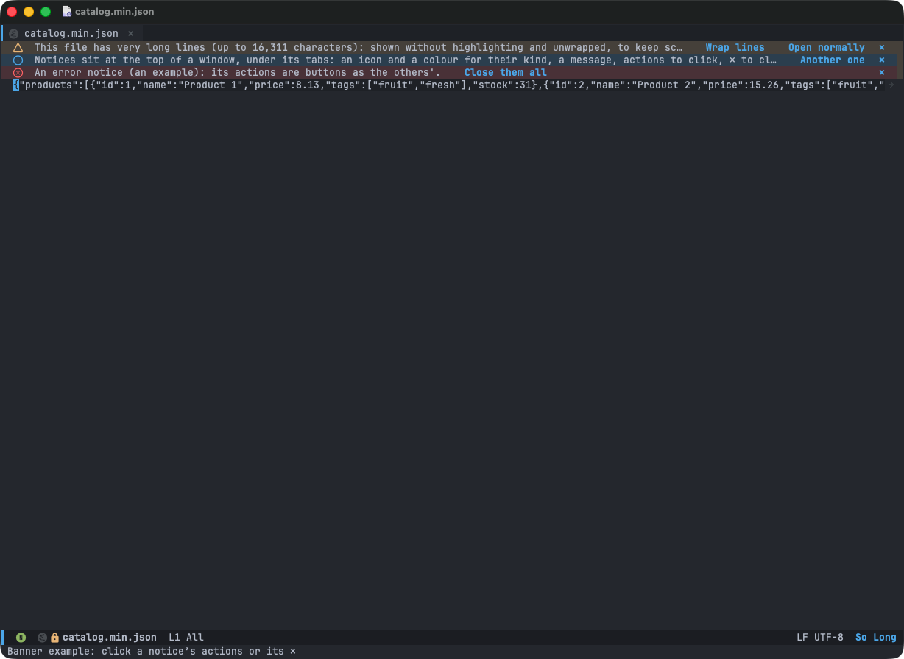

# The editor

This config changes how windows and files work. Each window has its own tabs, applications open in tiled panes, and
files get an error stripe, notices and a sticky header.

## Tabs per window

Each window has its own tabs: the files shown in it, new buffers (`SPC b N`), the buffer list (`SPC b i`), and the
issue list and its issues (`SPC o i`). The tabs are the current workspace's buffers only.

| macOS | Linux | Action |
|---|---|---|
| `gt` / `gT` | `gt` / `gT` | Next / previous tab |
| `Cmd+1`..`Cmd+8` | `Ctrl+1`..`Ctrl+8` | Tab 1 to 8 |
| `Cmd+9` | `Ctrl+9` | The last tab |
| `Cmd+W`, middle click | `Ctrl+Shift+W`, middle click | Close the tab, and the window with its last tab |
| Right click | Right click | A menu: close the others, split vertically or horizontally |

- A file, the buffer list or the issues close once no window has them as a tab. The buffer list and the issues also
  close with their `q`.
- The buffer list (`SPC b i`) is grouped by workspace. Each buffer is under the workspace it's in, and so are the
  issues and an agent's session. Buffers in no workspace are under Default.

## A minibuffer left open

A prompt still open while you're in another window, such as `M-x` or a question, is tinted with the theme's yellow.
It's waiting for you. Click it to answer, or press `C-g` there to cancel it. The tint goes as soon as you're back.

## Tiling

Emacs is tiling first. Applications open in a new pane, where the tiling strategy puts it. Files open as tabs in the
current pane, and a pane closes with its last tab.

| Key | Action |
|---|---|
| `SPC w SPC` | A new pane, showing the current buffer |
| `SPC w a` | Arrange the panes again, the main pane staying the main one |
| `SPC w RET` | Move the current pane's buffer to the main pane, and the main's to its place |
| `SPC w ]` / `SPC w [` | The main pane bigger / smaller, from any pane (`]` / `[` again repeat it) |
| `SPC w }` / `SPC w {` | The current pane bigger / smaller among the others (`}` / `{` again repeat it) |
| `SPC w e` | Choose another strategy for the session (`M-x +my/tiling-choose-strategy`) |
| `SPC w TAB` / `SPC w S-TAB` | The next / previous strategy (`TAB` / `S-TAB` again go on) |
| `SPC w w` / `SPC w W` | The next / previous window |
| `SPC o C` / `SPC o T` | Your agent / a terminal in the window you're in, not in a new pane |
| `M-x +my/example-tiling` | Try it |

- Applications are your agent's sessions, the terminal, Magit, the Markdown and Mermaid previews, drawings, Agent UI
  and HTML pages. One already open, shown or as a tab under a file, opens in its pane.
- Inside Magit, a log or a diff stays in its pane. A commit opens in a new one.
- `SPC o T` from a popup or the sidebar opens in the last pane used.
- Once open, applications behave as any buffer. A file opened in their pane is a tab there, and they keep their own.
- Files always open as a tab in the current pane, whatever pane it is. From a popup or the sidebar, they open in the
  last pane used.
- A pane closes with its last tab (`Cmd+W`, `SPC b k`). However a pane closes (`SPC w d`, `q`, its last tab), the
  stacked panes share its rows again, at equal heights.
- A [merge](git.md#resolving-conflicts) keeps its bar and three panes together. An application or a file opened during
  it goes in a pane beside them, and `SPC w a` leaves them as they are.
- [Agent UI](agent-ui.md#in-the-sessions-pane) is part of its session's pane. Laying the panes out, resizing them and
  fullscreen take it along with the session.
- Without `(load! "config/tiling")` in `config.el`, each application opens where it would on its own.

### Strategies

The strategy says where the panes go.

| Strategy | Layout |
|---|---|
| `tall` | The main pane on the left, the others stacked on the right |
| `tall-right` | The main pane on the right, the others stacked on the left |
| `wide` | The main pane on top, the others side by side below it |
| `fullscreen` | The current pane alone, the others hidden behind it in order |
| `bsp` | No main pane: each new pane halves the current one along its longer side |

- `SPC w e` and `SPC w TAB` lay the panes out the new way at once. The echo area says which strategy it is
  (`Tiling: wide (3/5)`).
- Another workspace's panes follow at its next `SPC w a`.

What the resize keys change depends on the strategy:

| Strategy | `SPC w ]` / `SPC w [` | `SPC w }` / `SPC w {` |
|---|---|---|
| `tall`, `tall-right` | The main pane's width (the same for both) | A stacked pane's height |
| `wide` | The main pane's height | A pane's width in the row below |
| `fullscreen` | Nothing to resize | Nothing to resize |
| `bsp` | The current pane's half of its split | Its split's half of the one above |

A pane resized with `SPC w }` / `SPC w {` keeps its size when you arrange the panes, open one or close another.

### The fullscreen and bsp strategies

In `fullscreen`, one pane is in front and the others are hidden behind it. Some keys work differently there.

| Key | Action (`fullscreen`) |
|---|---|
| `SPC w w` / `SPC w W` | Bring the next / previous pane to the front |
| `SPC w RET` | Make the pane in front the first one. It becomes the main pane when another strategy lays them out |

- A new pane opens alone, just after the current one. Closing it (`SPC w d`, its last tab, `q`) shows the next one.
- A pane that opens by itself, such as a canvas from a shell, goes behind the current one, just after it. `SPC w w`
  brings it up.
- Each workspace keeps its own hidden panes.
- Choosing another strategy shows them all again, laid out its way. It shows as many as it has room for, and the rest
  stay hidden.

In `bsp`:

- `SPC w a` lays the panes out as a spiral, each halving the last.
- When a pane closes, its space goes to its neighbour, and every split runs along its longer side again.
- Splits are always even. A resize lasts until the panes are laid out again.

### Settings

Set these in `config.el`:

| Setting | Default | What |
|---|---|---|
| `+my/tiling-strategy` | `'tall` | The strategy: `tall`, `tall-right`, `wide`, `fullscreen` or `bsp` |
| `+my/tiling-apps` | `'all` | The applications that open in a new pane: `all`, or a list of `agent-shell`, `terminal`, `preview` (the Markdown and Mermaid previews), `drawings`, `magit`, `agent-ui`, `html` |

- `M-x customize-variable +my/tiling-apps` lets you tick them.
- An application left out opens as it would without tiling. The terminal, for one, opens as a popup.
- An unknown name is warned about at startup.

## Error stripe

A strip at the right edge of a file's window maps the whole file. It marks errors, TODOs and git changes, and a light
band shows the part of the file on screen.

| Key | Action |
|---|---|
| Click the strip | Jump to that part of the file |
| Drag the band | Scroll |
| `M-x +my/example-stripe` | Try it |

- Diagnostics: errors in red, warnings in yellow, suggestions in dim yellow (LSP hints and information).
- TODO comments: `TODO`, `FIXME` and `HACK`, in blue.
- Git changes: added, changed and deleted lines, in the gutter's colours.
- Where marks overlap, the most important wins: error, then warning, TODO, deleted, changed, added, and suggestion.

## Notices

Notices show at the top of a window, with buttons for their actions. Some kinds of files open with one.

| File | Notice |
|---|---|
| Markdown | Offers the [live preview](markdown.md) |
| HTML | Offers to open it in your browser, or [in Emacs](#html-pages) |
| Lines over 5,000 characters | Opens plain, and offers to wrap the lines or open it normally |
| Over 20,000 lines or 1 MB | Opens at once, without the language server, spelling, syntax checking, the sticky header and the error stripe. Offers to open it normally |

| Key | Action |
|---|---|
| Click a button | Do what it says |
| Click `✕` | Close the notice |
| `M-x +my/example-banner` | Try it: a notice of each kind |

## HTML pages

An HTML file or a URL can open as a page in WebKit, in a pane. Links out of it open in your browser. In a terminal, or
in an Emacs without WebKit, the page opens in your browser instead.

| Key | Action |
|---|---|
| `M-x +my/html-open-in-emacs` | Open an HTML file or a URL as a page |
| `j` / `k`, `C-d` / `C-u`, `gg` / `G` | Scroll |
| `h` / `l` | Scroll sideways |
| `+` / `-` / `0` | Zoom in / out / back to its own size, in all the page's panes |
| `W` | As wide as the pane |
| `gr` | Reload, as opening it again does |
| `y`, `Cmd+C` | Copy the selection (Linux: `y`, `Ctrl+Shift+C`) |
| `q` | Close |

## Sticky header

The header line shows the classes and functions the window's top line is inside. Before any, it shows the file's path
in its project.

| File | Header |
|---|---|
| Code | The classes and functions: `class Api { › fun call(x: Int) {` |
| Markdown | The headings: `# Guide › ## Setup` |
| Dockerfile | The stage: its `FROM` line |

- In a narrow pane the header fits. The scopes are cut to their names (`class Api › fun call`), then the outer ones are
  dropped (`… › fun call`). The path is cut from the left, keeping the file's name.
- A tree-sitter language gets its scopes from its major mode. These are the functions the mode declares (Python, Java,
  TypeScript, Rust, C, Lua, CSS, JSON, YAML...), or else its outline (Markdown, Dockerfile).
- A mode declaring neither needs its scopes' node types in `+my/sticky-defun-types`. Kotlin's are there.
- An entry in `+my/sticky-defun-types`, set in `config.el`, also replaces a mode's own.

## Code

| macOS | Linux | Action |
|---|---|---|
| `Cmd+B` | `Ctrl+Shift+B` | Go to the declaration. On the declaration, list the usages |
| `Cmd+[` / `Cmd+]` | `Alt+←` / `Alt+→` | Back / forward (`C-o` / `C-i` on both) |
| `Option+Enter` | `Alt+Enter` | Spelling fixes, code actions and [your agent](agent-shell.md), in one menu |
| `SPC c ~` | `SPC c ~` | Cycle the word through snake_case, UPPER_CASE, PascalCase, camelCase and kebab-case |

Spelling knows about 40,000 programming words, and checks camelCase words part by part.

## Language servers

Inlay hints, semantic highlighting and colour swatches are on. Inlay hints are in the comment colour. A code lens sits
at the end of its line, or above the line when they don't fit the pane together.

| Language | Inlay hints | Code lenses |
|---|---|---|
| Kotlin (kotlin-lsp) | Types, parameter names, chained calls | |
| Python (basedpyright) | Variable and return types, argument names | |
| Rust (rust-analyzer) | Types, parameter names, method chains, closure return types, lifetimes | `▶ Run`, implementations, references |
| TypeScript / JavaScript (TypeScript 7) | Parameter names of literals, return types, enum values | References, implementations |

Other languages get their server's own.

`Cmd+B` (Linux: `Ctrl+Shift+B`) on a declaration lists its usages in a peek under it. Each usage shows its line, the
function it's in and its code, beside a preview of the selected one. In a pane under 70 columns, the list shows alone.

| Key | Action |
|---|---|
| `j` / `k` | Next / previous usage |
| `C-j` / `C-k` | Next / previous file |
| `RET` / `M-RET` | Open the usage / in the other window |
| `Esc` | Close |

## Behaviour

- New windows take focus. `SPC w S` / `SPC w V` split and keep the focus where it was.
- Saving returns to normal state.
- `q` closes transient menus.
- A thin line marks column 120, or a project's `.editorconfig` `max_line_length`.
- The line you're on is always shown whole, at a window's bottom too, as in an agent's prompt. Only a scroll leaves it
  cut.
