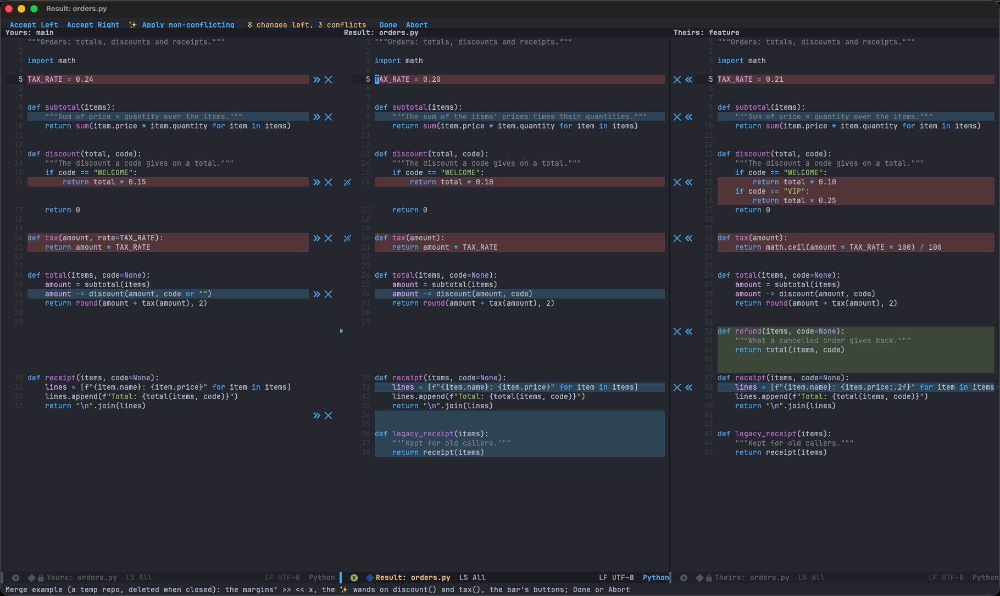
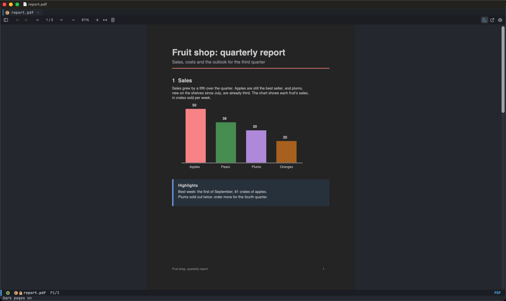
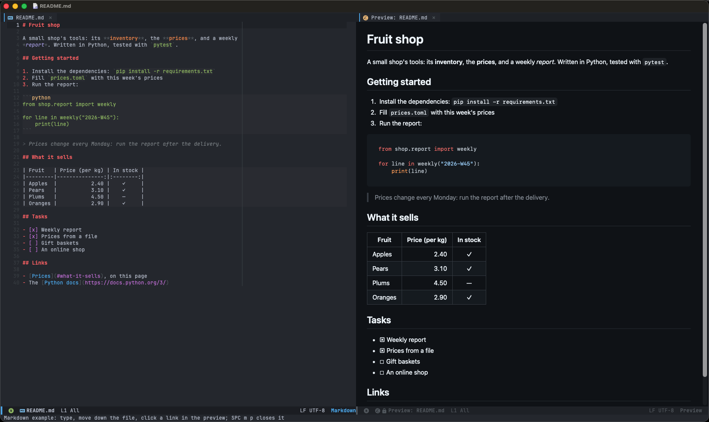
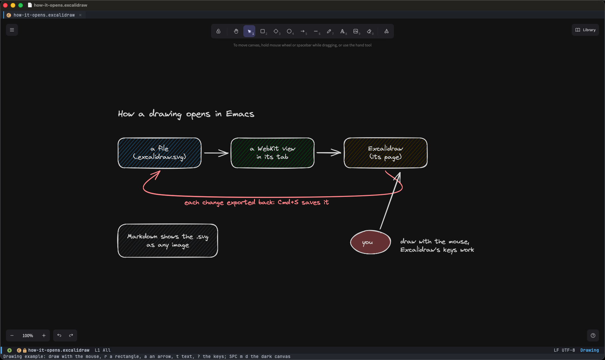
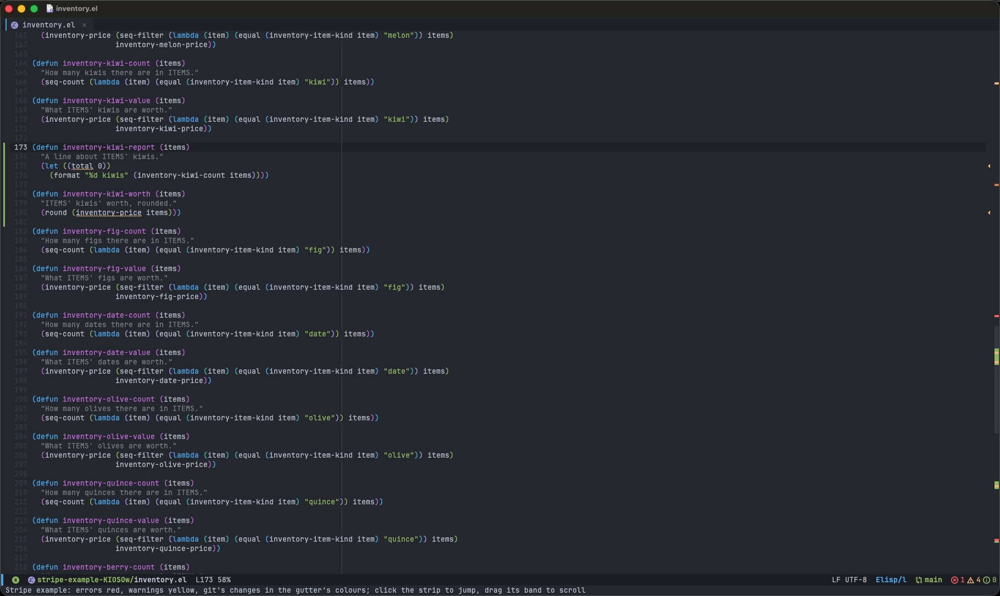
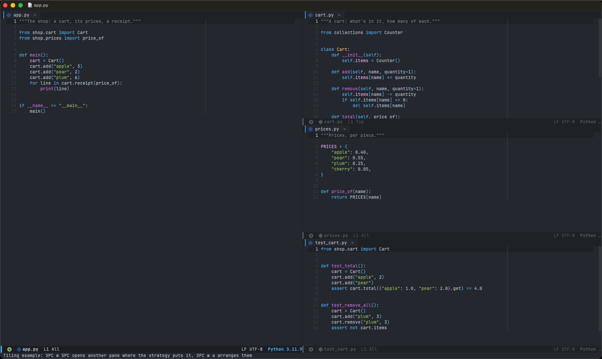
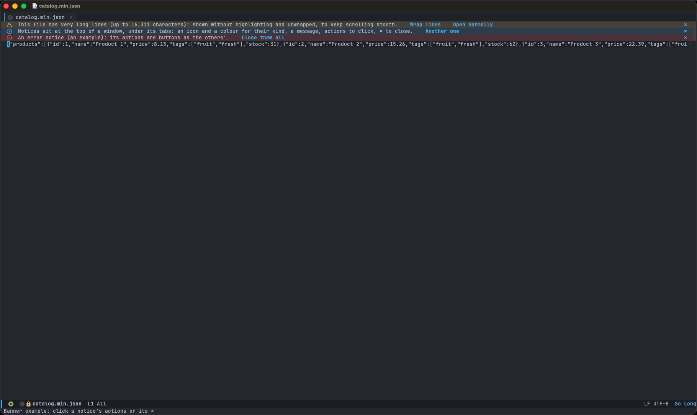

# Examples

`examples/` has an example of each feature that needs something set up to be seen, such as a Git repository in
conflict. `M-x +my/example` picks one in the minibuffer, and `M-x +my/example-NAME` runs one directly. An example
opens the feature as you'd come to it, on files of its own in the temp folder, and leaves nothing behind: its files are
deleted once you're done with it. Doom doesn't load `examples/` at startup: `config/examples.el` makes each
`+my/example-NAME` command, which loads `examples/NAME.el` when first run.

| Example | What it shows |
|---|---|
| `merge` | [Resolving conflicts](git.md#resolving-conflicts) in three panes. A temp repository merges `feature` into `main` and `orders.py` conflicts every way the panes handle: a conflict over one word (the tax rate: keep one, or both), two the ✨ wand merges (`discount()`, `tax()`), a change of each side alone, lines added (`refund()`), lines removed (`legacy_receipt()`), and the same change on both sides (a docstring). Try anything: the repository is deleted once the merge is closed (Done or Abort), along with whatever Done saved. |
| `pdf` | [A PDF in WebKit](editor.md#pdfs-in-webkit), its pages dark. A short report (three pages: headings, text, coloured charts, an outline) opened in PDF.js, then dark pages turned on (`SPC m d`): inverted to dark greys, the charts' hues kept. Closing it deletes the file and forgets its place, and dark pages go back to how they were. |
| `markdown` | [The live Markdown preview](markdown.md#live-markdown-preview). A README (headings, lists, a table, code, a quote, links) with its preview beside it: it re-renders as you type and follows the cursor. |
| `excalidraw` | [A drawing in Excalidraw](editor.md#drawings-excalidraw): how a drawing opens in Emacs, in boxes, arrows and labels. Draw with the mouse, Excalidraw's keys work, `Cmd+S` saves it. |
| `stripe` | [The error stripe](editor.md#error-stripe). An Emacs Lisp file in a temp repository, changed since its commit (lines changed, added, removed) and with mistakes the byte compiler finds: four warnings through the file, an error at its end. Flycheck byte-compiles only trusted files (Emacs 30), so the example trusts its own folder while it's open. |
| `tiling` | [Tiling](editor.md#tiling-spc-w-spc). A small project's four files in panes, as `SPC w SPC` opens them: the first on the left, the others stacked on the right. |
| `banner` | [Notices](editor.md#notices), one of each kind. A minified catalog (one very long line) opens plain, so the config's own warning says so, with its actions. An info notice ("Another one" adds a notice) and an error notice ("Close them all") are the example's own. |

To add one: `examples/NAME.el` defines the command `+my/example-NAME` (interactive), sets up what it needs in the temp
folder, opens the feature and deletes its files once it's closed. Add it to this table and to the list in
`config/examples.el`, and test it in `tests/unit/test-examples.el` (and `tests/e2e/test-examples.el` for what needs a
GUI). If it takes a moment to be drawn (a WebKit page), define `+my/example-NAME-ready`, true once it is: the
screenshots wait for it. Then take its screenshot (below).

## What they look like

| Example | Screenshot |
|---|---|
| `merge` |  |
| `pdf` |  |
| `markdown` |  |
| `excalidraw` |  |
| `stripe` |  |
| `tiling` |  |
| `banner` |  |

## Screenshots

Each example has a screenshot next to it, `examples/NAME.png`, made by `scripts/screenshots.sh`:

```sh
scripts/screenshots.sh           # every example
scripts/screenshots.sh merge     # those named
```

It runs a GUI Emacs of its own with this config's look: `doom-one`, JetBrains Mono 13, Doom's mode line, line numbers,
current line and git gutter (its `ui/vc-gutter` module's own code, `+pretty`), and the config's window, tab, editor and
feature settings. PDF.js and Excalidraw are copies of Doom's, not downloaded again. Its setup is the tests' (`tests/helper.el`, its own temp folders), so your
Doom profile and a running Emacs aren't touched. For each example, it opens it in a large frame kept above the other
windows, waits a moment for it to be drawn, and captures the frame's rectangle with macOS's `screencapture` (title bar
included). Then it closes the example, so its files are deleted as usual.

- **Permission:** the terminal you run it from needs the Screen Recording permission (*System Settings → Privacy &
  Security → Screen & System Audio Recording*); macOS asks the first time. Once it's allowed, quit and reopen the
  terminal: macOS applies it only then. Without it, an example isn't captured, and the script says so, with
  `screencapture`'s own message and exit status, and exits 1.
- **Variables:** `EMACS_GUI` (default: the emacs-plus app) is the Emacs it runs, `SCREENCAPTURE` the capture program,
  and `SCREENSHOT_DIR` (default: `examples/`) where the PNGs go.
- **Code:** `scripts/screenshots.el` is the part that runs inside that Emacs. `tests/unit/test-screenshots.el` tests it
  with a stand-in for `screencapture`.
