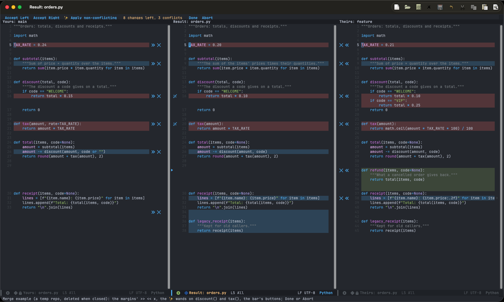

# Git

## Magit

- Diffs are rendered by `git-delta`.
- The status buffer lists the repository's TODO comments.
- The log draws the branch graph with lines, a colour per lane, and the author and date in the margin (hidden in a pane
  too narrow for it).

## File diff

`SPC g d` shows the current file's changes in a new pane, on the hunk of the line you're on; from another file, the
pane shows that one's. It refreshes when the file is saved.

| Key | Action |
|---|---|
| `s` / `u` / `x` | Stage, unstage or discard the hunk |
| `RET` | Go to the line |
| `SPC g d` / `q` / `Esc` | Close the diff (its pane too, unless it has other tabs) |

## Resolving conflicts

`e` on a conflicted file in Magit opens three panes, **Yours**, the **Result** and **Theirs**, lined up and scrolling
together. Try it: `M-x +my/example-merge`.

Each change has buttons in its margin: `>>` / `<<` put it in the Result, `x` ignores it (the Result keeps what it has
there), and `✨` merges both sides word by word. A change you edit by hand in the Result is done too. The bar at the top
accepts the rest from one side or every non-conflicting change, and ends with **Done** (save and stage) or **Abort**.

| Key | Action |
|---|---|
| `]c` / `[c` | Next / previous change |
| `SPC m l` / `SPC m r` / `SPC m x` | Take the change from Yours / Theirs / ignore it |
| `SPC m w` | Merge word by word |
| `SPC m L` / `SPC m R` / `SPC m a` | Accept left / right / non-conflicting |
| `C-c C-c` / `C-c C-k` | Done / Abort |

It works for merges, rebases, cherry-picks and stash pops, also in a terminal. `M-x +my/merge-all` resolves every
conflicted file in turn; from the shell, use [`cmd/diff`](cmd.md).
