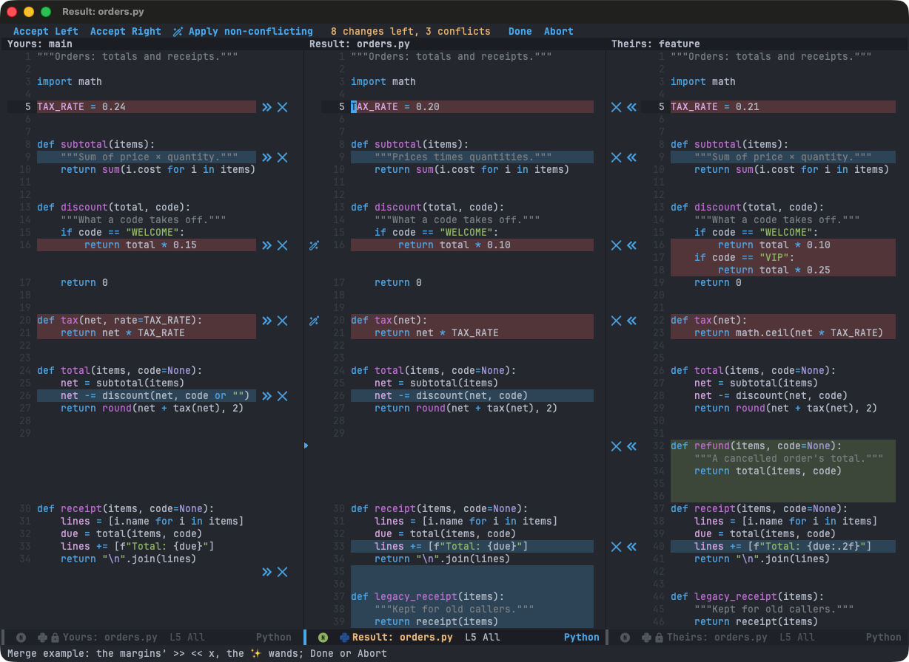

# Git

Magit with a few additions, a file's diff in a pane of its own, and a three-way merge for conflicts.

## Magit

- Diffs are rendered by `git-delta`.
- The status buffer lists the repository's TODO comments.
- The log draws the branch graph with lines, a colour per lane. The author and date are in the margin, hidden in a pane
  too narrow for them.

## File diff

`SPC g d` shows the current file's changes in a new pane, at the hunk of the line you're on. Pressed in another file,
the pane shows that file's changes. It refreshes when the file is saved.

| Key | Action |
|---|---|
| `SPC g d` | The file's diff in a pane |
| `s` / `u` / `x` | Stage, unstage or discard the hunk |
| `RET` | Go to the line |
| `SPC g d` / `q` / `Esc` | Close the diff, and its pane unless it has other tabs |

## Resolving conflicts

`e` on a conflicted file in Magit opens three panes: **Yours**, the **Result** and **Theirs**. They're lined up and
scroll together. Try it: `M-x +my/example-merge`.

| Key | Action |
|---|---|
| `e` (in Magit, on a conflicted file) | Resolve its conflicts |
| `M-x +my/merge-all` | Resolve every conflicted file of the repository, one after the other |
| `]c` / `[c` | Next / previous change |
| `SPC m l` / `SPC m r` / `SPC m x` | Take the change from Yours / Theirs / ignore it |
| `SPC m w` | Merge the change word by word |
| `SPC m L` / `SPC m R` / `SPC m a` | Every change left from Yours / from Theirs / every non-conflicting one |
| `C-c C-c` / `C-c C-k` | Done (save and stage) / Abort |

- Each change has buttons in its margin. `>>` / `<<` put it in the Result, and `x` ignores it: the Result keeps what it
  has there. `✨` merges both sides word by word.
- A change you edit by hand in the Result is done too.
- The bar at the top takes the rest from one side, or every non-conflicting change. It ends with **Done** (save and
  stage) and **Abort**.
- In a frame under 120 columns, Yours and Theirs are above the Result. `+my/merge-side-by-side-width` sets that width.
- It works for merges, rebases, cherry-picks and stash pops, and in a terminal too.
- From the shell, use [`cmd/diff`](cmd.md).
