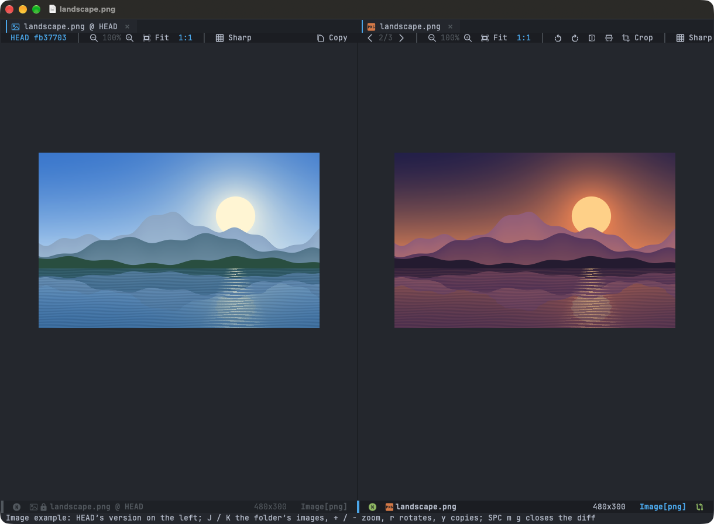

# Images

Images open in Emacs's own viewer, in their tab, with a toolbar in the header line: the folder's images, zoom, rotate,
flip, crop, sharp pixels, the image's size, copy, git's HEAD beside it, Preview (Linux: Open). In a narrow pane it keeps
what fits, the rest in the menu of its `…` button. A file changed on disk (a regenerated screenshot) is shown anew, its
zoom kept. Try it: `M-x +my/example-image`.

| macOS | Linux | Action |
|---|---|---|
| `J` / `K` | `J` / `K` | Next / previous image in the folder |
| `+` / `-`, `Cmd+=` / `Cmd+-`, `Cmd+scroll` | `+` / `-`, `Ctrl+=` / `Ctrl+-`, `Ctrl+scroll` | Zoom in / out |
| `W` / `0` (`Cmd+0`) | `W` / `0` (`Ctrl+0`) | Fit the window / actual size |
| `r` / `R` | `r` / `R` | Rotate clockwise / anticlockwise |
| `f` / `F` | `f` / `F` | Flip horizontally / vertically |
| `c` | `c` | Crop: drag, `RET` crops, `q` cancels |
| `RET` | `RET` | Play / pause an animation |
| `y`, `Cmd+C` | `y`, `Ctrl+Shift+C` | Copy the image (to paste in other apps) |
| `SPC m y` | `SPC m y` | Copy its path |
| `SPC m g` | `SPC m g` | The image as in git's HEAD, in half of its pane: on its left (above, in a narrow pane); again, closed |
| `SPC m s` | `SPC m s` | Sharp pixels (no smoothing) |
| `SPC m t` | `SPC m t` | The toolbar |
| `SPC m p` / `SPC m f` | `SPC m p` / `SPC m f` | Open in Preview / show in Finder (Linux: the default app / the file manager) |
| `q` | `q` | Close |

Rotating, flipping and cropping change the image, as Preview does: save it as any file (`SPC f s`, or the toolbar's
Save), or revert it (`SPC b r`) to undo. Not SVGs, nor animations. On macOS they use `sips`; on Linux ImageMagick
(`magick`, or `convert` of ImageMagick 6), which cropping needs on both (`scripts/tools.sh` installs it). Copying the
image on Linux needs `wl-copy` (Wayland, the wl-clipboard package) or `xclip` (X11).
