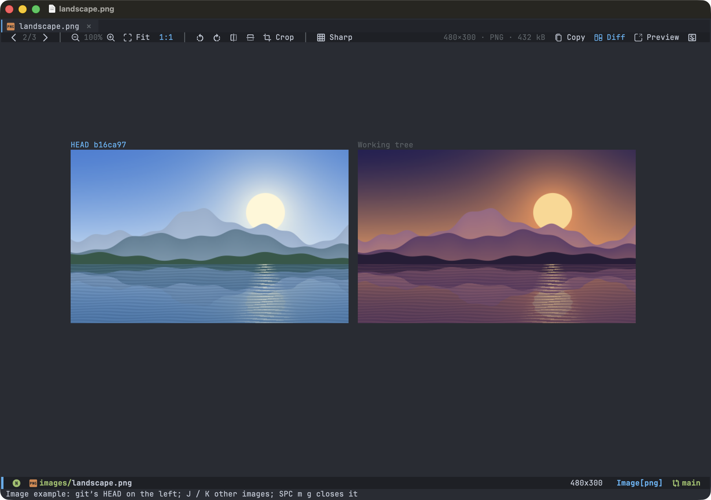

# Images

Images open in Emacs's own viewer, in their tab, with a toolbar in the header line. The toolbar has the folder's images,
zoom, rotate, flip, crop, sharp pixels, the image's size, copy, Git's HEAD beside it, and Preview (Linux: Open). Try it:
`M-x +my/example-image`.

| macOS | Linux | Action |
|---|---|---|
| `J` / `K` | `J` / `K` | Next / previous image in the folder |
| `+` / `-`, `Cmd+=` / `Cmd+-`, `Cmd+scroll` | `+` / `-`, `Ctrl+=` / `Ctrl+-`, `Ctrl+scroll` | Zoom in / out |
| `W` / `0` (`Cmd+0`) | `W` / `0` (`Ctrl+0`) | Fit the window / actual size |
| `r` / `R` | `r` / `R` | Rotate clockwise / anticlockwise |
| `f` / `F` | `f` / `F` | Flip horizontally / vertically |
| `c` | `c` | Crop: drag, `RET` crops, `q` cancels |
| `RET` | `RET` | Play / pause an animation |
| `y`, `Cmd+C` | `y`, `Ctrl+Shift+C` | Copy the image, to paste in other apps |
| `SPC m y` | `SPC m y` | Copy its path |
| `SPC m g` | `SPC m g` | The image beside its version in Git's HEAD; again (or `q`) to close it |
| `SPC m s` | `SPC m s` | Sharp pixels (no smoothing) |
| `SPC m t` | `SPC m t` | The toolbar |
| `SPC m p` / `SPC m f` | `SPC m p` / `SPC m f` | Open in Preview / show in Finder (Linux: the default app / the file manager) |
| `q` | `q` | Close |

- In a narrow pane, the toolbar keeps what fits. The rest goes in the menu of its `…` button.
- A file changed on disk (a regenerated screenshot) is shown anew, its zoom kept.
- Copying the image on Linux needs `wl-copy` (Wayland, the wl-clipboard package) or `xclip` (X11).

## Beside Git's HEAD

`SPC m g`, or the toolbar's Diff, shows the image beside its version in Git's HEAD, in the image's own pane. HEAD is on
the left, or above in a narrow pane, with a caption over each. Both are shown at the image's zoom.

- Zoom, `W`, `0` and Sharp change both. `W` fits the pair to the pane.
- It stays while the file changes on disk (shown anew beside HEAD), and while you rotate or flip the image.
- Cropping closes it first. `J` / `K` show the other image without it.

## Editing

Rotating, flipping and cropping change the image, as Preview does. Save it as any file (`SPC f s`, or the toolbar's
Save), or revert it (`SPC b r`) to undo.

- SVGs and animations can't be rotated, flipped or cropped.
- On macOS, rotating and flipping use `sips`. On Linux they use ImageMagick (`magick`, or `convert` of ImageMagick 6).
- Cropping needs ImageMagick on both. `scripts/tools.sh` installs it.
