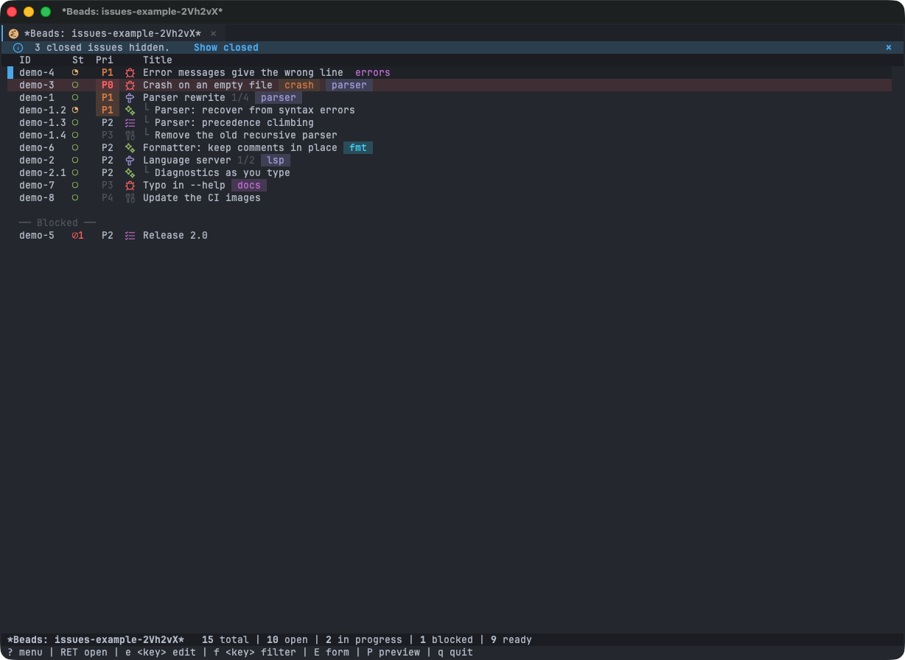

# Issues

A project's issues, tracked with [Beads](https://github.com/gastownhall/beads) (`bd`), a git-backed tracker that keeps
them in the project's `.beads/`, beside the code. Your coding agent (Claude Code, Codex...) uses the same issues as its
memory across sessions, and [beads.el](https://codeberg.org/ctietze/beads.el) shows them in Emacs. Try it:
`M-x +my/example-issues`.

| Key | Action |
|---|---|
| `SPC o i` | The project's issues |
| `SPC o I` | A new issue: title, type, priority |

`scripts/tools.sh` installs `bd`: with Homebrew on macOS, with npm on Linux.

## A project without issues yet

In a project that doesn't track its issues yet, `SPC o i` and `SPC o I` open a terminal at its root. The command
`bd init --skip-agents` is typed there, but not run. Read it, press `RET` to run it, then press `SPC o i` again.

- It adds `.beads/` and `.gitignore`, and commits them along with what's staged.
- It adds no files for AI tools (`CLAUDE.md`, `AGENTS.md`, `.codex/`, `.cursor/`...). Your agent in Emacs is told about
  the issues anyway ([more](agent-shell.md#issues-for-the-agent)).
- For an agent run from a terminal, run `bd setup AGENT` (`claude`, `codex`...) after it.
- To install no git hooks, add `--skip-hooks` before running it.
- The typed command is `+my/beads-init-command`, set in `config/beads.el`.

## The list

`SPC o i` opens the list in the current window and workspace. It shows the work still open, one issue per line. Each
issue's status, priority and type are icons and badges in their colours.

| Key | Action |
|---|---|
| `j` / `k` | The next / previous issue (a title on two lines counts as one) |
| `RET` | Open the issue |
| `P` | Preview the issue under the cursor, beside the list, as you move |
| `c` / `C` | A new issue / a new one, previewed first |
| `e t`, `e s`, `e p`, `e T`, `e d` | Edit its title, status, priority, type, description |
| `E` | Edit all of it in a form (`TAB` next field, `C-c C-c` save, `C-c C-k` cancel) |
| `a` / `A` | Assign it / assign it to yourself |
| `/` | Search the titles and descriptions |
| `f` | Filter: status, priority, type, assignee, label, ready (`f r`), blocked (`f b`) |
| `s`, `o`, `O` | Sections or columns; sort by the next column; reverse the order |
| `H` | Its dependencies, as a tree |
| `S` | The project's statistics |
| `D` / `R` | Delete it / reopen it |
| `gr` | Refresh |
| `?` | Every command, in a menu |
| `q` | Close |

What the rows show:

- **Status:** ○ ready (nothing open blocks it), ◔ in progress, ⊘3 blocked by 3 open issues, ✓ closed. Blocked issues
  are in the Blocked section.
- **Priority:** P0 and P1 stand out, P3 and P4 are muted. A P0 issue's row is tinted with the theme's red.
- **Type:** its icon, or its word in a terminal.
- Statuses and types take the theme's colours.
- The columns are narrow, so the title keeps most of the width. In a pane under 60 columns, the id is hidden too.
- Each row is one line. A long title is cut at the pane's edge.
- Labels follow the title as tags.
- An epic shows its progress (`3/11`, counting its closed issues). Its open issues are listed under it, without the lead
  they share with it (`Agent workspace: `).
- The bar under the list counts the project's issues. In a narrow pane it counts them by icon first (`○5 ◔1 ⊘1 ✓1`:
  ready, in progress, blocked, closed).

How it behaves:

- A notice over the list says how many closed issues it hides, with **Show closed** (then **Hide closed**). `f s closed`
  lists only the closed ones.
- With a filter on, a notice says which one, with **Clear filter**.
- While it's shown, the list refreshes itself every 30 seconds, in the background.
- An issue opened from the list opens below it, and the next ones open in that same window. Issues keep their tabs as
  files do, and close once no window has them as a tab.
- The preview (`P`) opens beside the list, and closes with it. When the list's pane is narrow, the preview takes room
  from the pane next to it.
- In normal state, the list's and an issue's own letter keys win over Vim's. Vim's `gg`, `gt` and `SPC` still work.

| Setting | Default | What |
|---|---|---|
| `+my/beads-closed-shown` | `nil` | `t`: a new list shows the closed issues too |
| `+my/beads-titles-wrapped` | `nil` | `t`: titles shown whole, a long one going on to the next line, under itself |

Set them in `config.el`, as `(setq +my/beads-titles-wrapped t)`.

## An issue

`RET` on an issue in the list opens it. It shows the description, design, acceptance criteria and notes as Markdown,
with the issue's fields, its dependencies and its comments. It also lists the issues depending on it: an epic's issues,
or what a blocker holds up.

| Key | Action |
|---|---|
| `e d`, `e D`, `e a`, `e n` | Edit the description, design, acceptance criteria, notes (`C-c C-c` saves) |
| `e t`, `e s`, `e p`, `e A`, `e l a` | Edit the title, status, priority, assignee; add a label |
| `E` | Edit all of it in a form |
| `c` | Add a comment |
| `P` / `C` | Its parent / its children |
| `H` | Its dependencies, as a tree |
| `gr` | Refresh |
| `q` | Close it, and its pane with it (it isn't kept in the background) |

## Reports

beads.el has reports of its own, each in its buffer.

| Key | Action |
|---|---|
| `M-x beads-stale` | Stale issues |
| `M-x beads-orphans` | Issues mentioned in commits but still open |
| `M-x beads-duplicates` | Issues with the same content, to merge |
| `M-x beads-lint` | Issues missing their type's sections |

beads.el's activity feed and merge conflicts view need commands that bd 1.x no longer has. They say so when opened.

## With your agent

Your agent works with the same issues, whichever agent it is. A session in the project is told about them, with Beads'
guide. Your open lists follow its `bd` commands as it runs them ([more](agent-shell.md#issues-for-the-agent)).

| Key | Action |
|---|---|
| `C-c C-a` (on an issue) | Put it in the prompt of the project's session |
| `C-c C-i` (in a session) | Pick one of the project's open issues for the prompt |
