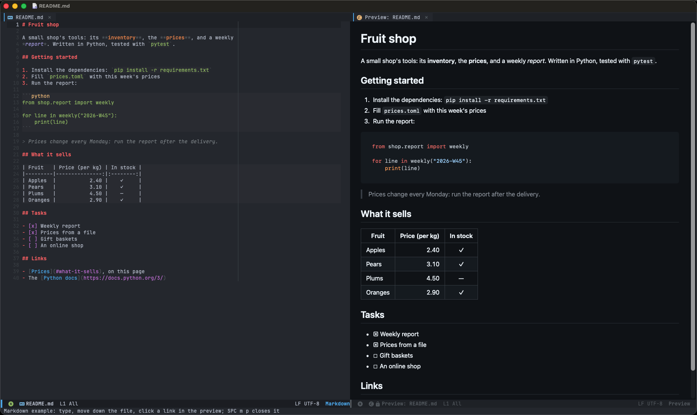

# Markdown

`SPC m p` opens a live preview in a new pane: GitHub's look, updated as you type and following the cursor. Links to
files open them in Emacs. `SPC m P` previews in the browser instead. It needs `pandoc`. Try it:
`M-x +my/example-markdown`.

The notice at the top of a Markdown file has an **Open preview** button: it opens the preview, or shows it again if
its pane was closed. `SPC m p` closes the preview when it's on screen.

In the preview, `j` / `k`, `C-d` / `C-u` and `gg` / `G` scroll, `y` (or `Cmd+C`; Linux: `Ctrl+Shift+C`) copies and `q`
closes it.

The preview needs an Emacs with xwidgets (WebKit; see [PDFs](pdf.md)) and works with any pandoc (Debian's and Ubuntu's
too). Without xwidgets, or in a terminal, `SPC m p` is markdown-mode's preview (eww), updated on save.
