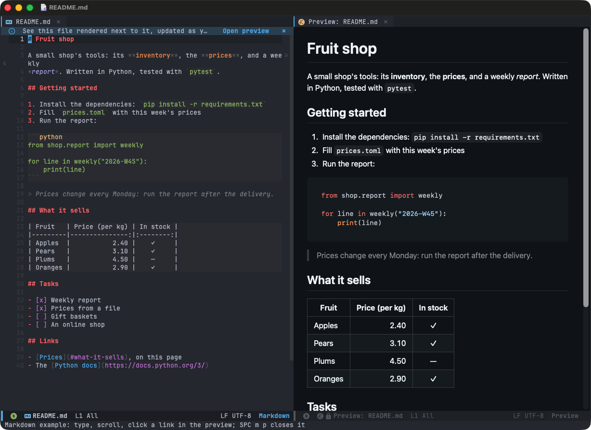

# Markdown

A live preview of a Markdown file in a pane beside it, in GitHub's look. It's updated as you type and follows the
cursor. Try it: `M-x +my/example-markdown`.



| Key | Action |
|---|---|
| `SPC m p` | Open the live preview in a new pane, or close it when it's on screen |
| `SPC m P` | Open the same page in the browser |

- Where the live preview works, the notice at the top of a Markdown file has an **Open preview** button. It opens the
  preview, or shows it again if its pane was closed.
- Links to files open them in Emacs.
- The preview needs `pandoc` (any version: Debian's and Ubuntu's too) and an Emacs with xwidgets (WebKit; see
  [PDFs](pdf.md)).
- Without xwidgets, or in a terminal, `SPC m p` opens markdown-mode's own preview (eww), updated on save.

## In the preview

| macOS | Linux | Action |
|---|---|---|
| `j` / `k`, `C-d` / `C-u`, `C-f` / `C-b`, `gg` / `G` | the same | Scroll |
| `y`, `Cmd+C` | `y`, `Ctrl+Shift+C` | Copy the selection |
| `q` | `q` | Close it |

## In the browser

`SPC m P` opens the same page in the browser. It has the same look, diagrams, alerts, math and highlighted code, with
the file's images and links. Pressed again, it writes the page anew from the file as it is now.

- It needs only `pandoc`, not WebKit.
- Without `pandoc`, `SPC m P` opens markdown-mode's own preview.

## Mermaid diagrams

```` ```mermaid ```` blocks show as diagrams in the preview, in the theme's colours ([Mermaid](mermaid.md)). They're
redrawn as you edit them.

- A diagram too wide for the pane scrolls sideways.
- A diagram with an error shows Mermaid's message under its last drawing.
- The browser's page draws them too. It uses mermaid.js from its CDN until the preview has downloaded it.

## Reflowed on screen

In a Markdown file, a paragraph's lines are shown as one line, wrapped at the pane's edge. So a file filled at a wider
column than its pane (this config's docs are filled at 120) wraps cleanly, not line by line. The file itself isn't
changed.

- A list item's and a quote's lines are joined too, the following rows lined up under the item's text.
- Hard line breaks (two trailing spaces, a backslash), code blocks, tables and headings are left as they are.
- Nothing changes while lines don't wrap.
- Line numbers show on a paragraph's first line only.

## Settings

| Setting | Default | What |
|---|---|---|
| `+my/markdown-reflow` | `t` | Show a paragraph's lines as one, wrapped at the pane's edge |
| `+my/markdown-preview-notice` | `t` | Offer the live preview in a notice when a Markdown file opens |

Set them in `config.el`: `(setq +my/markdown-reflow nil)` turns reflowing off.
