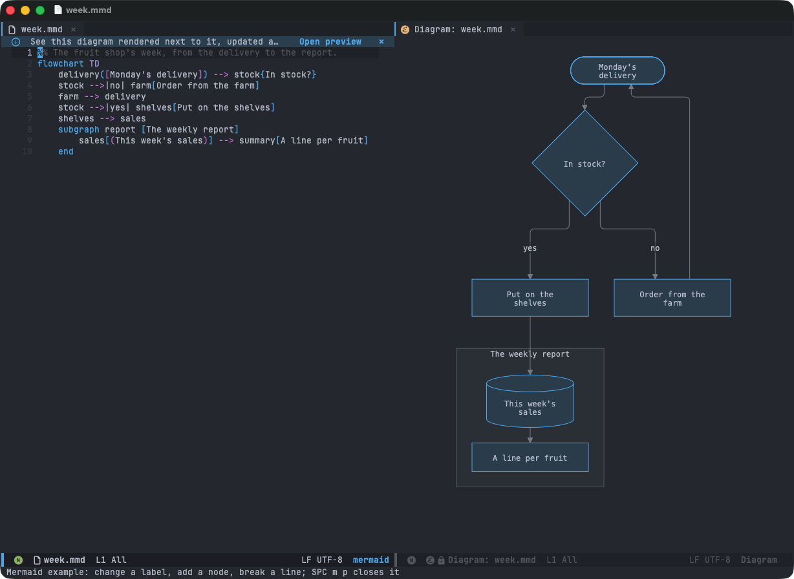

# Mermaid

[Mermaid](https://mermaid.js.org) diagrams, drawn in the theme's colours. `.mmd` and `.mermaid` files open with their
diagram beside them, and ```` ```mermaid ```` blocks are drawn in Markdown's preview and in your agent's replies. Try
it: `M-x +my/example-mermaid`.



## Mermaid files

`.mmd` and `.mermaid` files open in mermaid-mode. Flowcharts' and sequence diagrams' keywords are coloured, and `TAB`
indents. Its commands draw the diagram as an SVG with `mmdc` (mermaid-cli), in the background.

| Key | Action |
|---|---|
| `SPC m p` | The diagram beside the file, redrawn as you type; again to close it |
| `SPC m c` | Draw the file as an SVG next to it, and open it |
| `SPC m b` / `SPC m r` | Draw the buffer / the region |
| `SPC m f` | Draw a file you pick |
| `SPC m o` | Open the buffer (or the region) in Mermaid's Live Editor, in the browser |
| `SPC m d` | Mermaid's docs |

- `scripts/tools.sh` installs `mmdc`.
- The SVG opens once drawn, in a second or so. An error shows Mermaid's message.
- In Org, a `#+begin_src mermaid :file flow.svg` block draws with `C-c C-c`, in the theme's colours too.
- In Markdown files, ```` ```mermaid ```` blocks are coloured. They're drawn in [Markdown's live preview](markdown.md)
  and in [your agent's replies](agent-shell.md#diagrams-in-replies).

## Preview

`SPC m p`, or the **Open preview** button of the notice at the top of a Mermaid file, shows the diagram in a pane beside
the file. It's redrawn as you type, in the theme's colours. An error shows Mermaid's message under the last drawing.

| Key | Action |
|---|---|
| `+` / `-` | Zoom in / out |
| `0` | As wide as it is, at most the pane |
| `j` / `k`, `C-d` / `C-u`, `gg` / `G` | Scroll |
| `h` / `l` | Scroll sideways |
| `q` | Close |

- mermaid.js draws it in WebKit, downloaded once.
- In an Emacs without xwidgets, `mmdc` draws it, a second or so after you pause. The keys are the same.
- In a terminal, `SPC m p` opens the Live Editor instead.

## The theme's colours

Diagrams take their colours from the current theme's faces, and their font from the editor's. After a theme switch, the
next diagram drawn is in the new theme's colours.

| Face | Gives |
|---|---|
| `default` | Text, lines (dimmed), groups' boxes (a tint), the background behind edges' labels |
| `font-lock-keyword-face` | Nodes: their border, and a tint of it as their fill |
| `font-lock-function-name-face` | Secondary shapes: their border and fill |
| `shadow` | Groups' borders (subgraphs), lifelines, done tasks, a chart's grid |
| `warning` | Notes |
| `error` | Errors, critical tasks, today's line in a Gantt chart |
| The syntax colours | A series: a pie's slices, a git graph's branches, a mindmap's levels, a chart's lines |
