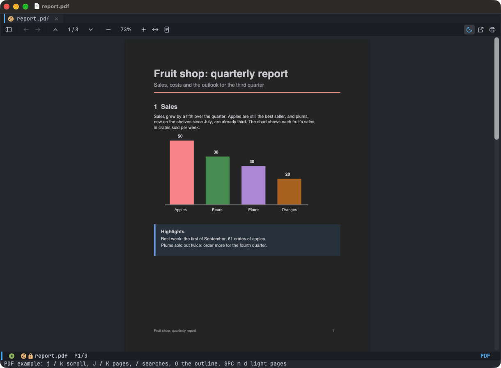

# PDFs

PDFs open in their tab, drawn by PDF.js: sharp at any zoom, with selectable text, and they reopen where you left them.
Pages are dark, the colours' hues kept (`+my/pdf-dark-pages` in `config.el`); `SPC m d` turns them light. Try it:
`M-x +my/example-pdf`.

| macOS | Linux | Action |
|---|---|---|
| `j` / `k`, `C-d` / `C-u`, `gg` / `G` | the same | Scroll (`5G`: page 5) |
| `J` / `K` | `J` / `K` | Next / previous page |
| `/` / `?`, `n` / `N` | the same | Search, next / previous match |
| `y`, `Cmd+C` | `y`, `Ctrl+Shift+C` | Copy |
| `Cmd+=` / `Cmd+-` / `Cmd+0` | `Ctrl+=` / `Ctrl+-` / `Ctrl+0` | Zoom in / out / 100% |
| `W` / `P` | `W` / `P` | Fit the width / the page |
| `o` / `O` | `o` / `O` | Go to a heading / the sidebar |
| `C-o` / `C-i`, `Cmd+[` / `Cmd+]` | `C-o` / `C-i`, `Alt+←` / `Alt+→` | Back / forward |
| `SPC m d` / `SPC m t` | the same | Dark / light pages, the toolbar |
| `SPC m p` | `SPC m p` | Open in Preview (Linux: the default PDF app) |
| `Cmd+P` | `Ctrl+P` | Print: Preview's dialog (Linux: the default printer, after asking) |
| `Option+Enter` | `Alt+Enter` | Actions on the selection |
| `q` | `q` | Close |

PDFs need an Emacs with xwidgets (WebKit): emacs-plus on macOS; on Linux an Emacs built `--with-xwidgets` (WebKitGTK),
which most distributions' packages aren't. Without it a PDF opens in Emacs's DocView (it needs `mutool` or Ghostscript's
`gs`). Printing on Linux needs CUPS's `lp`.
